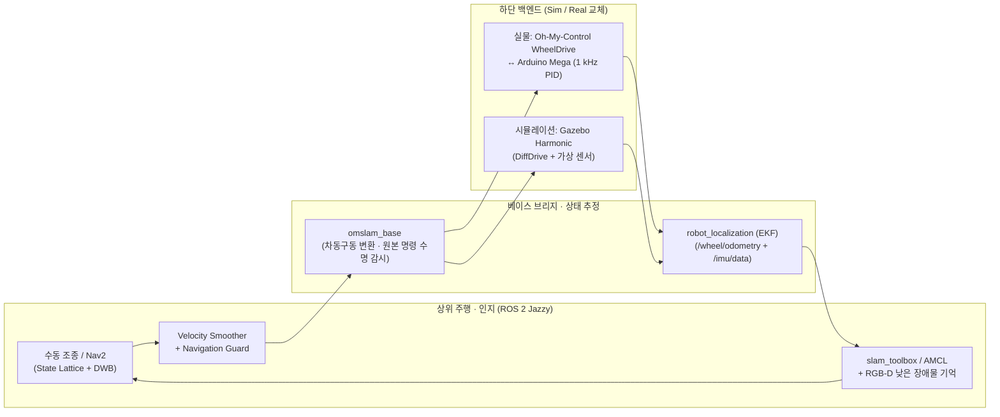

<h1 align="center">Oh-My-SLAM</h1>

<p align="center">
  <em>Oh My MobileRobot의 1 kHz 모터 제어 계층과 ROS 2 SLAM · Nav2 자율주행을 연결하는 통합 워크스페이스</em>
</p>

<p align="center">
  <a href="#overview">프로젝트 구성</a> ·
  <a href="#architecture">시스템 아키텍처</a> ·
  <a href="#roadmap">단계별 로드맵</a> ·
  <a href="#decisions">설계 원칙</a> ·
  <a href="#docs">상세 문서</a> ·
  <a href="#workspace">작업 환경 · 빠른 시작</a>
</p>

---

**Oh-My-SLAM**은 [`Oh-My-MobileRobot`](https://github.com/Leehyunbin0131/Oh-My-MobileRobot)에서 만든 기구·URDF 모델과 [`Oh-My-Control`](https://github.com/Leehyunbin0131/Oh-My-Control)의 Arduino Mega 1 kHz 모터 제어 계층 위에 ROS 2 자율주행 스택(`slam_toolbox`, `AMCL`, `Nav2`)을 올리는 워크스페이스입니다.

**Gazebo Harmonic** 시뮬레이션과 **Jetson Orin Nano Super + Arduino Mega 2560** 실물 로봇이 같은 ROS 2 토픽, TF, 명령 유효기간 규칙을 쓰도록 맞췄습니다. 시뮬레이션에서 검증한 위치추정과 지도 작성, 경로 주행, 장애물 처리 구조를 실물 로봇에 그대로 가져가는 것이 목표입니다.

> **현재 구현된 범위:** ROS 구동 브리지, 엔코더 오도메트리, 외장 IMU 입력과 EKF, 보행자 32명이 다니는 2터미널 공항 시뮬레이션 환경을 제공합니다. 시뮬레이션에서는 `slam_toolbox` 지도 작성과 저장, AMCL 위치추정, Nav2 목표 주행까지 연결해 두었습니다. **Oh My Robot Console**을 띄우면 지도 위에서 목적지를 관리하고 실제 ROS 센서와 구동 수치를 보면서 목표 이동, 직접 조종, 지도 저장과 불러오기를 바로 할 수 있습니다. 단일 목적지와 다중 목적지가 같은 이동 흐름을 쓰며 별도 화면은 시스템 로그 하나만 둡니다. 실물 로봇 주행과 실물 Nav2 적용은 다음 단계로 남아 있습니다. [콘솔 실행](docs/operator_gui.md) · [구동·EKF 실행](docs/base_ekf.md) · [로봇 시뮬레이션](docs/sim_robot.md) · [지도 작성·위치추정](docs/sim_mapping.md) · [공항 환경](docs/airport_world.md)

### 주요 특징

- **시뮬레이션과 실물이 같은 인터페이스를 씁니다.** 상위 제어와 위치추정, Nav2 구성은 그대로 두고 가장 아래쪽 구동 어댑터(`Gazebo DiffDrive` ↔ `Arduino Mega OMR1 USB`)와 기하 보정값만 바꿔 끼우는 구조입니다.
- **1 kHz 실시간 모터 제어는 그대로 살렸습니다.** Arduino Mega가 맡고 있는 20 kHz 엔코더 디코딩, 1 kHz 속도 PID, 정지 시 `HOLD` 제어, 300 ms 워치독을 건드리지 않습니다. `omslam_base` ROS 2 브리지는 명령 생성 시각을 유지해 전달하고 실측 엔코더로 오도메트리를 계산하는 일에 집중합니다.
- **엔코더와 IMU를 EKF로 묶고 2D SLAM을 연결했습니다.** 바퀴 엔코더로 계산한 오도메트리와 검증된 IMU 각속도를 `robot_localization` EKF로 합쳐 `odom → base_footprint`를 발행합니다. 주행 모드에 따라 `slam_toolbox`와 `AMCL` 중 하나만 켜져서 `map → odom`을 맡습니다.
- **Nav2 자율주행에 낮은 장애물 3D 기억을 더했습니다.** 전역 경로는 차체 방향과 움직임 집합을 고려하는 `Smac State Lattice`로 만들고 지역 주행은 차체 외곽 충돌을 검사하는 `DWB`로 추종합니다. 라이다보다 낮은 장애물은 2D 스캔에 걸리지 않기 때문에, 깊이 카메라로 걸러내서 시야에서 벗어나도 잠시 기억해 두는 비용지도 레이어를 함께 붙였습니다.

<a id="overview"></a>

## 전체 프로젝트 구성

전체 로봇 프로젝트는 기구 설계, 하위 제어와 보정, 상위 ROS 2 자율주행의 세 저장소로 나눠 관리합니다.

| 단계 | 저장소 | 담당 역할과 주요 내용 |
| --- | --- | --- |
| **1. 하드웨어 · 모델** | [`Oh-My-MobileRobot`](https://github.com/Leehyunbin0131/Oh-My-MobileRobot) | 2020 프로파일 프레임, 3D 프린팅 외장 CAD·STL·도면, 구매 부품 목록, ROS 1/2 URDF 모델 |
| **2. 하위 제어 · 진단** | [`Oh-My-Control`](https://github.com/Leehyunbin0131/Oh-My-Control) | Arduino Mega 1 kHz 폐루프 모터 제어 펌웨어, 모터 PID와 IMU 정지 보정, Jetson Orin 수동 조종과 터미널 진단 |
| **3. 자율주행** | **`Oh-My-SLAM`** *(현재 저장소)* | 구동 제어기–ROS 2 브리지, Gazebo 시뮬레이션, 2D SLAM(`slam_toolbox`, `AMCL`)과 `Nav2` 자율주행 통합 |

<a id="architecture"></a>

## 시스템 아키텍처

기준 환경은 **Ubuntu 24.04, ROS 2 Jazzy, Gazebo Harmonic**입니다.



| 계층 | 구성 요소 | 맡고 있는 역할 |
| --- | --- | --- |
| **하위 구동 MCU** | `Arduino Mega 2560`, [`Oh-My-Control`](https://github.com/Leehyunbin0131/Oh-My-Control) | 1 kHz 속도 PID 제어, 정지 위치 유지 `HOLD`, 300 ms 명령 유효기간 감시, 20 Hz 엔코더 피드백 |
| **ROS 2 베이스 브리지** | `omslam_base` (`LifecycleNode`) | `/cmd_vel` (`TwistStamped`) 수신과 원본 수명 검사, 좌우 바퀴 목표 RPM 변환, 실측 `/wheel/odometry`와 `/joint_states` 발행 |
| **상태 추정 · 지도** | `robot_localization`, `slam_toolbox`, `AMCL` | 바퀴 오도메트리와 IMU 각속도 EKF 결합(`odom → base_footprint`), 실시간 지도 작성 또는 저장 지도 위치추정(`map → odom`) |
| **경로 계획 · 안전** | `Nav2`, `omm_perception`, `omm_costmap_layers` | `State Lattice` 전역 경로, `DWB` 지역 궤적 평가와 추종, RGB-D 낮은 장애물 기억, `Velocity Smoother`와 `navigation_guard` 최종 차단 |

<a id="roadmap"></a>

## 단계별 로드맵

`Oh-My-Control`에서 검증한 펌웨어와 통신 코어를 바닥에 두고 먼저 ROS 2 브리지와 시뮬레이션 검증(`P1`–`P4`)을 마친 뒤 실물 로봇(`P5`–`P8`)으로 넘어갑니다.

| 단계 | 목표 산출물 | 검증 환경 | 현재 상태 |
| --- | --- | --- | --- |
| **P0** | 통합 아키텍처, 토픽·TF·수명 명세, 단계별 인수 기준과 저장소 구성 | 설계 · 정적 검증 | **완료** |
| **P1** | ROS 구동 브리지 `omslam_base`, 원본 명령 수명 관리, 실측 엔코더 오도메트리 | 단위 시험 · 모의 장치 | **브리지와 엔코더 구현, 모의 검증 완료** |
| **P2** | Gazebo 공항 환경, 공통 인터페이스, 로봇 URDF와 가상 센서·TF 통합 | 시뮬레이션 | **로봇·센서·TF 통합과 시뮬레이션 검증 완료** |
| **P3** | EKF 상태 추정, `slam_toolbox` 지도 작성과 저장, `AMCL` 재위치추정 | 시뮬레이션 | **SLAM 지도·그래프 저장/복원과 AMCL 재위치추정 완료** |
| **P4** | `State Lattice + DWB` 주행 구성, RGB-D 낮은 장애물 기억 레이어 이관 | 시뮬레이션 | **완료: 한 번의 실행에서 목표 5곳 연속 도착** |
| **P5** | Jetson Orin 실물 구동 브리지 배치, 바퀴 반경·윤거·IMU·오도메트리 검증 | 실물 로봇 | 예정 |
| **P6** | 실물 수동 주행 SLAM 지도 작성과 저장, `AMCL` 위치추정 | 실물 로봇 | 예정 |
| **P7** | 실물 저장 지도 기반 `Nav2` 목표 주행과 장애물 회피·정지 검증 | 실물 로봇 | 예정 |
| **P8** | 실물 온라인 SLAM + `Nav2` 통합 주행과 운용·복구 절차 정리 | 실물 로봇 | 예정 |

<a id="decisions"></a>

## 설계 원칙

- **검증된 저수준 제어 코드는 그대로 씁니다.** `Oh-My-Control`의 `OMR1` 시리얼 프로토콜과 구동 보정, `WheelDrive` 모듈을 고정 커밋으로 가져와 씁니다. Arduino Mega에 micro-ROS를 올리거나 속도 PID를 호스트 쪽으로 옮기지 않습니다.
- **원본 명령 시각을 끝까지 유지합니다.** 속도 명령은 전부 `TwistStamped`로 통일했습니다. `Velocity Smoother`를 거치더라도 처음 명령이 만들어진 시각 기준으로 **300 ms**가 지나면 바로 만료 처리합니다.
- **오도메트리는 실측값으로 계산하고 TF는 한 노드만 발행합니다.** 목표 명령을 적분하는 대신 실제 엔코더 변화량과 검증된 IMU 각속도로 오도메트리를 구합니다. `odom → base_footprint`와 `map → odom`은 각 모드에서 딱 하나의 노드만 발행하도록 묶어 두었습니다.
- **인지 범위는 필요한 만큼만 가져갑니다.** 시각 오도메트리는 쓰지 않습니다. 라이다 높이 아래에 있는 낮은 장애물만 RGB-D 깊이 기반 3D 점유 메모리로 보완하고 AI 객체 분류나 동적 객체 추적은 이번 기본 자율주행 범위에서 뺐습니다.

<a id="docs"></a>

## 상세 기술 문서

| 문서 | 다루는 내용 |
| --- | --- |
| [**통합 아키텍처 설계**](docs/architecture.md) | 호스트–Mega 연결 구조, 명령 수명과 워치독 규칙, 기구학·오도메트리, 토픽·서비스·액션·TF 계약 |
| [**단계별 구현 계획**](docs/roadmap.md) | `P0`–`P8` 단계별 선행 조건, 패키지 구성, 실행 모드와 완료 기준 |
| [**인수 검증 기준**](docs/acceptance.md) | 단계별 통합 시험 `V1`–`V8`, 통과 수치 기준, 실패 주입 항목과 기록 구조 |
| [**기술 기준과 호환성**](docs/baseline.md) | 기준 OS와 ROS 2 패키지 버전, 하드웨어·모델 기하 규격, 기존 자산 이관 범위 |
| [**구동 브리지·EKF 실행**](docs/base_ekf.md) | 엔코더·IMU 입력, lifecycle, 장착 TF, 빌드·실행과 모의 검증 |
| [**로봇·센서 시뮬레이션**](docs/sim_robot.md) | CAD 모델, 가상 라이다·IMU·RGB-D, 공통 명령과 wheel/EKF·TF 연결 |
| [**공항 시뮬레이션 환경**](docs/airport_world.md) | 2터미널 공간·가구·보행자, 빌드·실행, 기하 참고 지도와 자산 재생성 |
| [**시뮬레이션 지도 작성·위치추정**](docs/sim_mapping.md) | SLAM과 AMCL 모드, 지도·그래프 저장과 재로딩, 실행 절차 |
| [**시뮬레이션 자율주행**](docs/sim_navigation.md) | 두 Nav2 모드, 구동 활성화·목표·정지·복구, 인지와 통합 검증 |
| [**로봇 콘솔 실행**](docs/operator_gui.md) | 실제 ROS 계측, 통합 목적지 이동, 직접 조종, 금지 구역, 지도 작업과 시스템 로그 |

<a id="workspace"></a>

## 작업 환경과 빠른 시작

- **기준 환경:** Ubuntu 24.04, ROS 2 Jazzy, Gazebo Harmonic을 씁니다. 개발 PC(`x86_64`)와 실물 Jetson Orin(`ARM64`)은 각각 따로 빌드합니다.
- **작업 경로:** 개발 PC는 `~/MyRos/Oh-My-SLAM`, 실물 Jetson Orin은 `~/Oh-My-SLAM`을 기준으로 잡았습니다.
- **고정 의존성:** [`dependencies.repos`](dependencies.repos)에 `Oh-My-Control` 통신·구동 코어와 `Oh-My-MobileRobot` URDF·메시 모델의 기준 커밋을 고정해 두었습니다. `external/` 경로는 `colcon` 기본 탐색에서 빼고 필요한 모듈만 전용 패키지로 설치합니다.
- **데이터 분리:** 실물 실내 지도, 원본 `rosbag`, 장비별 로컬 설정과 상세 실행 로그(`reports/`)는 Git에 올리지 않고 로컬에만 둡니다. 공개 저장소에는 검증 요약과 재현 절차만 남깁니다.

### 1. 사전 패키지 설치와 빌드

```bash
# ROS 2 Jazzy 필수 패키지 (Ubuntu 24.04)
sudo apt update && sudo apt install -y \
  ros-jazzy-navigation2 ros-jazzy-nav2-bringup \
  ros-jazzy-slam-toolbox ros-jazzy-robot-localization \
  ros-jazzy-ros-gz-sim ros-jazzy-ros-gz-bridge \
  python3-serial python3-yaml python3-numpy python3-pytest

# 저장소 클론 및 전체 시뮬레이션·자율주행·콘솔 빌드
git clone https://github.com/Leehyunbin0131/Oh-My-SLAM.git
cd Oh-My-SLAM
source /opt/ros/jazzy/setup.bash
colcon build --base-paths src --packages-up-to omslam_operator_support \
  --cmake-args -DCMAKE_BUILD_TYPE=Release -DPython3_EXECUTABLE=/usr/bin/python3

# (선택) Qt 로봇 콘솔 실행용 가상환경
python3 -m venv --system-site-packages .venv-operator
.venv-operator/bin/python -m pip install -r requirements-operator.txt
```

### 2. 실행 모드

| 명령 | 실행 구성과 용도 | 상세 안내 |
| --- | --- | --- |
| `./sim.sh` | Gazebo 공항 환경, 로봇, 센서, EKF (`pedestrians:=false`로 보행자 끄기 가능) | [공항 환경](docs/airport_world.md) · [로봇 시뮬레이션](docs/sim_robot.md) |
| `./nav.sh` | Gazebo, 온라인 SLAM, Nav2, RViz (`--world airport`로 공항 선택) | [자율주행 실행 안내](docs/sim_navigation.md#한-명령으로-실행) |
| `./console.sh --start-sim` | Gazebo, SLAM, Nav2, **Oh My Robot Console** 통합 실행 (`--world airport`, `--gazebo-gui`) | [콘솔 실행 안내](docs/operator_gui.md) |

터미널 전체 배치는 [공항 평면도](src/omslam_sim/maps/airport_floorplan.png)에서 바로 볼 수 있습니다.

## 라이선스

이 저장소에서 새로 작성한 코드와 문서에는 [Apache-2.0](LICENSE)을 적용합니다. 가져다 쓰는 로봇 모델(`CERN-OHL-P-2.0`), 보행자 mesh(`CC BY 4.0`)와 외부 소스는 각 원본 라이선스를 따르며 자세한 출처는 [NOTICE.md](NOTICE.md)에 정리해 두었습니다.
