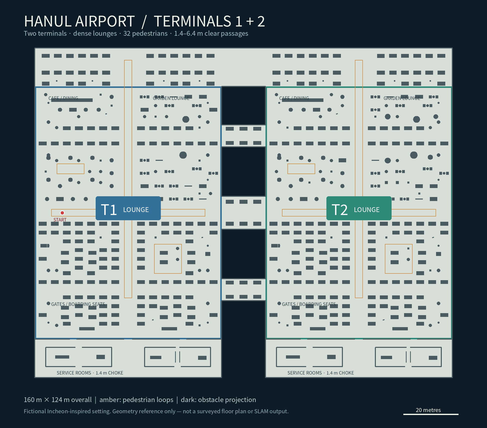

# 공항 실내 시뮬레이션 환경

[README](../README.md) · [통합 설계](architecture.md) · [구현 계획](roadmap.md)

`omslam_sim`에는 Gazebo Harmonic에서 돌아가는 가상 공항 환경 **하늘 국제공항**(Hanul International)이 들어 있습니다. 인천공항의 넓은 대합실, 탑승구, 상업 구역, 실내 정원 구조를 참고해 단일 층 2터미널 테스트 공간으로 꾸몄습니다. T1과 T2, 연결 통로는 시뮬레이션 테스트에 맞게 새로 설계한 배치입니다.

이 문서가 다루는 범위는 정적 공항 공간, 걷는 보행자, ROS 시각 연결, 기하 기반 참고 지도까지입니다. 로봇 모델과 센서, EKF까지 같이 띄우는 방법은 [로봇 시뮬레이션](sim_robot.md)에 정리되어 있고, SLAM과 State Lattice + DWB 주행 구성은 이어지는 문서에서 다룹니다.



## 공간 구성

| 항목 | 구성 |
| --- | --- |
| 전체 크기 | X: −122 m – 38 m, Y: −62 m – 62 m (160 × 124 m) |
| 실내 바닥 | 약 16,992 m², 단일 층, 여러 연결 루프 |
| 터미널 | T1·T2, 각각 약 68 × 92 m 라운지와 남측 서비스 구역 |
| 주 동선 | 가구 사이 중앙 통로 약 6.7 m, 교차 통로 약 4.3 m (배치 기준 통행 폭 각각 6.4 m, 3.8 m 확보) |
| 환승 갤러리 | 양쪽에 좌석군 배치, 중앙 약 3.6 m 통행 공간 확보 |
| 보조 동선 | 2.8 m·3.6 m 서비스 복도, 1.4 m 병목과 90° 코너 |
| 탑승 대기석 | 2,440석(305개 벤치군), 카페·라운지 좌석 별도 |
| 카페·라운지 | 카페 탁자 37개, 스툴 148개, 커피 탁자 25개, 라운지 의자 52개 |
| 추가 시설 | 매대 54개, 낮은 칸막이 7개, 키오스크 23개, 화분·수목 61개, 카운터·표지·수하물·서비스실 |
| 구역 특징 | T1은 탑승 대기 위주, T2는 정원과 라운지 위주 |
| 초기 기준 위치 | `world` 좌표 `(−108, 0, 0)`, yaw=0 (환경 전용 launch에서는 로봇 미생성) |
| 보행자 | 32명, 라운지 주변과 연결 통로 폐루프 이동, 시뮬레이션 시각 기준 재현 가능 |

원본 배치, 장애물 외곽, 통로 폭, 관찰 시점, 보행 경로는 [airport_layout.json](../src/omslam_sim/config/airport_layout.json)에 저장해 두었습니다. 공간이 큰 편이라 렌더링과 물리 연산 부담을 줄이려고 재질별로 정적 visual mesh를 합치고 충돌 형상은 단순 collision으로 분리했습니다. 위에서 전체를 내려다볼 수 있도록 천장 대신 개방형 상부 구조를 썼습니다.

라운지 내부는 좌석군, 카페, 매대, 화분, 칸막이로 구역을 나누고 가구 사이에 약 1.4–3 m 통로를 냈습니다. 넓은 홀을 큰 장애물 덩어리 하나로 채우지 않고, 로봇이 지날 수 있는 통행 공간과 보행 동선을 먼저 잡아 둔 뒤 주변 가구를 배치했습니다. 보행자는 터미널마다 16명씩 총 32명이며, 긴 주 통로와 카페·좌석 주변 짧은 동선에 나눠 걸어 다닙니다.

## 시뮬레이터 선택 이유

실행 환경은 Ubuntu 24.04, ROS 2 Jazzy, Gazebo Harmonic 8.15.0, `ros_gz` 1.0.24입니다. GUI는 Ogre를 기본으로 쓰고, 센서 서버는 Ogre2 headless 렌더링을 씁니다. 물리 시뮬레이션 간격은 0.004 s입니다.

| 도구 | 이 프로젝트에서의 선택 기준 |
| --- | --- |
| **Gazebo Harmonic** | ROS 2 시각, 카메라, GPU LiDAR 연동과 SDF 자산, actor 애니메이션을 바로 쓸 수 있어 기준 시뮬레이터로 선택 |
| Isaac Sim / Isaac Lab | RTX 기반 별도 NVIDIA GPU 환경이 필요하므로 현재 Intel 내장 GPU PC의 기본 실행 경로로 쓰지 않음 |
| MuJoCo | 물리·제어 실험에는 좋지만, 이 공항 환경은 기존 ROS 2 센서와 SDF 연동을 살릴 수 있는 Gazebo를 선택 |

현재 개발 PC 사양과 ROS 2 통합 조건에 맞춘 선택이지, 시뮬레이터 성능 비교 실험 결과는 아닙니다. [Gazebo ROS 2 연동](https://gazebosim.org/docs/harmonic/ros2_integration/) · [Isaac Sim 요구 환경](https://docs.isaacsim.omniverse.nvidia.com/latest/installation/requirements.html) · [MuJoCo 개요](https://mujoco.readthedocs.io/en/stable/overview.html)

## 빌드와 실행

새 터미널에서 ROS underlay를 source한 뒤 `omslam_sim`을 빌드합니다. 다른 로컬 Python 환경이 CMake에 섞여 들어가지 않도록 시스템 Python 경로를 명시했습니다.

```bash
cd ~/MyRos/Oh-My-SLAM
source /opt/ros/jazzy/setup.bash
colcon build --packages-up-to omslam_sim \
  --cmake-args -DCMAKE_BUILD_TYPE=Release -DPython3_EXECUTABLE=/usr/bin/python3
```

빌드가 끝나면 루트 스크립트로 실행합니다.

```bash
./sim.sh
```

| 실행 명령 | 동작 내용 |
| --- | --- |
| `./sim.sh` | GUI, 로봇, 센서, EKF와 보행자 32명 실행 |
| `./sim.sh pedestrians:=false` | 보행자 없이 공항과 로봇·센서 실행 |
| `./sim.sh gui:=false` | 화면 없이 서버와 센서만 실행 |
| `./sim.sh gui_renderer:=ogre2` | GUI 렌더러도 Ogre2로 지정 |
| `ros2 launch omslam_sim airport.launch.py` | 로봇 없이 공항 환경만 실행(install source 필요) |

종료할 때는 `Ctrl+C`를 누릅니다. 실행 스크립트가 자신이 띄운 Gazebo 서버에 종료를 요청하고 자기 자식 프로세스만 깔끔하게 정리합니다. GUI를 열면 공항 전체가 내려다보이는 조감도 시점으로 시작하고, 마우스로 이동하거나 확대·회전할 수 있습니다.

`sim.sh`는 기본으로 ROS domain 86과 전용 Gazebo partition을 씁니다. 다른 실행과 분리하고 싶으면 `OMSLAM_SIM_DOMAIN_ID`와 `OMSLAM_GZ_PARTITION`을 바꾸면 됩니다. ROS 로그 기본 저장 경로는 `reports/airport/live/ros_logs`입니다.

로컬 Gazebo 통신에는 기본 `GZ_IP=127.0.0.1`을 써서 Wi-Fi IP가 바뀌어도 통신이 흔들리지 않게 했습니다. 이미 환경변수로 지정해 둔 `GZ_IP`가 있다면 그 값을 그대로 씁니다.

`ros2 launch`로 직접 띄울 때는 먼저 `install/setup.bash`를 source해야 합니다. launch 파일이 자산과 플러그인 경로를 설치된 패키지 기준으로 찾기 때문입니다.

```bash
source install/setup.bash
ros2 launch omslam_sim airport.launch.py gui:=true pedestrians:=true
```

## 보행자 모델

보행자는 걷기 애니메이션이 들어간 actor와 반경 0.30 m, 높이 1.75 m 원통 collision proxy가 같은 경로를 따라 함께 움직이는 구조입니다. Actor는 RGB 카메라와 GPU 센서에 보이고, proxy가 실제 물리 충돌을 맡습니다. 좌석·카페 주변의 짧은 동선과 터미널 연결 동선을 정해진 폐루프로 반복 이동하며, 보행자끼리 피해 가거나 로봇을 보고 우회하는 사회적 군중 모델까지는 넣지 않았습니다.

이동과 애니메이션은 `omslam::AirportPedestrians` 플러그인이 시뮬레이션 시각에 맞춰 갱신합니다. 일시정지나 시각 초기화도 함께 처리합니다. `/airport/pedestrians/poses`의 `gz.msgs.Pose_V`로 actor와 물리 처리 후 proxy 위치를 최대 5 Hz로 내보내지만, 이 데이터는 환경 검증용이며 로봇 위치추정 입력으로 쓰지 않습니다.

보행자 3D 모델은 Gazebo Fuel의 Mingfei/actor version 1 자산을 로컬에 포함해 두었습니다. 출처와 CC BY 4.0 라이선스, 파일 해시는 [자산 NOTICE](../src/omslam_sim/models/omslam_pedestrian/NOTICE)와 [manifest](../src/omslam_sim/models/omslam_pedestrian/asset_manifest.json)에서 확인할 수 있고, 실행할 때 인터넷에서 Fuel 자산을 다시 내려받을 필요는 없습니다. [Gazebo actor 특성](https://gazebosim.org/docs/harmonic/actors/)

## 지도와 좌표

- [평면 안내도](../src/omslam_sim/maps/airport_floorplan.png): 터미널 배치, 통로, 가구, 보행 동선 표시
- [reference map](../src/omslam_sim/maps/airport_reference.yaml): 정적 collision과 바닥 영역에서 뽑아낸 0.1 m 격자 참고 지도(보행자 제외)
- Gazebo `world` 좌표는 미터 단위이고 +Z가 위쪽입니다. 참고 지도 원점과 해상도는 YAML 파일 기준을 따릅니다.

reference map은 시뮬레이터 기하 정보를 알고 있는 상태에서 뽑은 검증용 자료입니다. SLAM으로 직접 스캔해 만든 지도로 취급하거나 SLAM 결과를 대신하지 않습니다. 로봇 기본 주행 구성은 State Lattice + DWB이며 보로노이 전용 레이어는 쓰지 않습니다.

## 월드 재생성과 수정

공항 공간과 가구, 정적 collision, 참고 지도는 생성기 스크립트 하나로 다시 만들 수 있습니다. 그다음 보행자를 합치고 패키지를 다시 빌드합니다.

```bash
/usr/bin/python3 tools/generate_airport.py
/usr/bin/python3 tools/add_airport_pedestrians.py \
  --world src/omslam_sim/worlds/airport_static.sdf \
  --layout src/omslam_sim/config/airport_layout.json \
  --output src/omslam_sim/worlds/airport.sdf
```

`generate_airport.py --package PATH`로 다른 출력 패키지를 지정할 수도 있습니다. 보행자 경로의 waypoint는 `(x, y)` 미터, speed는 m/s, phase는 시뮬레이션 초 단위입니다. 생성된 SDF 파일을 손으로 직접 고치면 다음에 재생성할 때 덮어쓰이므로, 계속 유지할 수정은 생성기 코드에 반영하는 편이 좋습니다.

## 환경 검증

`tools/verify_airport.py`는 새 설치본 기준으로 정적 배치와 연결성, Gazebo 실행과 시각, 보행자 이동과 proxy 정합, RGB 렌더링과 GPU LiDAR 반환을 한 번에 확인하고 이미지와 영상을 남깁니다.

```bash
source /opt/ros/jazzy/setup.bash
source install/setup.bash
/usr/bin/python3 tools/verify_airport.py --output reports/airport/manual-check
```

결과는 지정한 출력 폴더에 저장됩니다. 이 검증이 통과했다고 해서 로봇 오도메트리나 SLAM 지도 품질, 자율주행 도착까지 검증된 것은 아닙니다. 빌드가 실패한 상태에서는 이 검증을 돌리지 않습니다.
