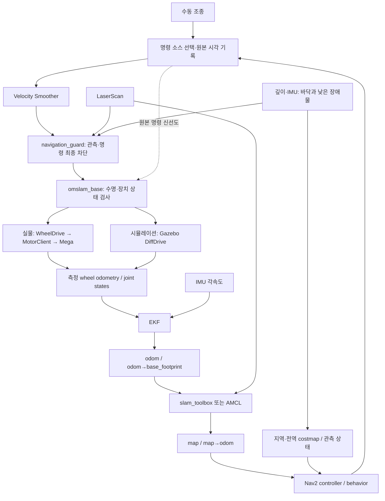
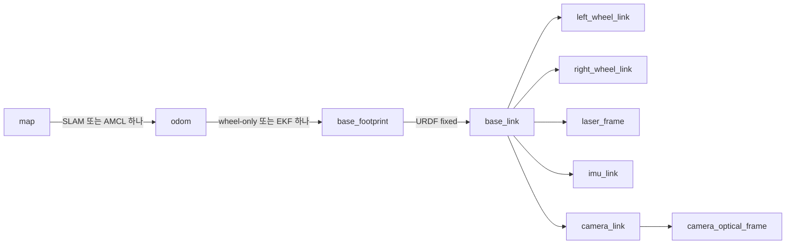

# Mega–ROS 2 통합 아키텍처 설계

[README](../README.md) · [구현 계획](roadmap.md) · [검증 기준](acceptance.md) · [기술 기준](baseline.md)

Arduino Mega 2560 하위 구동 제어기와 상위 ROS 2 자율주행 스택(`robot_localization`, `slam_toolbox`, `AMCL`, `Nav2`)을 어떻게 연결할지 정리한 문서입니다. 데이터 흐름, 원본 명령 수명 규칙, 기구학과 오도메트리, 토픽과 TF 계약을 다룹니다. 하드웨어와 패키지 버전 기준은 [기술 기준과 호환성](baseline.md), 단계별 진행 순서는 [단계별 구현 계획](roadmap.md)을 참고하면 됩니다.

## 1. 제어 계층과 연결 방식

| 계층 | 맡은 일 | 유지·신규 여부 |
| --- | --- | --- |
| Arduino Mega | 20 kHz 엔코더, 1 kHz 속도 PID, HOLD, I²C 출력, 명령 만료·고장 감시 | 완료된 펌웨어 유지 |
| `Oh-My-Control` | 시리얼 식별·CRC·ACK, 바퀴 부호/단위 변환, `WheelDrive` | 고정 커밋 재사용 |
| `omslam_base` | ROS 명령 수명, 차동구동 변환, 백엔드 선택, 측정 odom·joint states·진단 | 신규 |
| `robot_localization` | 바퀴 측정과 검증된 IMU yaw rate 결합 | ROS 기존 패키지 설정 |
| `slam_toolbox` / AMCL | 지도 작성 또는 저장 지도 위치추정 | 모드별 하나만 선택 |
| Nav2 | 전역 경로, 지역 추종, 속도 평활 | 공통 설정과 장비별 제한 분리 |

**1차 구현은 `rclpy` 브리지로 가기로 했습니다.** 이미 검증해 둔 Python 프로토콜과 보정, 구동 코드를 그대로 쓸 수 있고, Nav2가 필요로 하는 표준 속도 명령과 odom, TF를 깔끔하게 붙일 수 있기 때문입니다. 메가의 1 kHz 제어 루프는 호스트의 ROS executor 주기와 별도로 돌아갑니다.

`ros2_control + diff_drive_controller`도 차체 속도 변환과 피드백 odom, timeout을 다 제공하는 좋은 대안입니다. 다만 지금 도입하려면 하드웨어 플러그인과 시리얼 비동기 입출력, 상태 전환을 기존 Python 계층과 다시 나눠 짜야 해서 이번 기준 경로에는 넣지 않았습니다. 나중에 교체하더라도 아래에 정리한 ROS 외부 인터페이스는 그대로 유지합니다. [Jazzy diff_drive_controller](https://control.ros.org/jazzy/doc/ros2_controllers/diff_drive_controller/doc/userdoc.html)

## 2. 명령과 관측 흐름



수동 모드와 자율 모드는 명시적으로 전환합니다. 두 곳에서 동시에 들어온 명령을 임의로 섞지 않습니다. 초기 구현에서는 모드마다 고정된 입력 소스 하나만 열어 두어, 조종기와 Nav2가 서로 명령을 두고 경쟁할 일이 없게 했습니다.

속도 평활은 `Velocity Smoother`가 맡고, `navigation_guard`가 센서 관측과 원본 명령 신선도, 실행 상태를 확인해서 최종 명령을 차단하는 역할을 합니다. 그 뒤에 있는 base 브리지는 유효한 명령의 단위 변환, 상한 축소, 3.0 RPM 최소 구동 하한 데드밴드 컷, 차단만 처리하고, 감속 중이거나 0인 명령을 다시 가속하지 않습니다. 실제 센서가 없는 순수 모의 장치 시험은 별도 프로파일로 나눠 둡니다.

## 3. 원본 명령 수명과 정지

### 메시지와 시각

- 속도 명령 체인은 전부 `geometry_msgs/msg/TwistStamped`로 맞췄습니다. Jazzy에서 기본값이 `Twist`인 노드는 `enable_stamped_cmd_vel=true`를 직접 켜고, 설치된 바이너리에서 실제로 지원하는지 확인합니다.
- 키보드 입력이 `Twist`만 내보내는 경우에는 입력 어댑터에서 처음 한 번만 stamp를 찍습니다. 수동 조종 입력이 끊겼는데 이전 명령을 계속 반복해서 보내는 동작은 막아 두었습니다.
- 원본 timestamp는 smoother와 `navigation_guard`, base를 통과하는 내내 그대로 유지합니다. smoother가 timestamp를 새로 덮어쓰는 기능은 꺼 두고, 설치 버전에서 실제로 원본 stamp가 남는지 P1에서 확인합니다.
- base는 원본 입력의 경과 시간을 ROS 시각으로 먼저 확인한 뒤, 같은 프로세스 안의 monotonic deadline으로 관리합니다. 장치 I/O 마감 시각을 `/clock`이나 시스템 시각 점프에 맡기지 않기 위해서입니다.
- NaN이나 Inf, 차동구동에서 쓸 수 없는 횡이동이나 roll/pitch 속도, 잘못된 frame이 들어오면 거부합니다. 기준 프레임은 `base_footprint`로 통일하고, `base_link` 입력을 받을 때는 두 프레임의 고정 관계를 확인합니다.
- 시뮬레이션은 ROS 시각을 쓰되, 일시정지하거나 재시작하면 저장해 둔 명령을 바로 버립니다. 실물 백엔드는 `use_sim_time=true` 설정 자체를 거부합니다.

### 기존 API와의 차이

공개 기준 커밋 `c703f13`의 `WheelDrive.set_target_rpm()`은 함수가 호출되는 시점에 명령 생성 시각을 기록합니다. ROS에서 메시지를 받은 뒤 큐에서 지연된 명령을 넘기거나 smoother가 같은 stamp로 다시 출력할 때 이 함수를 그대로 부르면 명령 유효기간이 의도치 않게 늘어날 수 있습니다.

그래서 설치하는 vendor 패키지에는 **원래 명령 시각을 함께 받는 호환 API** `set_target_rpm(left, right, issued_at=...)`를 추가했습니다. `issued_at`은 같은 프로세스에서 계산한 monotonic 시각이고, 기본 인수를 생략하면 기존 키보드 조종과 똑같이 동작합니다. 같은 원본 stamp의 평활 출력이 들어오면 목표 속도값만 바꿀 뿐 deadline은 늘리지 않습니다. 이미 만료됐거나 미래 시각이거나 시간이 거꾸로 간 입력은 모두 거부합니다.

이 수정은 메가 펌웨어나 OMR1 프로토콜에는 손을 대지 않습니다. 공통 라이브러리의 호환 변경만 `Oh-My-Control`의 격리된 로컬 커밋에 넣고 `dependencies.repos`에 고정했습니다. 같은 소스를 vendor에 직접 담아 두었기 때문에 빌드할 때 원격 커밋을 따로 내려받을 필요도 없습니다. ROS 노드와 기구학, launch, 검증 코드는 모두 `Oh-My-SLAM`에서 작성합니다. 검증 없이 private 속성을 억지로 덮어쓰는 어댑터는 만들지 않습니다.

### watchdog과 상태

| 상황 | 동작 |
| --- | --- |
| 유효한 새 이동 명령 | 좌우 목표 RPM 계산, 최대 50 Hz 송신 |
| 유효한 새 0 명령 | 0 RPM 감속과 HOLD; 소스가 새 0 명령을 계속 보내는 동안만 유지 |
| 원본 명령 300 ms 만료 | `STOP` 후 이전 목표 삭제; 0 명령을 새 의도처럼 계속 재생하지 않음 |
| 같은 명령의 50 Hz 재송신 | 원본 deadline까지 남은 시간만 MCU lease로 전달 |
| 남은 lease가 MCU 최소 허용 100 ms 미만 | 추가 송신 중단, 마지막 lease가 자연스럽게 만료되도록 둠 |
| 장애물 또는 명시적 정지 출력 | 일반 송신 주기보다 즉시 우선 처리. 원본 deadline 안에 유효한 0 RPM lease를 못 만들면 즉시 `STOP` |
| 피드백 400 ms 중단, MCU fault, 프로토콜 오류 | 출력 해제 시도, fault 상태 고정, 명시적 복구 전까지 재구동 금지 |
| 입력 소스 또는 Velocity Smoother 중단 | 원본과 최종 명령 신선도를 각각 확인한 뒤 차단 |
| deactivate, 종료, 재접속, MCU 재부팅 | 과거 목표 폐기, 새 식별·피드백·활성화·새 명령 필요 |

원본 명령 토픽도 같이 지켜보고 있기 때문에 smoother가 timeout 뒤에 새 stamp로 만든 0 메시지를 운전자의 새 정지 의도로 착각하지 않습니다. 정상 정지와 장애물 정지는 유효한 소스가 살아 있는 동안 HOLD를 유지할 수 있지만, 소스 자체가 끊기면 출력을 아예 풉니다. Nav2 목표가 끝난 뒤 0 출력이 멈춰도 최종적으로는 정지하고 출력이 풀린 상태로 남습니다.

특히 원본 명령이 200 ms 넘게 지난 시점에 같은 stamp의 장애물 정지 출력이 들어왔을 때, 최소 100 ms lease 조건 때문에 0 명령을 건너뛰면 안 됩니다. 이런 상황에서는 `STOP`이 무조건 우선하며 이전의 0이 아닌 속도를 deadline까지 끌고 가지 않습니다. 최소 lease 규칙은 일반 이동 명령을 재송신할 때만 적용합니다.

300 ms는 어디까지나 **명령의 유효기간**입니다. 로봇이 실제로 완전히 멈추는 시간과 제동 거리는 주행 속도와 바닥 상태에 따라 따로 측정해야 합니다. 명령 만료 시각과 물리적 정지 시점을 같은 수치로 적지 않습니다.

### 시리얼 소유권

`MotorClient`는 I/O worker 하나만 독점해서 다룹니다. ROS 콜백은 최신 명령 한 개와 원본 시각만 넘겨주고, executor 안에서 블로킹 ACK 대기를 하지 않습니다. I/O worker가 수신과 `WheelDrive.tick()`, 오류 상태 갱신을 맡고 ROS 쪽에는 측정 스냅샷만 전달합니다. 브리지가 켜져 있는 동안 별도 `teleop.sh`나 진단 도구가 같은 USB 포트를 열지 못하도록 exclusive 접근과 사전 확인을 걸어 두었습니다.

## 4. 기구학과 엔코더 odometry

좌표계는 전진 +X, 왼쪽 +Y, 위 +Z, 좌회전 +yaw 기준입니다. 물리적인 좌우 바퀴는 전진 RPM을 양수로 두고, 실제 모터 드라이버와 엔코더 부호는 기존 `DriveCalibration`에서 한 번만 변환합니다. [REP 103](https://github.com/ros-infrastructure/rep/blob/master/rep-0103.rst)

차체 선속도 `v`, 각속도 `w`, 유효 윤거 `b`, 좌우 유효 반경 `rL/rR`에 대한 변환 식은 다음과 같습니다.

```text
omega_L = (v - w*b/2) / rL
omega_R = (v + w*b/2) / rR
rpm_L/R = omega_L/R * 60 / (2*pi)
```

계산된 값이 바퀴 상한을 넘으면 좌우 바퀴에 같은 비율을 곱해 줄여서 회전 곡률이 틀어지지 않게 합니다. 반대로 두 바퀴 중 큰 절댓값 `peak = max(|L|, |R|)`이 최소 구동 하한인 **3.0 RPM**보다 작으면, 작은 명령을 임의로 끌어올리지 않고 출력을 `(0, 0)`으로 끊습니다. 이때도 원본 명령의 수명은 유지하고, `peak >= 3.0 RPM`인 조합은 좌우 비율을 그대로 살립니다. 실물 기본 시험을 통과한 30 RPM과 Nav2 목표 근처 저속 구간은 실물에서 따로 확인합니다.

현재 모델의 `r=0.068 m`, `b=0.480 m`는 초기값입니다. 이 값 기준으로 3 RPM 직진은 약 0.0214 m/s, 양쪽 ±3 RPM 제자리 회전은 약 0.0890 rad/s, 30 RPM 직진은 약 0.214 m/s가 나옵니다. 실물 유효 반경과 윤거는 바닥에서 실제 이동 거리와 회전각을 재서 보정합니다. 실물 운용 상한 95 RPM은 MCU 보호 상한 100 RPM과 구분해서 쓰고, 시뮬레이션 바퀴 운용 범위는 **3–70 RPM**(직진 최대 약 0.498 m/s)입니다.

오도메트리는 목표 명령이 아니라 **실제 측정한 엔코더 변화량**으로 계산합니다.

```text
delta_sL = rL * delta_phiL
delta_sR = rR * delta_phiR
delta_s  = (delta_sR + delta_sL) / 2
delta_yaw = (delta_sR - delta_sL) / b
```

적분에는 SE(2) 원호 적분을 쓰고, 회전량이 아주 작을 때는 직선 극한식으로 처리합니다. 목표 RPM이나 마지막 `/cmd_vel`을 적분해서 실측 odom인 것처럼 내보내지 않습니다. MCU tick wrap과 재부팅, 한꺼번에 들어온 수신 batch, 중복 샘플은 모두 구분해서 처리합니다. 새로운 엔코더 샘플이 들어왔을 때만 약 20 Hz로 wheel odom과 joint states를 발행하고, 적분 주기는 MCU 시간 증가량을 씁니다. ROS stamp로 바꿀 때의 초기 오프셋과 재동기화 기준도 따로 둡니다.

`/joint_states`는 `left_wheel_joint`와 `right_wheel_joint`의 실제 누적 각도(rad)와 각속도(rad/s)를 발행합니다. 양쪽 URDF 관절 축은 +Y이며 물리적 전진 방향과 맞는지 확인합니다. `base_footprint`는 차체 외곽 정중앙이 아니라 구동축 중점을 지면에 내린 점입니다.

## 5. 토픽·서비스·액션 계약

아래 이름은 이 워크스페이스 전체에서 쓰는 표준 ROS 2 인터페이스입니다. 기존 드라이버의 토픽 이름이 다르면 bringup에서 명시적으로 remap합니다.

### 주요 토픽과 QoS

| 토픽 | 타입 | 발행 → 소비 | 초기 주기 / QoS |
| --- | --- | --- | --- |
| `/cmd_vel/teleop`, `/cmd_vel/nav` | `TwistStamped` | 수동/자율 입력 → 소스 선택 | 새 의도 20 Hz 목표; reliable, volatile, depth 1 |
| `/cmd_vel/requested` | `TwistStamped` | 선택 소스 → smoother·freshness 감시 | 원본 stamp 유지 |
| `/cmd_vel/smoothed` | `TwistStamped` | velocity_smoother → navigation_guard 최종 차단 | 50 Hz 목표, 원본 stamp 유지 |
| `/cmd_vel` | `TwistStamped` | navigation_guard → base | 유효 원본 stamp; reliable, volatile, depth 1; guard 단독 발행 |
| `/wheel/odometry` | `nav_msgs/Odometry` | base/sim → EKF | 새 측정 20 Hz 실물; reliable, volatile |
| `/joint_states` | `sensor_msgs/JointState` | base/sim → robot_state_publisher | 새 측정에 맞춤 |
| `/imu/data` | `sensor_msgs/Imu` | 선택 IMU → EKF | 장치 실제 주기; sensor-data QoS 호환 |
| `/odom` | `nav_msgs/Odometry` | EKF → Nav2·진단 | 초기 50 Hz(실측 입력이 늘어난 것은 아님) |
| `/scan` | `sensor_msgs/LaserScan` | 라이다 → SLAM/AMCL/costmap | 실제 약 10 Hz 기준, best effort, volatile |
| `/camera/depth/image_rect_raw`, `/camera/depth/camera_info` | `Image`, `CameraInfo` | D435i/가상 센서 → 인지 | 실제 frame·단위·intrinsics 확인; 시뮬레이션 depth는 reliable·volatile·depth 5(`depth_reliable=true`), CameraInfo는 sensor QoS |
| `/perception/health`, `/perception/memory` | `omm_perception_msgs/PerceptionHealth`, `ObstacleMemory` | 인지 → guard/costmap | reliable, transient-local, depth 1; 원본 `observation_stamp` 별도 검사 |
| `/navigation/state` | `std_msgs/String` JSON | navigation guard → 운용·검증 | 상태, 차단 원인, 준비 항목, 활성화 epoch; transient-local depth 1 |
| `/map` | `nav_msgs/OccupancyGrid` | SLAM 또는 map_server | map 소비 QoS에 맞춘 transient local |
| `/diagnostics` | `DiagnosticArray` | base·상태 감시 → 관측 | 1 Hz + 상태 변화 시 |

시뮬레이션 영상이나 IMU 데이터가 `/clock`보다 먼저 도착하면 인지 노드는 시계가 따라올 때까지 잠시 들고 기다립니다. 미래 시각 관측을 미리 처리하거나 현재 시각으로 바꿔치기하지 않으며, 기다리는 동안에도 최초 수신 기준 0.30초 만료 시간은 연장하지 않습니다.

토픽 이름만 맞췄다고 끝내지 않고, 양쪽 endpoint의 offered/requested QoS가 실제로 호환되는지 확인합니다. 동기화가 필요한 RGB-D와 IMU의 timestamp, TF 유효 시각도 함께 기록합니다.

### 주요 서비스와 액션

| 이름 | 종류 · 타입 | 제공 노드 | 역할 |
| --- | --- | --- | --- |
| `/navigation/enable` | Service · `std_srvs/srv/SetBool` | `navigation_guard` | 관측·TF·서버 준비 확인 후 구동 권한 활성화, 또는 즉시 정지·해제 |
| `/navigate_to_pose` | Action · `nav2_msgs/action/NavigateToPose` | `bt_navigator` | Nav2 단일 목표 경로 계획·추종과 정지 도착 판정 |
| `/operator/control` | Service · `omslam_operator_msgs/srv/Control` | `navigation_guard` | 콘솔 제어권 취득·유지·해제와 내부 `AUTO`/`MANUAL` 전환 |
| `/operator/navigate` | Action · `omslam_operator_msgs/action/OperatorNavigate` | `navigation_guard` | 콘솔 단일·순차 목적지 이동(목표마다 완료와 측정 정지 확인) |
| `/operator/stop` | Service · `std_srvs/srv/Trigger` | `navigation_guard` | 즉시 정지, 진행 중 목표 취소, 구동 권한 해제 |
| `/operator/speed_limit` | Service · `omslam_operator_msgs/srv/SetSpeedLimit` | `navigation_guard` | 바퀴별 운용 RPM 상한(시뮬레이션 `3–70 RPM`) 동적 설정 |
| `/operator/set_keepouts` | Service · `omslam_operator_msgs/srv/SetKeepoutZones` | `navigation_guard` | 진입 금지 구역 갱신(전역·지역 비용지도와 수동 조종 반영) |
| `/operator/maps` | Service · `omslam_operator_msgs/srv/MapCommand` | `omslam_operator_support` | 지도와 금지 구역 저장, 저장 지도 AMCL 전환, 새 SLAM 세션 시작 |

## 6. TF와 위치추정 소유권



위 그림은 개념적인 트리이고, 실제 `lidar_link` 같은 중간 링크는 원본 URDF 구조를 그대로 유지합니다. `camera_optical_frame`은 Z 전방, X 우측, Y 하방 기준입니다. 실물 센서 장착 자세는 CAD 값만 믿지 않고 실제 장착 상태를 따로 확인합니다.

| 모드 | `odom → base_footprint` | `map → odom` |
| --- | --- | --- |
| P1/P2 wheel-only | base wheel odom 또는 Gazebo 중 하나 | 없음 |
| EKF 적용 후 sim·real | EKF 단독 | 모드에 따라 아래 선택 |
| 수동/온라인 지도 작성 | EKF | `slam_toolbox` |
| 저장 지도 주행 | EKF | AMCL |

EKF를 켤 때는 raw wheel odom이나 Gazebo, 기존 ICP odometry가 `odom` TF를 같이 발행하지 않도록 전부 끕니다. 기존 `icp_odometry`는 새 기본 경로에서 실행하지 않으며, `map → base_link`를 직접 발행하는 구성도 쓰지 않습니다. [REP 105](https://github.com/ros-infrastructure/rep/blob/master/rep-0105.rst), [Nav2 robot_localization](https://docs.nav2.org/jazzy/configuration_and_development/first_time_robot_setup_guide/odom/setup_robot_localization/)

EKF는 `two_d_mode=true`, `world_frame=odom`, `base_link_frame=base_footprint`로 시작합니다. 기본 입력은 바퀴의 `vx`, `wz`와 IMU 하나의 차체 기준 yaw rate입니다. 같은 엔코더에서 나온 pose와 twist를 독립 측정처럼 중복해서 넣지 않습니다. `vy=0` 제약과 covariance는 차체 미끄러짐을 보면서 잡습니다. 자기장 yaw나 선형 가속도, IMU 두 개 동시 결합은 기본 설정에서 뺐습니다. IMU 입력 마스크는 세 축 각속도를 모두 선택해서 장착 TF로 차체 기준에 맞게 회전시킨 뒤 2D 제약을 적용합니다. 센서 Z축만 떼어다가 차체 yaw라고 가정하지 않습니다.

라이다 `LaserScan`은 EKF에 직접 넣지 않습니다. 기본 구성에서 라이다는 `slam_toolbox`나 AMCL이 `/odom`과 함께 써서 `map → odom`을 보정하는 데 씁니다. 별도 scan matching으로 라이다 오도메트리를 만들어 결합할 수도 있지만 기본 입력에는 넣지 않았습니다. EKF odom을 사전값으로 쓴 SLAM 결과를 다시 같은 EKF의 독립 측정처럼 되먹이는 구조도 피합니다.

외장 IMU인 HFI-A9을 1차 yaw-rate 후보로 두되, 축 방향과 바이어스, timestamp를 먼저 검증합니다. D435i 내장 IMU는 깊이 바닥 추정과 센서 상태 확인에 쓸 수 있습니다. 카메라 기반 pose나 VO/VIO는 도입하지 않습니다.

## 7. 시뮬레이션과 실물의 경계

| 항목 | 시뮬레이션 | 실물 |
| --- | --- | --- |
| 구동 하단 | Gazebo DiffDrive 어댑터 | OMR1 USB 어댑터 |
| ROS 시각 | `/clock`, `use_sim_time=true` | 시스템 시각, `use_sim_time=false` |
| domain | 격리 프로파일로 86 사용 | 기존 11 사용(배치 전 충돌 확인) |
| odom 입력 | 가상 wheel feedback | 실제 encoder feedback |
| 센서 | 가상 LaserScan, IMU, RGB-D | RPLIDAR, D435i, HFI-A9 |
| 기하 | CAD 초기값 | 지면 보정값과 장착 실측값 |
| 검증용 truth | 별도 sim truth만 사용 | 줄자, 각도 기준, 관찰·측정 로그 |

Gazebo truth는 어디까지나 검증용이며 SLAM이나 EKF, Nav2 입력으로 쓰지 않습니다. 시뮬레이션을 통과했다고 해서 USB 통신, 메가 PID, 실제 바닥 마찰, MCU 차단 시간까지 검증된 것은 아닙니다. 프로토콜 mock 시험과 Gazebo 주행 시험 결과도 구분해서 기록합니다.

## 8. Nav2와 인지의 기본 선택

- **전역 계획은 `State Lattice`, 지역 제어는 `DWB`로 맞췄습니다:** 시뮬레이션과 실물 모두 `nav2_smac_planner::SmacPlannerLattice`와 `dwb_core::DWBLocalPlanner`를 씁니다. State Lattice는 로봇 방향과 기본 움직임 집합을 고려해 전역 경로를 찾고, DWB는 현재 속도와 주변 장애물을 보고 지역 궤적을 골라 명령을 냅니다. 전역과 지역 비용지도 양쪽에 같은 사각형 footprint와 padding을 적용합니다.
- **목표 도착과 방향 정렬 기준을 한곳에서 관리합니다:** 도착 판정의 XY 허용오차(기본 5 cm)는 `controller_server.goal_checker.xy_goal_tolerance` 한곳에만 두고, launch가 같은 값을 DWB(`FollowPath.xy_goal_tolerance`)로 넘겨줍니다. 전역 계획기는 공식 Jazzy `nav2_smac_planner::SmacPlannerLattice`를 쓰며, `GridBased.tolerance`(4 cm)는 A* 탐색 fallback 허용값이라 의미가 다릅니다. 최종 도착은 목표 위치와 방향, 실제 측정 정지를 매 주기 함께 확인하는 `StoppedGoalChecker`(`stateful=false`)가 판정합니다.
- **DWB 구동과 충돌 규칙:** 차동구동이므로 측면 속도 `vy`는 0으로 고정합니다. 속도와 가감속 한도는 검증된 바퀴 운용 범위(실물 3–95 RPM, 시뮬레이션 3–70 RPM)에 맞춥니다. 사각형 footprint와 padding을 검사하는 `ObstacleFootprint` critic을 필수로 넣어, 충돌하는 궤적은 경로 비용이 아무리 낮아도 버립니다. 경로 정렬, 목표 도착, 진동 억제 가중치와 속도 샘플은 P4의 코너·낮은 장애물·막힌 통로 시나리오에서 다듬었습니다. [DWB 설정](https://docs.nav2.org/jazzy/configuration_and_development/configuration_guide/controller_plugins/dwb_controller/), [ObstacleFootprintCritic](https://docs.nav2.org/jazzy/configuration_and_development/configuration_guide/controller_plugins/dwb_controller/trajectory_critics/obstacle_footprint/)
- **비용지도는 표준 레이어로 먼저 구성합니다:** static, obstacle, inflation 레이어로 기본 주행을 안정화하는 것이 우선입니다. 보로노이 전용 레이어와 중앙선 선호 검증은 초기 범위에서 뺐습니다. 나중에 실제 주행 결과를 보고 꼭 필요하다고 판단되면 별도로 검토합니다.
- **State Lattice 움직임 집합:** 미리 계산해 둔 기본 움직임 집합을 JSON으로 설치하고 `lattice_filepath`로 지정합니다. 차동구동 `diff` 모델과 전역 costmap 격자 해상도를 맞춰야 하며, 초기 설정은 아래 표를 따릅니다. 움직임 집합과 설정의 출처, 해시를 고정해 두고 PC와 Orin에서 같은 파일을 씁니다. [Jazzy 움직임 집합 생성기](https://github.com/ros-navigation/navigation2/blob/jazzy/nav2_smac_planner/lattice_primitives/README.md)
- **라이다 아래 낮은 장애물은 RGB-D로 기억합니다:** 라이다 스캔 높이보다 낮은 장애물은 2D 스캔에 걸리지 않습니다. 깊이 카메라로 바닥을 분리해 낮은 장애물을 찾아내고, 시야에서 벗어나도 `omm_perception`과 `camera_memory` 레이어에 남겨 지역·전역 비용지도에 반영합니다. 라이다 정적 SLAM 지도와 임시 장애물 메모리는 따로 관리합니다.
- **루프 클로저가 일어나면 장애물 메모리를 정리합니다:** 장애물 메모리가 `odom` 프레임 기준일 때 루프 클로저로 `map → odom`이 크게 보정되면 재투영하거나 무효화하는 규칙을 적용합니다. 관측하지 못한 영역이나 깊이 무효값을 빈 공간으로 오인하지 않도록 처리합니다.
- **회복 동작은 보수적으로 둡니다:** 실물 로봇의 초기 회복 동작은 정지, 대기, 재계획 순서로 잡습니다. 자율 후진이나 제자리 회전 회복은 차체 외곽과 후방 센서 관측 범위가 검증된 조건에서만 엽니다.
- **연산 자원은 역할에 맞게 나눕니다:** Jetson Orin에서는 구동 제어, 위치추정, Nav2만 돌리고 무거운 Gazebo 시뮬레이터와 RViz는 개발 PC에서 띄웁니다. CPU 부하 때문에 제어 주기가 밀릴 때는 안전 워치독을 느슨하게 풀지 않고, 카메라 해상도나 프레임레이트, 시각화 전송량부터 줄입니다.

### State Lattice 초기 프로파일

| 항목 | 초기 기준과 적용 조건 |
| --- | --- |
| 움직임 모델 | `diff`: 전진 궤적과 제자리 회전 |
| 전역 costmap과 집합 해상도 | 둘 다 `0.05 m`로 일치해야 함 |
| 방향 구간 | 16개; 실제 각도는 JSON의 `heading_angles` 사용 |
| 곡선 주행 반경 | `0.5 m` 예제로 P4 시작. 제자리 회전과 별개이며 실물 최소 회전 반경 측정값은 아님 |
| 후진 | 초기 `allow_reverse_expansion=false`, DWB `min_vel_x=0.0`; 후방 관측 검증 전까지 자율 후진 비활성화 |
| 기준 출처 | `nav2_smac_planner` 1.3.13의 `sample_primitives/5cm_resolution/0.5m_turning_radius/diff/output.json` |
| 설치 자산 | `omslam_navigation`의 `share/omslam_navigation/config/lattice/diff_5cm_16h_r0p5.json` |

P4에서는 이 움직임 집합으로 만든 전역 경로와 DWB의 코너·제자리 회전 추종을 함께 확인했습니다. 차체 충돌 검사는 실제 footprint를 따로 쓰고, 경로 후처리 결과도 같은 조건을 만족해야 합니다. P5 실측에서 곡선 주행 조건을 바꿀 필요가 생기면 집합과 설정을 갱신하고 영향받는 시나리오만 다시 확인합니다.

## 9. 실행 모드와 준비 조건

공통 `backend=sim|real`과 `mode`는 한곳에서 결정하도록 launch를 구성했습니다. 개별 launch가 제각각 odom이나 map 발행자를 추가로 띄우지 못하게 막아 두었습니다.

| 모드 | 주요 구성 | 구동 활성화 조건 |
| --- | --- | --- |
| `base_check` | base, joint states, wheel odom, 필요 센서만 | 새 장치 식별, 피드백, 명시적 활성화, 새 수동 명령 |
| `manual_mapping` | base, 센서, EKF, SLAM | 위 조건과 센서·TF 유효성; 자율 command source 미실행 |
| `localization` | 센서, EKF, map_server, AMCL | 기본 구동 비활성, 위치추정 확인용 |
| `navigation` | localization + Nav2 + velocity_smoother/navigation_guard | 지도 위치 초기화, localization·센서 상태, Nav2 lifecycle, fresh command |
| `slam_navigation` | EKF·SLAM + Nav2 + velocity_smoother/navigation_guard | SLAM map/TF 준비, 센서 상태, Nav2 lifecycle, fresh command |

처음 시작할 때 base는 이동 명령을 받지 않습니다. 모드별 준비 조건을 모두 통과한 뒤에 활성화하고, 설정을 바꾸거나 모드를 전환할 때는 명령 수락부터 먼저 끊습니다. 이전 입력이 큐나 latched 상태로 남아서 갑자기 다시 출발하는 일이 없도록 막고, 센서 단절로 차단된 상태에서 다시 시작할 조건도 모드마다 분명하게 정해 둡니다.
