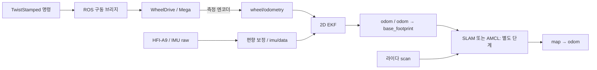

# ROS 구동 브리지와 EKF 오도메트리

[README](../README.md) · [통합 설계](architecture.md) · [검증 기준](acceptance.md)

`omslam_base`는 원본 시각이 있는 속도 명령을 좌우 바퀴 RPM으로 변환하고, 수신한 엔코더 누적값으로 바퀴 오도메트리를 계산합니다. `omslam_localization`은 이 측정값과 외장 IMU 각속도를 `robot_localization` EKF에서 결합합니다.

## 입력과 좌표계



| 데이터 | 의미 |
| --- | --- |
| `/cmd_vel/requested`, `/cmd_vel` | 원본 명령 신선도와 최종 출력의 `TwistStamped`; 원본 stamp 보존 |
| `/wheel/odometry` | MCU 엔코더 변화량의 SE(2) 적분; 목표 속도 적분이 아님 |
| `/joint_states` | 좌우 바퀴의 측정 각도·각속도 |
| `/imu/raw` → `/imu/data` | 센서 좌표계에서 gyro 편향 보정; 입력 stamp/frame 유지 |
| `/odom` | wheel `vx`, `wz`와 차체 기준 IMU yaw rate를 결합한 EKF 출력 |

IMU의 입력 세 축 각속도를 활성화해 장착 TF로 차체 기준으로 회전시킨 뒤 2D 모드에서 평면 회전을 사용합니다. 센서 원래 Z축 하나만 선택하면 기울어진 장착에서 차체 yaw 성분을 잃을 수 있습니다.

EKF는 2D 모드이며 `odom → base_footprint`를 단독 발행합니다. 브리지는 같은 TF를 중복 발행하지 않습니다. 같은 엔코더에서 계산한 pose와 twist를 독립 관측으로 함께 사용하지 않으며, 자기장 yaw·선형 가속도·카메라 IMU는 기본 EKF 입력에 포함하지 않습니다.

라이다 스캔은 EKF에 직접 들어가지 않습니다. 라이다 기반 SLAM/AMCL은 지도 기준 위치를 보정하는 별도 계층입니다. 별도의 라이다 odometry 추정기를 추가하는 구성은 현재 기본 경로에 포함하지 않습니다.

## 구동과 측정의 경계

기본 실행은 모의 장치이며 구동 브리지는 lifecycle 미구성(`unconfigured`) 상태에서 시작합니다. 실제 시리얼 백엔드는 장치 경로와 기존 구동 보정·PID 설정을 명시해야 합니다. 소스 트리의 개인 보정값을 설치 예제로 복사하지 않습니다.

원본 명령은 300 ms 뒤 만료하며, 같은 stamp의 반복 수신이나 송신으로 수명을 늘리지 않습니다. 실물 바퀴 목표는 좌우 같은 비율로 95 RPM 이하로 제한합니다. 시뮬레이션은 별도 42 RPM 프로파일을 사용합니다. 명령·피드백 단절, fault, lifecycle 해제 및 재접속에서는 이전 목표를 폐기합니다. 새로운 측정만 odometry로 발행하며, MCU 시각 wrap과 재시작을 구분합니다. 적분 `dt`는 MCU tick 차이를 유지하고 메시지 시각은 2초 EMA와 MCU `dt`의 1% slew 한도로 호스트에 동기화합니다. 보정 전 400 ms 초과 오프셋 점프와 호스트 시각 역행은 거부하며, 이 동기화는 실물 발진기·전송 지연 검증을 대체하지 않습니다.

모의 입력은 검증 도구가 공급하는 엔코더·IMU 관측입니다. 이는 실제 엔코더의 물리적 정확도, 모터의 응답, 지면 미끄러짐이나 IMU 장착 보정을 입증하지 않습니다. 실물 거리·회전각과의 비교는 P5에서 수행합니다.

## IMU 장착과 보정

편향 보정과 장착 방향 보정은 별개입니다. gyro bias는 센서 축에서 빼고, 센서 축과 차체 축의 회전 관계는 TF로 지정합니다. 정지 중력만으로 장착 yaw를 결정하지 않습니다. 실물 profile에는 확인한 frame·장착 자세와 해당 센서의 보정값을 적용합니다.

기존 HFI-A9 기록은 정지 gyro 보정 결과이며 장착 변환·동적 동작의 검증을 대신하지 않습니다. 실물에서는 차체 기준 중력 방향, 좌회전 각속도 부호, timestamp와 정지 편향을 확인한 뒤 EKF 입력으로 승인합니다. D435i 내장 IMU와 HFI-A9를 동시에 융합하지 않습니다.

## 빌드와 실행

```bash
cd ~/MyRos/Oh_My_SLAM
source /opt/ros/jazzy/setup.bash
colcon build --packages-up-to omslam_localization \
  --cmake-args -DCMAKE_BUILD_TYPE=Release -DPython3_EXECUTABLE=/usr/bin/python3
```

빌드 성공 후 새 셸에서 실행합니다. 기본 실행에는 장치 접근과 모터 활성화가 없습니다.

```bash
source /opt/ros/jazzy/setup.bash
source ~/MyRos/Oh_My_SLAM/install/setup.bash
ros2 launch omslam_localization base_ekf.launch.py
```

| 인수 | 의미 |
| --- | --- |
| `backend:=mock` | 기본값. 외부에서 공급한 모의 엔코더 샘플 사용 |
| `imu_source:=external` | 기본값. `/imu/raw` 입력 대기 |
| `imu_source:=mock` | 독립적인 합성 gyro 입력; 실제 센서 측정이 아님 |
| `base_config`, `imu_config`, `ekf_config` | 각 노드의 설정 YAML 경로 |
| `publish_static_tfs` | mock 결합 launch에서만 기본 true. URDF가 같은 TF를 발행하면 false |
| `imu_x/y/z`, `imu_roll/pitch/yaw` | base_link 기준 장착 위치(m)·회전(rad); 실물은 측정값 지정 |
| `backend:=real` | 하위 base의 `serial` 백엔드로 변환. 검증한 장착 설정과 `mounting_verified:=true` 필요 |
| `imu_source:=hfi_a9`, `imu_port` | 명시적으로 선택한 HFI-A9 시리얼 gyro 입력. 기본 비활성 |

브리지는 `unconfigured`에서 시작합니다. configure가 통신 worker를 준비하고, fresh encoder feedback을 받은 뒤 activate할 수 있습니다. 활성화 이전 명령은 재사용하지 않습니다. fault 복구 순서는 deactivate → cleanup → configure → 새 피드백 → activate → 새 명령입니다. 진단 오류 시 출력은 차단되지만 ROS lifecycle 표시는 active로 남을 수 있으므로 `/diagnostics`를 함께 확인합니다.

실물 base 설정에는 `port`, `drive_calibration`, `pid_config`의 명시적 경로가 필요합니다. `base.launch.py`를 직접 사용할 때의 백엔드 이름은 `serial`입니다. HFI-A9는 gyro만 발행하며, 시각은 새 프레임의 호스트 수신 시각입니다. 장치 시계 단위·전송 지연 보정은 실물 검증 범위에 남습니다. 기존 드라이버를 사용하는 경우 `/imu/raw`로 remap하고 보정을 중복 적용하지 않습니다.

## 소프트웨어 검증

`tools/verify_base_ekf.py`는 설치된 결합 launch와 실제 EKF를 격리 ROS domain에서 실행합니다. 목표 명령과 독립적인 엔코더 변화, 서로 다른 gyro 입력, 기울어진 장착 TF, 명령 수명과 lifecycle 복구를 확인합니다. 상세 실행 인수는 `--help`로 확인합니다.

입력 중단 때 EKF가 예측값을 계속 출력할 수 있으므로 `/odom` 수신만으로 센서가 정상이라고 판단하지 않습니다. 입력 freshness와 `/diagnostics`를 함께 확인합니다. 이 검증은 Gazebo 로봇 주행·실물 이동·SLAM 검증과 별개입니다.

재현 가능한 통합 실행 명령(현재 셸에서 설치본 source 필요):

```bash
/usr/bin/python3 tools/verify_base_ekf.py --output reports/base-ekf/manual-check
```

검증 완료 범위는 구동·IMU 처리 단위 검사, 공통 WheelDrive 회귀와 설치된 ROS 경로의 모의 통합 실행입니다. 모터 펌웨어·실물 센서 보정·물리적 정지 성능은 이 결과로 대체하지 않습니다.
