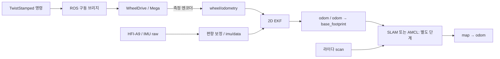

# ROS 구동 브리지와 EKF 오도메트리

[README](../README.md) · [통합 설계](architecture.md) · [검증 기준](acceptance.md)

`omslam_base`는 원본 시각이 찍힌 속도 명령을 받아 좌우 바퀴 RPM으로 바꾸고, 돌아온 엔코더 누적값으로 바퀴 오도메트리를 계산합니다. `omslam_localization`은 이 바퀴 측정값과 외장 IMU 각속도를 `robot_localization` EKF로 합쳐 `/odom`을 만듭니다.

## 입력과 좌표계



| 데이터 | 의미 |
| --- | --- |
| `/cmd_vel/requested`, `/cmd_vel` | 원본 명령 신선도와 최종 출력 `TwistStamped`, 원본 stamp 유지 |
| `/wheel/odometry` | MCU 엔코더 변화량의 SE(2) 적분(목표 속도 적분 아님) |
| `/joint_states` | 좌우 바퀴의 실제 측정 각도와 각속도 |
| `/imu/raw` → `/imu/data` | 센서 좌표계에서 자이로 편향 보정, 입력 stamp와 frame 유지 |
| `/odom` | wheel `vx`·`wz`와 차체 기준 IMU yaw rate를 합친 EKF 출력 |

IMU는 세 축 각속도를 모두 입력으로 켜서 장착 TF로 차체 기준에 맞게 회전시킨 뒤 2D 평면 회전을 씁니다. 센서 Z축 하나만 떼어 쓰면 IMU가 조금이라도 기울어져 장착됐을 때 차체 yaw 성분이 빠질 수 있기 때문입니다.

EKF는 2D 모드로 동작하며 `odom → base_footprint`를 단독으로 발행합니다. 구동 브리지는 같은 TF를 겹쳐서 내지 않습니다. 같은 엔코더에서 나온 pose와 twist를 독립 센서처럼 중복 입력하지 않으며, 자기장 yaw, 선형 가속도, 카메라 내장 IMU는 기본 EKF 입력에서 뺐습니다.

라이다 스캔도 EKF에 직접 넣지 않습니다. 라이다는 별도 계층인 SLAM이나 AMCL에서 지도 기준 위치를 맞추는 데 씁니다. 라이다 오도메트리 추정기를 따로 붙이는 방식은 현재 기본 구성에 넣지 않았습니다.

## 구동과 측정의 경계

기본 실행 백엔드는 모의 장치이고, 구동 브리지는 처음에 lifecycle 미구성 상태(`unconfigured`)로 뜹니다. 실제 시리얼 백엔드를 쓰려면 장치 경로와 기존 구동 보정·PID 설정 파일 경로를 직접 넘겨야 합니다. 개인 장비 보정값을 설치 예제로 복사해 넣지 않습니다.

원본 명령은 300 ms가 지나면 만료되며, 같은 stamp를 여러 번 받거나 다시 보낸다고 해서 수명이 늘어나지 않습니다. 실물 바퀴 목표는 좌우 비율을 지키며 95 RPM 이하로 제한하고, 두 바퀴 중 큰 절댓값이 3.0 RPM 미만이면 끌어올리지 않고 출력을 0으로 끊습니다. 이때도 원본 명령 수명은 그대로 유지합니다. 시뮬레이션은 별도의 3–70 RPM 프로파일을 씁니다.

명령이나 피드백이 끊기거나 fault가 나거나 lifecycle이 해제·재접속되면 이전 목표를 전부 비웁니다. 오도메트리는 새로운 측정값이 들어올 때만 발행하고, MCU 시각 wrap과 재시작을 구분해 처리합니다. 적분 `dt`는 MCU tick 차이를 그대로 쓰고, 메시지 시각은 2초 EMA와 MCU `dt`의 1% slew 한도로 호스트 시각에 맞춥니다. 보정 전 400 ms를 넘는 오프셋 점프나 호스트 시각 역행은 거부합니다. 다만 이 소프트웨어 동기화가 실물 발진기 오차나 전송 지연 검증을 대신하지는 않습니다.

모의 입력은 검증 도구가 만들어 주는 엔코더와 IMU 데이터입니다. 모의 검증이 통과했다고 해서 실제 엔코더 정밀도, 모터 응답, 바닥 미끄러짐, IMU 장착 각도까지 확인된 것은 아닙니다. 실물 거리와 회전각 비교는 P5에서 직접 측정합니다.

## IMU 장착과 보정

자이로 편향 보정과 장착 방향 보정은 구분해서 다뤄야 합니다. 자이로 바이어스는 센서 자체 축에서 빼고, 센서 축과 차체 축 사이의 회전은 TF로 넘겨줍니다. 정지 상태 중력 벡터만으로는 장착 yaw 각도를 알 수 없으므로, 실물 프로파일에는 확인된 frame과 장착 자세, 해당 센서의 보정값을 함께 넣습니다.

기존 HFI-A9 기록은 정지 상태 자이로 보정 결과일 뿐 장착 변환이나 움직일 때의 응답 검증을 대신하지 않습니다. 실물에서는 차체 기준 중력 방향, 좌회전 각속도 부호, timestamp, 정지 편향을 먼저 확인한 뒤 EKF 입력으로 씁니다. D435i 내장 IMU와 HFI-A9을 동시에 융합하지는 않습니다.

## 빌드와 실행

```bash
cd ~/MyRos/Oh-My-SLAM
source /opt/ros/jazzy/setup.bash
colcon build --packages-up-to omslam_localization \
  --cmake-args -DCMAKE_BUILD_TYPE=Release -DPython3_EXECUTABLE=/usr/bin/python3
```

빌드가 끝나면 새 셸을 열어 아래처럼 실행합니다. 기본 실행은 모의 장치라 실제 USB 포트를 열거나 모터를 움직이지 않습니다.

```bash
source /opt/ros/jazzy/setup.bash
source ~/MyRos/Oh-My-SLAM/install/setup.bash
ros2 launch omslam_localization base_ekf.launch.py
```

| 인수 | 의미 |
| --- | --- |
| `backend:=mock` | 기본값. 외부에서 넣어 주는 모의 엔코더 샘플 사용 |
| `imu_source:=external` | 기본값. `/imu/raw` 토픽 입력 대기 |
| `imu_source:=mock` | 독립적인 합성 자이로 입력(실제 센서 측정 아님) |
| `base_config`, `imu_config`, `ekf_config` | 각 노드의 설정 YAML 경로 |
| `publish_static_tfs` | mock 결합 launch에서만 기본 true. URDF가 같은 TF를 내면 false |
| `imu_x/y/z`, `imu_roll/pitch/yaw` | `base_link` 기준 장착 위치(m)와 회전(rad), 실물은 실측값 지정 |
| `backend:=real` | 하위 base의 `serial` 백엔드로 연결. 검증된 장착 설정과 `mounting_verified:=true` 필요 |
| `imu_source:=hfi_a9`, `imu_port` | HFI-A9 시리얼 자이로 입력 선택, 기본 비활성 |

브리지는 `unconfigured` 상태로 시작합니다. `configure`로 통신 worker를 준비하고 새 엔코더 피드백이 들어온 뒤에야 `activate`할 수 있습니다. 활성화하기 전에 들어온 명령은 재사용하지 않습니다. fault가 나면 `deactivate → cleanup → configure → 새 피드백 → activate → 새 명령` 순서로 복구합니다. 진단 오류가 났을 때 실제 출력은 차단되지만 ROS lifecycle 상태는 `active`로 남아 있을 수 있으므로 `/diagnostics`도 같이 확인해야 합니다.

실물 base를 띄울 때는 `port`, `drive_calibration`, `pid_config` 경로를 모두 명시해야 합니다. `base.launch.py`를 직접 실행할 때 백엔드 이름은 `serial`입니다. HFI-A9은 자이로만 발행하며 시각은 새 프레임을 호스트가 받은 시각을 씁니다. 장치 시계 단위와 전송 지연 보정은 실물 검증 범위로 남겨 두었습니다. 기존 IMU 드라이버를 쓸 때는 `/imu/raw`로 remap하되 편향 보정이 두 번 들어가지 않게 주의합니다.

## 소프트웨어 검증

`tools/verify_base_ekf.py`는 설치된 launch와 실제 EKF 노드를 격리된 ROS domain에서 띄워 검증합니다. 목표 명령과 별개로 들어오는 엔코더 변화, 서로 다른 자이로 입력, 기울어진 장착 TF, 명령 수명과 lifecycle 복구를 한 번에 확인합니다. 세부 옵션은 `--help`로 볼 수 있습니다.

센서 입력이 끊겨도 EKF가 예측값을 계속 내보낼 수 있으므로 `/odom`이 들어온다는 이유만으로 센서가 정상이라고 보면 안 됩니다. 입력 freshness와 `/diagnostics`를 함께 봐야 합니다. 이 검증은 Gazebo 로봇 주행이나 실물 이동, SLAM 검증과는 별개입니다.

현재 셸에서 설치본을 source한 뒤 아래 명령으로 재현할 수 있습니다.

```bash
/usr/bin/python3 tools/verify_base_ekf.py --output reports/base-ekf/manual-check
```

이 검증이 보장하는 범위는 구동과 IMU 처리 단위 검사, 공통 `WheelDrive` 회귀, 설치된 ROS 경로의 모의 통합 실행까지입니다. 모터 펌웨어, 실물 센서 보정, 물리적 정지 성능은 이 결과로 대체하지 않습니다.
