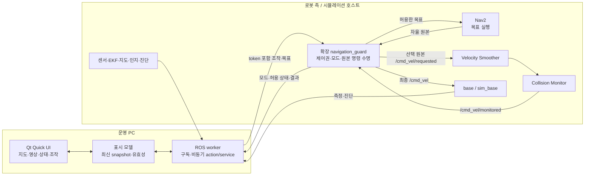

# 지도 중심 로봇 콘솔 요구사항

[README](../README.md) · [통합 아키텍처](architecture.md) · [콘솔 실행](operator_gui.md)

**주행 지도 위에서 목적지와 모든 주요 계측을 함께 보고, 한 가지 이동 흐름을 사용합니다.** 시스템 로그만 별도 화면으로 둡니다. 전체 다크 테마의 지도·로그 UI를 실제 ROS 센서·주행·지도 서비스에 연결했습니다. 시뮬레이션에서 G1–G5의 현재 연결 범위를 검증했으며 실행 절차와 적용 범위는 [콘솔 사용 안내](operator_gui.md)에 정리합니다.

아래 1–4절은 화면과 조작 기준, 5절 이후는 데이터·ROS·제어 계약입니다. 구현 완료 조건에는 최신 설치본으로 실행한 시뮬레이션 통합 검증을 포함합니다.

## 1. 화면 원칙

| 항목 | 기준 |
| --- | --- |
| 프로그램 | Ubuntu 데스크톱 앱 `Oh My Robot`, Python + PySide6/Qt Quick |
| 화면 수 | 지도와 시스템 로그, 두 화면 |
| 기본 화면 | 전체 작업 영역을 지도에 사용. 목적지·영상·핵심 수치는 반투명 오버레이 |
| 탐색 | 센서·구동계·시스템 상세 페이지와 왼쪽 탐색 막대 제거 |
| 조작 | 관측·수동·자율 선택 버튼 제거. 목적지 이동 또는 직접 조종을 바로 사용 |
| 이동 경로 | 단일·다중 목적지를 같은 목록과 **이동** 버튼으로 처리 |
| 접근 깊이 | 주요 조작은 기본 화면에 노출. 영상은 한 번 클릭으로 확대. 수치는 기본 화면에 표시 |
| 창 크기 | 기본 1440×900, 최소 1280×800 |
| 정지 | 모든 화면 상단에 **정지**를 상시 노출, 확인창 없이 처리 |
| 이동 상태 | 상단 한 줄에 이동 가능 여부와 다음 행동 표시. 연결 끊김·지도 필요·현재 위치 필요·경로 없음·이동 차단을 구분하고 상태 코드는 로그로 전달 |

## 2. 지도와 반투명 계측

```text
┌ Oh My Robot   현재 작업 / 연결 상태                시스템 로그  정지 ┐
│ ┌ 목적지  + ┐                ┌ 속도 / 위치 ┐          ┌ RGB ┐    │
│ │ 1 좌표  − │                                        │깊이 │    │
│ │ 2 좌표  − │          지도 / 로봇 / 이동 순서         └─────┘    │
│ │ 속도 ━━━  │                                                   │
│ │   이동    │                                                   │
│ └───────────┘                                                   │
│ ┌직접 조종──┐                                  지도 / 전체 보기 │
│ └───────────┘                                                   │
│ ┌ 좌우 RPM ─────────┬ 자세·방향 ────────┬ host·로봇 자원 ──┐    │
│ │ 왼쪽 / 오른쪽     │ 롤 / 피치 / 방향 │ CPU·메모리·온도 │    │
│ └───────────────────┴──────────────────┴─────────────────┘    │
└─────────────────────────────────────────────────────────────────┘
```

하단은 124px 높이로 핵심 숫자만 표시합니다. 좌우 회전수, 자세·방향, 컴퓨터 부하를 한눈에 확인하며 원시값·유효성·통신 상세는 시스템 로그로 모읍니다. 그래프와 기술 정보 팝업은 제거합니다. 방향은 지도 기준 0°에서의 회전각이며 지도 로봇과 함께 갱신합니다.

| 표시 | 기본 화면 | 한 번 클릭하는 상세 |
| --- | --- | --- |
| 움직임 | 로봇 위치·방향, 선속도·각속도 | — |
| 카메라 | RGB·깊이 영상 | 영상 확대 |
| 구동계 | 왼쪽·오른쪽 RPM | — |
| 자세·방향 | 롤·피치·지도 기준 방향 | — |
| 시스템 | host/로봇 CPU·메모리·CPU 온도 | — |
| 시스템 로그 | 상단 진입 버튼 | 조작·진단·센서 세부 정보의 시간순 목록과 검색 |

전체 바탕은 `#14212E`, 오버레이는 반투명 청회색 `#DE101B28`(Qt ARGB), 글자는 `#E8EEF6`, 보조 문자는 `#9AAAC0`를 사용합니다. 선택·예정 경로는 청색 `#6AA9FF`, 로봇·측정값은 청록색 `#63CFB1`입니다. 경고·차단은 문구와 함께 황갈색·적색으로 표시합니다. 글꼴은 Noto Sans CJK KR, 조작 13–14px, 주요 수치 18–22px를 기준으로 합니다.

표시 대상 값이 없거나 오래되었으면 `—`로 표시하며 유효하지 않은 값을 정상 수치로 바꾸지 않습니다. 배터리·모터 온도는 표시 대상에서 제외합니다.

## 3. 하나의 목적지 목록

### 추가와 이동

1. **+**를 누르고 지도에서 위치를 클릭합니다. 드래그하면 같은 동작으로 도착 방향을 지정합니다.
2. 원하는 수만큼 같은 방식으로 목적지를 추가합니다.
3. **이동**을 누르면 목록 순서대로 처리합니다. 목적지가 하나인 경우도 동일합니다.

단일 목표 입력과 목록 목표 입력을 나누지 않습니다. 별도의 목표 추가 확정, 목록 실행, 제어권 획득 또는 모드 선택 버튼을 요구하지 않습니다. 빈 목록에서는 다음 행동을 안내하고 이동은 비활성화합니다.

### 수정·삭제·순서

- 각 행의 **−**로 해당 목적지를 바로 삭제합니다.
- 행 손잡이를 위아래로 끌어 순서를 바꿉니다. 키보드 위/아래도 제공합니다.
- 지도 마커 번호와 연결선은 목록 순서와 항상 일치합니다.
- 지도 마커를 끌어 위치를, 화살표를 끌어 도착 방향을 바꿉니다.
- 목록 좌표를 한 번 누르면 x/y/yaw 숫자 입력창이 열립니다. 입력 완료 시 즉시 반영합니다.
- 로그에 다녀와도 목적지 목록을 유지합니다.

이동은 실제 Nav2 목표 action으로 실행합니다. 이동 중에는 목록 편집을 잠그고, 정지 확인 후 다시 편집할 수 있습니다.

## 4. 직접 조종·지도 작업·내부 제어

### 직접 조종과 속도

직접 조종 패드를 지도에서 항상 접근할 수 있게 둡니다. 패드 누름 또는 Space와 방향키 입력으로 조종 의도가 전달되며, 별도의 수동 모드 선택을 요구하지 않습니다. 입력을 놓거나 창이 비활성화되면 현재 입력을 폐기합니다. 텍스트 입력 중의 방향키는 조종 입력으로 사용하지 않습니다.

속도는 하나의 슬라이더로 표시하고 수치와 단위를 함께 보여 줍니다. 실제 연결에서는 선택한 선속도·각속도와 프로파일 상한을 구분하고 최종 한도는 로봇 측에서 적용합니다. 실물 후진의 지원 조건과 잠금 기준은 유지합니다.

### 지도 작업

지도 도구에서 **지도 저장 / 저장 지도 열기 / 새 지도 작성 / 현재 위치 맞추기**에 바로 접근합니다. 저장 지도 열기는 위치추정, 새 지도 작성은 지도 작성 흐름으로 연결하며 SLAM/AMCL 선택을 별도의 필수 단계로 요구하지 않습니다. 라이다·기억·비용지도 표시도 이 메뉴에서 바꿉니다.

지도·pose graph·메타데이터 저장, 대상 호스트·경로 구분, 기존 파일 덮어쓰기 거부, 지도 교체 전 정지 확인, 현재 위치와 목적지의 분리는 실제 연결 요구사항으로 유지합니다.

### 실제 연결 시의 제어 계약

사용자가 **이동**을 누르거나 직접 조종을 시작하면 필요한 제어권·준비 조건 확인과 전환을 내부에서 수행합니다. 기존 `DISABLED/MANUAL/AUTO`는 백엔드의 내부 상태로 유지하며 사용자가 선택하는 버튼으로 노출하지 않습니다. 단일 목표와 다중 목표 모두 같은 운영 목표 경로를 사용하고, 이전 목표의 성공과 실제 정지 확인 후 다음 목표를 처리합니다. 실패·취소 시 다음 목표를 자동 실행하지 않습니다.

다른 세션의 제어권을 자동으로 빼앗지 않습니다. 준비 부족이나 연결 단절은 현재 작업과 원인을 같은 화면에서 설명합니다. UI 조작을 줄이는 것은 원본 명령 수명·deadman·소유권·정지 확인을 생략하는 뜻이 아닙니다. 제어권 획득·모드 전환·정지 확인은 기존 ROS 제어 계약으로 처리합니다.

**정지**는 입력 차단·0 요청·목표 취소·구동해제 후 실제 측정 정지를 확인합니다. 제어 전환도 입력 차단 → 기존 작업 취소 → 실제 정지 확인 → 새 제어 시작 순서를 유지합니다. 원본 명령 유효기간 0.30초와 물리적인 정지 확인 시간은 구분합니다.

## 5. 현재 데이터와 추가 계측

아래의 “현재”는 소스에서 확인한 발행 계약입니다. 실행 환경에서 항상 해당 토픽이 존재한다는 뜻은 아닙니다. GUI는 실제 endpoint·메시지·capability를 확인합니다.

| 정보 | 현재 데이터 | GUI에서의 처리·추가 작업 |
| --- | --- | --- |
| RGB·depth | `/camera/color/image_raw`, `/camera/depth/image_rect_raw`, 각 `camera_info` | 시뮬 320×240·10 Hz. 실물 해상도·encoding·frame은 연결 후 확인 |
| IMU | `/imu/raw`, `/imu/data` — `sensor_msgs/Imu` | covariance 유효성 반영. 실물 HFI-A9 자세·가속도는 현재 미제공 |
| 라이다 | `/scan` — `sensor_msgs/LaserScan` | 지도 위 도트 표시 |
| 바퀴 상태 | `/joint_states` — `sensor_msgs/JointState` | 좌우 RPM에 사용. 데이터 출처와 변환은 내부에서 관리 |
| 차체 속도·추정 | `/wheel/odometry`, `/odom` — `nav_msgs/Odometry` | 선속도·각속도·지도 방향에 사용. 출처와 유효성은 내부에서 관리 |
| 명령 속도 | `/cmd_vel/requested`, `/cmd_vel/smoothed`, `/cmd_vel/monitored`, `/cmd_vel` — `TwistStamped` | 명령 수명·허용 여부를 내부에서 확인 |
| 지도·경로 | `/map` — `OccupancyGrid`, Nav2 전역 경로 `/plan` — `Path` | frame·origin·resolution 반영, endpoint는 프로파일로 확인 |
| 비용지도 | `/global_costmap/costmap_raw`, `/local_costmap/costmap_raw` — `nav2_msgs/Costmap` | map/odom 좌표 변환, 합성 비용지도라는 점 명시 |
| 점군·기억 | `/camera/points`, `/perception/obstacles`, `/perception/memory_cloud`, `/perception/memory` | 현재 관측과 누적 기억 분리, 객체별 추적 목록은 미제공 |
| 인지 건강 | `/perception/health` — `PerceptionHealth` | 발행 stamp 외 **observation_stamp**로 원본 관측 신선도 확인 |
| 구동·Nav2 상태 | `/navigation/state` JSON, `/diagnostics`, lifecycle, action 결과 | 기존 필드 어댑터 유지, 신규 제어 상태는 typed 메시지로 추가 |
| MCU 상세 | host protocol 내부 encoder·RPM·PWM·fault·ACK·timing·RX counters | `/base/motor_state`에 기존 I/O worker의 snapshot과 필드별 유효성을 발행 |
| 호스트 자원 | `omslam_system_monitor`의 `/diagnostics` | 호스트 이름·역할을 포함해 host와 로봇의 값을 구분 |
| 시뮬 truth | `/sim/ground_truth` | 시뮬 진단용 별도 표시. 실제 로봇 상태·Nav2 입력과 구분 |

모든 상세 값은 `출처 / 단위 / frame / 원본 시각 / 마지막 수신 / 유효성`을 조회할 수 있게 합니다. 상태는 `정상·지연·단절·미제공·비활성`을 구분합니다. 0은 유효한 측정값일 때만 표시합니다. transient-local 상태를 늦게 수신했다는 이유로 정상 상태를 갱신하지 않습니다.

근거: [base 발행](../src/omslam_base/omslam_base/node.py), [MCU host protocol](../src/omslam_control_vendor/control/motor_link.py), [IMU 입력](../src/omslam_localization/omslam_localization/hfi_a9_node.py), [시뮬 bridge](../src/omslam_sim/config/robot_bridge.yaml), [기억 메시지](../src/omm_perception_msgs/msg/ObstacleMemory.msg), [guard](../src/omslam_navigation/omslam_navigation/navigation_guard.py).

## 6. 프로그램·ROS 구조



### GUI와 ROS 실행 분리

Qt 주 스레드는 입력과 화면 표시를 담당합니다. `rclpy` executor는 별도 worker에서 돌리고, 구독 callback은 최신 snapshot만 갱신합니다. action/service는 비동기로 처리하며 UI 스레드에서 응답 대기·이미지 변환·점군 변환을 수행하지 않습니다. Qt 객체 갱신은 queued signal로 주 스레드에 전달합니다. [Qt 스레드·queued connection](https://doc.qt.io/qtforpython-6/PySide6/QtCore/QThread.html), [Jazzy executor 구현](https://github.com/ros2/rclpy/blob/jazzy/rclpy/rclpy/executors.py)

지도는 OccupancyGrid/Costmap을 이미지로 만들고 로봇·경로·선택 도형을 별도 Qt Quick 항목으로 그립니다. 카메라도 최신 프레임만 표시하고 오래된 프레임 큐를 쌓지 않습니다. 전체 3D 장면 대신 운행용 2D 지도와 IMU 방향 도형을 우선 구현합니다.

시스템 Python에는 `rclpy`, `cv_bridge`, PyQt5가 설치되어 있으므로, Qt6/PySide6는 `--system-site-packages` 옵션의 전용 가상환경(`.venv-operator`, `requirements-operator.txt`)에 고정하여 ROS Jazzy 패키지와 함께 사용합니다. RViz의 Qt5 위젯을 Qt6 앱 안에 삽입하는 방식을 기본 구조로 사용하지 않습니다.

### 제어권과 명령 계약

현재 guard는 Nav2의 실행 중 goal이 있어야 비영 명령을 통과시키고 `/cmd_vel`의 단일 publisher를 요구합니다. 따라서 GUI가 `/cmd_vel`에 직접 발행하거나 기존 guard 옆에 별도 최종 출력 노드를 추가하면 안 됩니다. **기존 guard 안에 소스 선택·수동 수명·모드 전환을 구현**합니다.

제어 모드와 건강 상태는 별개로 둡니다. 모드는 `DISABLED / MANUAL / AUTO`, 진행 상태는 `준비 / 활성 / 전환 중 / 차단`으로 표현하고 기존 readiness·fault 사유를 유지합니다. 관측 GUI는 제어 token을 갖지 않습니다. 동시에 한 운영 세션만 제어권을 가지며, 새 GUI 연결이 기존 제어권을 자동으로 빼앗지 않습니다.

| 신규 계약안 | 내용 |
| --- | --- |
| `OperatorState` | backend·capabilities·제어 모드·소유자·epoch·준비/차단 원인·활성 목표·속도 상한·정지 확인 상태 |
| `ManualCommand` | 원본 `TwistStamped`, session token, 증가 sequence, deadman. 횡이동·NaN·잘못된 frame 거부 |
| 제어권 서비스 | 획득·반납·모드 전환. 요청 ID로 중복 클릭을 구분하고 실제 완료 상태는 `OperatorState`로 확인 |
| 운영 목표 action | token과 `PoseStamped`를 받고 내부 `NavigateToPose`로 전달; 외부 요청과 내부 Nav2 UUID 연결 |
| 정지 서비스 | 비영 명령 수락 중단·0 출력·취소·구동해제. 이동 권한 획득보다 우선 처리 |
| `MotorTelemetry` | sample stamp, backend·필드 유효성, 좌우 count/RPM/PWM, fault·통신·타이밍 snapshot |

위 계약의 `/operator/*`, `/base/motor_state`는 구현에서 채택한 인터페이스입니다. 기존 `/navigation/state`는 호환성을 위해 유지합니다. GUI 목표는 운영 목표 action을 통해 전달하고 guard가 발급·등록한 내부 UUID만 구동을 허용합니다. 다른 RViz/CLI의 직접 목표가 들어오면 제어권을 얻은 것으로 간주하지 않습니다.

원본 명령 수명은 기존 `0.30초`를 유지합니다. UI 입력을 실제 샘플링한 시각을 보존하며 ROS worker가 마지막 비영 입력에 새 stamp를 붙여 재생하지 않습니다. 입력 queue는 최신 1개로 제한하고 token·epoch·sequence·ROS stamp와 로봇 수신 후 monotonic 경과를 함께 검사합니다.

수동 입력은 20 Hz를 목표로 합니다. 제어 세션 heartbeat도 UI 이벤트 루프의 진행을 반영해야 하며, ROS worker 혼자 갱신해서 멈춘 화면의 제어권을 유지하지 않습니다. 제안 owner 만료는 `0.30초`입니다. 제어 GUI 단절 시 수동 명령 폐기, 자율 목표 취소·정지·권한 해제를 수행합니다. 재연결은 관측 모드부터 시작합니다. 관측 전용 GUI 종료는 다른 세션의 주행에 영향을 주지 않습니다.

수동 준비 조건은 base·신선한 odom·필수 센서·TF·smoother·collision monitor로 분리합니다. Nav2 목표나 지도가 없더라도 필요한 조건을 만족하면 수동 운전이 가능하도록 확장합니다. 자율 준비 조건에는 지도·위치추정·Nav2 서버를 추가합니다. 실물용 lifecycle 대상과 시각 정책은 별도 backend 설정으로 분리합니다.

## 7. 표시 성능·연결·세션 관리

| 항목 | 초기 설계 목표 |
| --- | --- |
| 지도 로봇·조작 반응 | 최대 30 FPS 표시; 위치·속도 원본은 해당 ROS 입력 주기를 유지 |
| 숫자·그래프 | 10–20 Hz 표시, 최근 60초 ring buffer; 더 오래된 데이터를 무한 누적하지 않음 |
| 카메라 | 원본 FPS 이하, 기본 10–15 FPS 상한; 숨겨진 큰 영상 변환 중단 |
| 점군·비용지도 | 열어 둔 레이어만 변환; 점군 표시량 제한, 원본 인지/제어 데이터는 변경하지 않음 |
| 진단·호스트 자원 | 약 1 Hz, 주요 상태 변경 즉시 표시 |
| 입력 지연 | 기준 PC에서 클릭·키 입력의 시각 반응 p95 100 ms 이내를 목표로 측정 |
| 메모리 | 영상·점군 최신값과 고정 길이 이력만 보관; 입력 폭주 시 오래된 표시 프레임 폐기 |

센서 구독은 실제 offered QoS와 맞춥니다. 지도·상태의 transient-local과 live 센서의 best-effort를 구분하며, 표시 속도를 줄이기 위해 제어 입력의 수신·수명 검사 주기를 바꾸지 않습니다. 명령 만료 판정과 물리적 정지 시간은 별도 항목으로 기록합니다.

기존 `nav.sh`는 localhost discovery 프로파일입니다. PC↔Orin 연결은 ROS domain·namespace·DDS discovery·backend 시각을 맞춘 별도 LAN 프로파일이 필요합니다. 세션 token은 명령 소유권을 위한 값이며 네트워크 인증 수단으로 취급하지 않습니다. 초기 대상은 신뢰하는 로컬 ROS 네트워크입니다.

앱이 실행한 시뮬레이션은 PID·process group·로그 경로를 기록하고 해당 프로세스만 종료합니다. 기존 실행에 연결한 경우 앱 종료가 전체 ROS/Gazebo를 종료하지 않습니다. 제어권 소유 앱의 종료는 먼저 정지·권한 반납을 요청하며, 응답을 못 받아도 로봇 측 만료 차단이 남아 있어야 합니다.

## 8. 실제 기능 연결 시의 구현 기준

| 단계 | 구현 대상 | 끝났다고 판단하는 기준 |
| --- | --- | --- |
| G1. 화면·읽기 전용 연결 | Qt 의존성 고정, `omslam_operator` 앱, 지도·로그 화면, ROS worker·표시 모델, 기존 데이터 구독 | 실제 시뮬 데이터로 지도·카메라·IMU·속도·상태가 표시되고 지연/미제공을 구분 |
| G2. 핵심 계측 | `omslam_operator_msgs`, base motor snapshot, 로봇 호스트 진단, 좌우 RPM·자세·방향 표시 | 화면 값의 단위·시각이 원본과 일치; sim/mock/real 출처는 내부에서 구분 |
| G3. 제어권·수동 조종 | 기존 guard 확장, mode별 readiness, token·deadman·원본 수명, 수동 속도 및 조건부 후진 | 입력 해제·전환·연결 단절 시 정지하고 이전 입력으로 재출발하지 않음 |
| G4. Nav2·지도 조작 | 목표 proxy, 위치·방향 입력, 순차 목표, 속도 제한, 취소·정지, 지도 작업 연결 | GUI에서 목표 설정부터 정지·완료/실패 확인까지 수행; 수동↔자율 전환 일관성 확인 |
| G5. 화면·통합 검증 | 기준 화면 크기, 데이터 부하, 한 통합 시나리오, 실행 안내 | 아래 인수 기준 통과 및 문서 작성 |

새 앱·메시지 패키지는 `src/`, 이 설계와 사용법은 `docs/`, 설치 설정은 패키지 `config/`에 둡니다. `console.sh`는 workspace 설치본으로 ROS에 연결합니다. `--start-sim`은 콘솔 소유 시뮬레이션과 Nav2를 시작하고 기본 실행은 기존 세션에 연결합니다. 개인 지도·로그·진단 덤프는 기존 비공개 출력 경로를 사용합니다.

G1–G5는 시뮬레이션에서 GUI 기능을 완성하고 실물에 필요한 데이터·backend 확장 경계를 준비하는 순서입니다. 실물 모터 상세 값의 최종 확인과 구동 활성화는 기존 P5 시험에 연결합니다. GUI 제작 때문에 실물 주행 검증이 완료된 것으로 표시하지 않습니다.

## 9. 실제 기능 연결 시의 검증 기준

구현 후 검증은 영향을 받는 제어 계약 시험과 **GUI 통합 시나리오 한 묶음**으로 구성합니다. 최신 빌드가 성공한 뒤 실행하며, 통과한 항목은 관련 변경이나 새 실패 근거가 없으면 반복하지 않습니다.

| 검증 | 확인 사항 |
| --- | --- |
| 데이터 정확성 | camera encoding·depth 단위, wheel RPM 변환, frame 변환, IMU 미제공 처리, MCU snapshot 유효성 |
| 제어 계약 | owner·token·epoch·sequence, 원본 0.30초 수명, 오래된 명령·중복 요청·잘못된 UUID 거부 |
| 정지·전환 | 수동 입력 해제·focus loss·단절·GUI 종료, 양방향 모드 전환, 취소 지연, 실제 정지 확인 |
| 주행 조작 | 위치·도착 방향 목표, 순차 목표, 속도 상한 변경, 목표 취소, 실패 시 다음 목표 중단 |
| 표시·부하 | 1280×800 및 1440×900에서 필수 조작 접근, 화면 변경 중 상태 유지, 영상 부하 중 입력 반응·freshness 표시 |

실제 연결 검증은 **연결 → 직접 조종·정지 → 목적지 이동 → 직접 조종 → 목록 이동 → 정지·연결 단절·재연결**을 한 세션에서 확인합니다. 각 조작에 따른 내부 제어 전환은 UI 모드 버튼 없이 수행합니다. 좌우 RPM·자세·방향은 이 실행의 동일 데이터로 확인합니다. 후진은 해당 프로파일의 후방 관측·정지 조건을 함께 확인합니다.

모든 실행에서 요청·최종 명령·측정 속도, action 상태, 모드·차단 이벤트를 같은 시간축에 기록합니다. GUI 표시가 `완료`이면 목표 결과와 측정 정지가 일치해야 합니다. 관측이 없거나 정지 여부를 모르면 `확인 불가`로 남겨야 합니다. 물리적 정지 시간은 0.30초 명령 수명과 혼동하지 않고 실제 값으로 기록합니다.

## 10. 현재 연결 작업의 완료 기준

지도와 주요 계측의 동시 표시, 단일·다중 목표의 추가·삭제·순서 변경·실제 이동, 직접 조종, 지도 작업, 카메라 확대와 시스템 로그를 ROS에 연결합니다. 최신 빌드와 관련 회귀 시험을 통과하고 시뮬레이션 통합 시나리오로 실제 조작·측정 정지·재연결 및 두 창 크기의 화면을 확인합니다. 변경하지 않은 backend 계약의 기존 통과 근거는 적용 범위를 확인해 재사용합니다. 실물 구동 시험은 이 작업의 완료 조건에 포함하지 않습니다.
