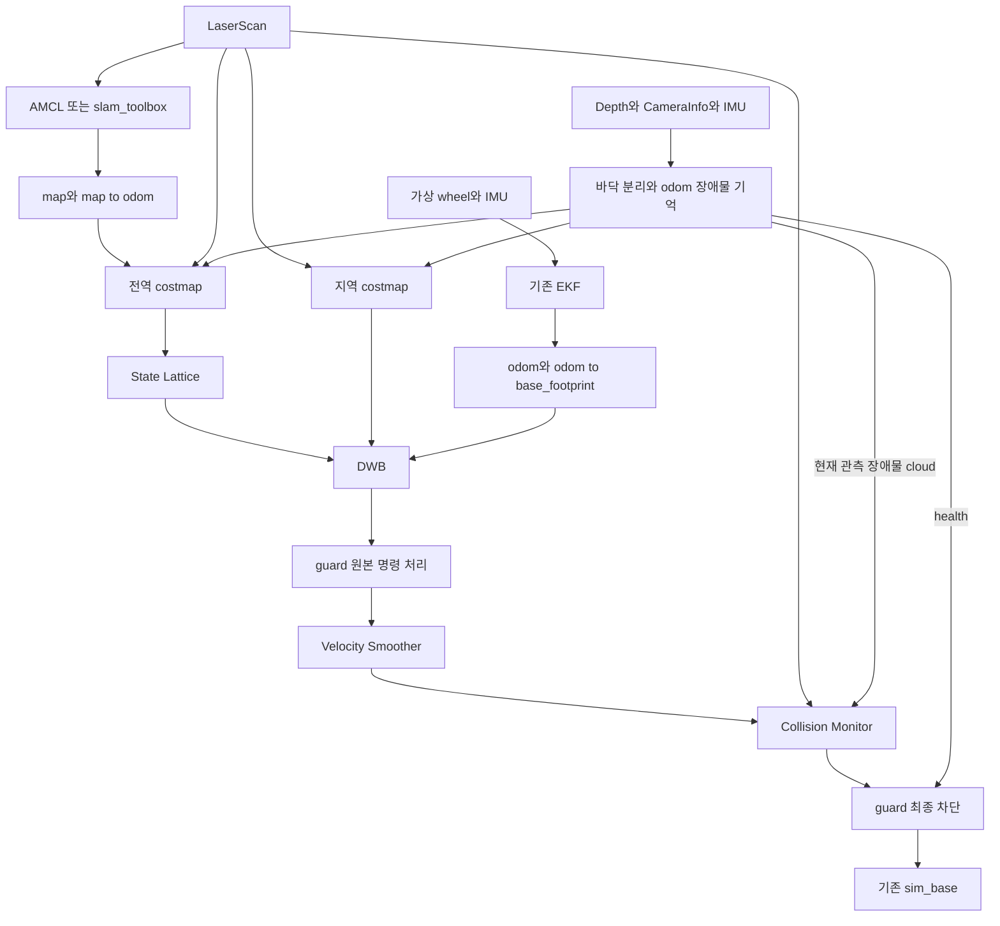

# P4 시뮬레이션 자율주행 구현 및 검증 계획

[README](../README.md) · [전체 로드맵](roadmap.md#p4-시뮬레이션-nav2와-기존-기능-이관) · [아키텍처](architecture.md) · [인수 기준](acceptance.md)

**현재 P4 완료 기준은 한 시뮬레이션 실행에서 5개 목표에 연속으로 정상 도착하는 것입니다.** 각 목표의 action 성공, 측정 정지, truth 기준 위치 오차 ≤0.15 m·yaw 오차 ≤0.20 rad를 확인하고, 같은 주행에서 충돌·명령 한도를 관측합니다. 5개를 연속 통과하면 구동 해제와 실행 정리를 마치고 종료합니다. 아래 전체 기능·실패 주입 표는 구현 계약과 선택 검증의 참조이며, 5목표 완료 뒤 추가 주행을 요구하는 완료 조건이 아닙니다.

이 문서는 State Lattice+DWB, 인지·장애물 기억, 명령 차단 경로의 구현 명세와 검증 방법을 정리합니다. P3 결과를 선행 근거로 사용하며 제공 상태는 [로드맵](roadmap.md#p4-시뮬레이션-nav2와-기존-기능-이관), 실행 절차는 [시뮬레이션 자율주행 안내](sim_navigation.md)를 따릅니다. 실행한 검사만 결과에 표시합니다.

현행 설치본에서 확인된 주행·제동 문제와 후속 리뷰의 구현 순서는 [주행·지도 콘솔 통합 수정 계획](code_review_fix_plan.md)을 따릅니다.

## 1. 범위와 완료 조건

| 구현 기능 | 기능 계약 |
| --- | --- |
| State Lattice 전역 계획 | 고정 움직임 집합, 설치 경로, 모델·해상도·방향 정보 검증; 차체 충돌 경로 거부 |
| DWB 지역 제어 | 전진·회전으로 경로 추종; 측면 속도 0; footprint 충돌 후보 거부 |
| 표준 비용지도 | static·obstacle·camera memory·inflation 레이어를 필요한 순서로 연결 |
| 목표 관리 | 도착, 취소, 정지, 새 목표, 막힌 경로의 유한한 실패 반환 |
| 명령 체인 | 원본 stamp를 보존하는 smoother·Collision Monitor·guard·sim base 연결 |
| RGB-D 인지 이관 | 낮은 장애물 감지, 시야 밖 기억, 유효한 빈 공간 재관측에 의한 삭제 |
| 관측 장애 대응 | 카메라·라이다·TF·관측 health의 이상 시 차단; 새 목표 없이 자동 재출발하지 않음 |
| 온라인 SLAM | AMCL과 배타적인 실행, 지도 갱신·폐루프·메모리 재투영 확인 |
| 실행·기록 | launch 두 모드, 사용 안내, 재현 가능한 검증기와 판정 근거 |

P4의 기존 합격 기준은 **목표 위치 오차 ≤0.15 m, yaw 오차 ≤0.20 rad, 충돌 0회, 측면 명령 0, 차체 충돌 경로·후보 거부**입니다. 결과를 보고 기준을 완화하지 않습니다.

이번 범위에 실물 구동·Orin 배치·실물 보정, 보로노이 레이어, MPPI/다른 계획기 비교, 자동 frontier 탐색, 전 공항 지도 작성, 자율 후진 recovery를 추가하지 않습니다. 공항의 32명 보행자 전체 벤치마크나 추가 실패 주입을 5목표 완료 조건에 더하지 않습니다. P1~P3의 변경 없는 통과 검사는 재사용합니다.

## 2. 확인된 개발 기준과 재사용 출처

| 항목 | 확인된 값 또는 위치 | 적용 |
| --- | --- | --- |
| 작업 저장소 | `~/MyRos/Oh_My_SLAM` | 신규 ROS 패키지·설정·문서 작성 위치 |
| ROS 환경 | ROS 2 Jazzy, `/opt/ros/jazzy` | 다른 배포판 API 혼용 금지 |
| Nav2 설치 버전 | workspace Smac `1.3.13`, Jazzy 제어기·DWB·속도 평활기·충돌 감시기 `1.3.14` | 검증 결과에 실행 바이너리와 설치 패키지 버전을 기록 |
| Smac 호환 패치 | 공식 `1.3.13` 커밋 `f4108e5b1c2bce804a1aa0c7be6673a8eb4a1501` | 연속 좌표·차체 충돌 검사, 목표 접근, Lattice 탐색을 보완한 설치본. 패키지에 원본·수정본 해시와 재현 패치를 보존 |
| SLAM | `slam_toolbox 2.8.5` | P3의 mapping/localization 패키지 재사용 |
| 빌드 방식 | isolated copy install, Release, `/usr/bin/python3` | 기존 빌드 규칙 유지; 새 셸에서 설치본 확인 |
| 구동·상태 추정 | `omslam_base`, `omslam_sim`, `omslam_localization` | 엔코더·IMU·EKF와 300 ms 원본 명령 수명 유지 |
| 로봇 모델 | `omslam_description/upstream/urdf/base.urdf` | CAD 형상·센서 장착을 변경하지 않음 |
| 기존 인지 원본 | `~/MyRos/mobile_robot_sim/src/` | 인지·메시지·메모리 레이어 3패키지 선택 이관 |
| 인지 원본 버전 근거 | 원본 디렉터리에 Git 이력 없음 | 이관 시 파일별 SHA-256, 원본 상대 경로, LICENSE 기록 |
| P3 지도·검증 | `maps/airport_p3/20261113-190348/`, `reports/sim-mapping/20261113-190348/` | 실제 SLAM 저장·복원 선행 근거로 유지 |

설치된 `nav2_bringup` 예제의 NavFn·MPPI와 기존 프로젝트의 보로노이·후진 recovery 설정은 새 설정의 출발점으로 통째 복사하지 않습니다. 인지 알고리즘과 ROS 인터페이스를 선별하여 가져옵니다.

### 2.1 ROS 2 스킬 적용 방식

- 구현과 연결 설계에는 설치된 `ros2-development` 및 공유 verification protocol을 적용합니다.
- 실제 실행 중인 QoS·TF·센서 문제를 코드로 확정할 수 없을 때만 `ros2-troubleshooting`의 해당 검사를 사용합니다. 계획서 작성 중에는 주행·하드웨어 진단을 실행하지 않습니다.
- `colcon list`로 패키지 의존 그래프를 확인하고 `--packages-up-to`로 변경 패키지와 의존성을 빌드합니다. 메시지 변경 시 소비 패키지를 함께 포함합니다.
- 빌드 실패 시 의존 검증을 중단합니다. 새 설치본 prefix·소스/설정 해시를 확인한 뒤에만 실행합니다.
- 단위 검사는 새 결과 디렉터리를 사용하고 실제 실행한 비-skipped ID를 검사합니다. 빈 `colcon test` 성공은 통과가 아닙니다.
- 구현·검증에 실제 적용한 스킬의 판단과 결과는 `docs/skill-evaluation.md`에 따라 저장소 밖 평가 기록에 남깁니다. 같은 논리 작업을 에이전트별로 중복 집계하지 않습니다.

## 3. 공식 문서를 코드로 옮기는 기준

공식 문서의 기본값은 이 로봇에 검증된 설정을 의미하지 않습니다. **Jazzy 문서 → 설치 버전의 선언·메시지·plugin XML → 생성한 설정 → 설치본 configure/activate 및 관측 결과** 순서로 확인합니다. 아래 URL은 구현자가 사용할 근거이며, 버전이 달라지면 작업 manifest에 차이를 기록합니다.

| 공식 근거 | 구현에 적용할 내용 |
| --- | --- |
| [ROS 2 Jazzy QoS 공식 원문](https://github.com/ros2/ros2_documentation/blob/jazzy/source/Concepts/Intermediate/About-Quality-of-Service-Settings.rst) | 센서 best-effort, 상태 snapshot transient-local, 명령 volatile; 실제 offered/requested 호환성 확인 |
| [ROS 2 managed nodes](https://design.ros2.org/articles/node_lifecycle.html) | configure·activate·deactivate 상태를 구분하고 준비 전 출력 차단 |
| [REP 103](https://github.com/ros-infrastructure/rep/blob/master/rep-0103.rst), [REP 105](https://github.com/ros-infrastructure/rep/blob/master/rep-0105.rst) | SI 단위, 전방 +X·좌측 +Y, optical frame, map의 보정과 odom의 연속성 구분 |
| [Smac State Lattice](https://docs.nav2.org/jazzy/configuration_and_development/configuration_guide/planners_plugins/smac/smac_lattice/configuring_smac_lattice/) | 사전 계산 움직임 집합과 costmap 해상도 일치, 후진 확장 비활성 |
| [DWB](https://docs.nav2.org/jazzy/configuration_and_development/configuration_guide/controller_plugins/dwb_controller/), [ObstacleFootprint](https://docs.nav2.org/jazzy/configuration_and_development/configuration_guide/controller_plugins/dwb_controller/trajectory_critics/obstacle_footprint/) | 운동학·샘플링·critic 설정, 사각형 footprint 검사 |
| [Velocity Smoother](https://docs.nav2.org/jazzy/configuration_and_development/configuration_guide/core_servers/configuring_velocity_smoother/) | stamped 입력, 가감속 제한, 원본 시각 보존 |
| [Collision Monitor](https://docs.nav2.org/jazzy/configuration_and_development/configuration_guide/core_servers/collision_monitor/configuring_collision_monitor_node/) | scan·PointCloud2의 직접 충돌 감시, stop/approach 영역, source timeout |
| [Lifecycle Manager](https://docs.nav2.org/jazzy/configuration_and_development/configuration_guide/core_servers/configuring_lifecycle_manager/) | node_names 순서, bond 감시, 종료 역순 |
| [Costmap plugin 작성](https://docs.nav2.org/jazzy/tutorials/plugin_tutorials/writing_new_costmap2d_plugin/writing_new_costmap2d_plugin/) | Layer API, bounds/cost 갱신, pluginlib export·설치 |
| [Nav2와 SLAM](https://docs.nav2.org/jazzy/tutorials/general_tutorials/navigation2_with_slam/navigation2_with_slam/) | 저장 지도 모드의 map_server/AMCL을 SLAM backend로 교체 |
| [Nav2 1.3.13 controller](https://github.com/ros-navigation/navigation2/blob/1.3.13/nav2_controller/src/controller_server.cpp), [smoother](https://github.com/ros-navigation/navigation2/blob/1.3.13/nav2_velocity_smoother/src/velocity_smoother.cpp), [monitor](https://github.com/ros-navigation/navigation2/blob/1.3.13/nav2_collision_monitor/src/collision_monitor_node.cpp) | 실제 header 생성·전달 및 timeout 분기 검증 |

`rclcpp` 코드는 C++로, `rclpy` 코드는 Python으로 작성합니다. launch에는 상태 확인 없는 긴 sleep 대신 서비스·TF·센서 준비 조건과 제한 시간을 사용합니다. Nav2의 planner/controller는 공식 플러그인을 사용합니다. Smac 1.3.13의 연속 좌표를 정수 셀 중심으로 바꾸는 충돌 검사에는 최소 호환 패치를 적용하며, 탐색·움직임 집합·footprint·충돌 임계값은 유지합니다.

## 4. 패키지 및 파일별 산출물

| 경로 | 구현 내용 | 끝나는 조건 |
| --- | --- | --- |
| `src/omslam_navigation/package.xml`, `setup.py`, `setup.cfg`, `resource/` | ament_python 패키지; Nav2·mapping·sim·이관 인지 의존성 선언 | 설치된 entry point·share 자산을 찾을 수 있음 |
| `src/nav2_smac_planner/` | 공식 1.3.13 원본·LICENSE·출처와 연속 좌표 보존 패치 | workspace 설치본 로드, 격자 경계 양쪽의 유효 경로와 실제 충돌 거부 |
| `omslam_navigation/navigation_guard.py` | 원본/최종 명령, health, 활성화 epoch, 새 목표, fault latch 관리 | 원본 수명·zero 우선·장애 후 재출발 차단 검사 통과 |
| `omslam_navigation/launch_support.py` | 두 모드 공통 구성을 한 곳에서 생성 | backend 중복·중복 base·중복 TF 없이 시작 |
| `launch/navigation.launch.py` | 저장 지도+AMCL+Nav2 구성 | 유효 지도와 초기 위치 없이는 구동 불가 |
| `launch/slam_navigation.launch.py` | slam_toolbox+Nav2 구성 | AMCL/map_server 없이 SLAM 지도 갱신 수신 |
| `config/nav2_common.yaml`, `config/sim_profile.yaml` | 플러그인, 비용지도, 속도·timeout·guard 설정 분리 | 모든 초기값의 출처·역할 명시, 실제 파라미터 적용 확인 |
| `config/perception.yaml` | 인지 입력 remap과 메모리 설정 | 원본 관측 시각·frame·health 계약 충족 |
| `config/lattice/diff_5cm_16h_r0p5.json`, `provenance.json` | 공식 움직임 집합 복사·해시·라이선스 | 설치본·원본·설정의 해시 일치 |
| `behavior_trees/navigate_bounded.xml` | 계획·추종·제한된 대기/재계획, 무한 recovery 배제 | 막힌 목표가 제한 시간 안에 실패 반환 |
| `test/test_navigation_guard.py` | 이번에 추가되는 구동 차단 계약 | 실제 비-skipped 필수 검사 실행 |
| `src/omm_perception_msgs/` | 기존 메시지 2개 이관 | 인터페이스와 모든 소비 패키지 함께 빌드 |
| `src/omm_perception/` | 바닥 분리·점유 기억·시각 처리 이관 및 세션 reset | 유효 관측으로만 marking/clearing |
| `src/omm_costmap_layers/` | ObstacleMemoryLayer만 이관·검증 | 전역/지역에 설치 플러그인 로드, Voronoi 등록 없음 |
| `src/omslam_sim/launch/` 및 `worlds/` | 기존 공항 기본값 유지, 시험 코스 선택 옵션 추가 | 시험 world에서도 같은 로봇·센서·base 경로 사용 |
| `tools/generate_p4_course.py`, `tools/p4_course.json` | 복합 코스·기준 지도·목표·이벤트를 단일 정의에서 생성 | 지도/SDF 좌표·크기·해시 일치 |
| `tools/verify_nav_contracts.py`, `tools/verify_sim_navigation.py` | 필수 비주행 계약 검사, 통합 주행·동시 관측·실패 원인별 재검증 | 실패/미실행을 통과로 취급하지 않음 |
| `docs/sim_navigation.md` | 빌드·시작·초기 위치·목표·정지·복구 사용법 | 실제 확인한 명령으로 갱신 |
| `README.md`, `docs/architecture.md`, `docs/acceptance.md`, `docs/roadmap.md` | 최종 인터페이스·V4 결과 반영 | P4 통과 후에만 완료 상태 표시 |

`omslam_navigation`의 의존성에는 이관 패키지와 `omslam_sim`, `omslam_mapping`을 포함하여 하나의 `--packages-up-to omslam_navigation` 빌드가 필요한 그래프를 포함하게 합니다. 신규 패키지의 LICENSE와 이관 NOTICE를 보존합니다. 원본 인지 프로젝트, 기존 지도, 실물 설정은 수정하지 않습니다.

## 5. 실행 구성과 구동 권한

### 5.1 데이터 흐름



guard는 하나의 노드 안에 원본 입력과 최종 출력 처리를 두며, planner/controller 기능은 갖지 않습니다. 최종 단계에서는 Collision Monitor 출력 그대로 전달하거나 정지/차단만 허용합니다. 속도를 올리거나 monitor의 zero를 nonzero로 바꾸지 않습니다.

### 5.2 TF와 메시지 계약

| 항목 | 계약 |
| --- | --- |
| TF | `map → odom`: AMCL 또는 slam_toolbox 하나; `odom → base_footprint`: 기존 EKF; 센서 TF: robot_state_publisher |
| `robot_base_frame` | costmap·controller·monitor·guard 모두 `base_footprint` |
| 전역/지역 frame | global=`map`, local=`odom`; 기억 원본=`odom` |
| 시간 | 모든 관련 노드 `use_sim_time=true`; 명령 만료·clock stall에는 기존 monotonic 감시도 유지 |
| `/cmd_vel/nav` | controller → guard, `TwistStamped` |
| `/cmd_vel/requested` | guard → smoother 및 base 원본 감시, 원본 stamp·frame 그대로 |
| `/cmd_vel/smoothed` | smoother → Collision Monitor, `TwistStamped`, 50 Hz 목표 |
| `/cmd_vel/monitored` | Collision Monitor → guard 최종 처리, header 보존 |
| `/cmd_vel` | guard → base 최종 입력; 발행자는 guard 하나 |
| `/sim/cmd_vel` | 기존 sim_base만 발행하는 Gazebo용 `Twist`; Nav2가 직접 발행하지 않음 |
| 명령 QoS | reliable·volatile; 자체 guard depth=1; Nav2 설치본의 endpoint depth는 기록하고 age로 검증 |
| 센서 QoS | scan/depth/CameraInfo/IMU는 SensorDataQoS와 호환되는 구독 |
| map·memory | map은 backend offered QoS와 호환; memory/health는 reliable·transient-local depth=1, 원본 observation age를 별도로 검사 |

Nav2 `1.3.13` controller는 costmap의 base frame과 명령 계산 시각을 header에 넣습니다. 따라서 `base_footprint`를 정확히 설정하며 새 stamp를 붙이는 변환 어댑터는 넣지 않습니다. smoother의 `stamp_smoothed_velocity_with_smoothing_time=false`를 명시합니다. smoother의 timeout zero는 새 stamp를 만들 수 있으므로 **최종 메시지만 보고 새 주행 의도로 인정하지 않고 원본 `/cmd_vel/requested`의 유효성을 확인**합니다.

서로 다른 DDS 토픽 사이에는 도착 순서 보장이 없습니다. base가 아직 원본을 받지 못한 final을 거부하는 것은 허용하되, 거부를 피하려고 stamp를 갱신하거나 오래된 명령을 재활성화하지 않습니다. 실제 설치 체인의 비주행 probe에서 수신 순서와 지연을 기록합니다. 지속적인 정상 명령 누락이 입증될 경우에만 1개의 짧은 pending final을 원래 deadline 안에서 매칭하는 좁은 수정과 회귀 검사를 추가합니다.

### 5.3 시작·정지·복구 상태

| 상태 | 진입 조건 및 허용 동작 |
| --- | --- |
| `DISARMED` | 기본 상태. 센서·SLAM/AMCL·Nav2 준비와 관계없이 nonzero 차단 |
| `READY` | map/TF/odom/센서/인지 health/서버 active를 확인. 아직 구동 권한 없음. 초기 준비 상한 30 s에서 실패 반환 |
| `ARMED_IDLE` | `/navigation/enable`의 `std_srvs/SetBool(data=true)` 성공. 활성화 시각 이전 명령·목표 폐기, 새 목표 대기 |
| `RUNNING` | 활성화 이후의 새 `NavigateToPose` 목표 UUID가 실행 중이며 새 stamped 명령 도착. 원본과 final 모두 유효할 때만 통과 |
| `FAULT_LATCHED` | 관측 장애·서버 실패·큰 map 보정·clock 이상. 즉시 최종 zero, 원본 전달 중지, 목표 cancel, base deactivate 요청 |
| 정상 종료·취소 | 최종 zero 및 실제 정지 확인, 현재 목표 UUID 폐기. 정상적인 새 목표는 기존 활성 세션에서 수락 가능 |

guard는 `action_msgs/GoalStatusArray`를 구독하고 비동기 cancel client를 사용합니다. 새 목표는 **이전 세션·fault에서 사용하지 않은 UUID이며 GoalInfo.stamp가 활성화 epoch 이후**여야 합니다. 시작 후 상태 확인 전의 명령은 버립니다. fault 발생 당시 UUID와 이전 명령 epoch는 복구 후에도 재사용하지 않습니다. 기존 ACCEPTED/EXECUTING/CANCELING 목표가 terminal 되기 전에는 재arm하지 않습니다. P4는 목표 하나씩 처리하며, 실행 중 다른 목표로 교체하는 preemption은 차단·취소로 처리합니다. goal ID가 없는 TwistStamped를 새 목표의 명령으로 잘못 통과시키지 않기 위한 계약입니다.

`/navigation/enable(data=false)`는 즉시 최종 zero와 원본 전달 중지 후 목표 cancel·base deactivate를 요청합니다. `true` 재요청은 기존 목표가 종료되고 관측 health가 1 s 동안 정상이며 fresh wheel feedback 및 base activate 성공을 확인한 뒤에만 성공 응답합니다. 이후 새 목표와 새 명령이 필요합니다. cancel·base lifecycle 요청은 2 s 응답 상한을 두며, timeout 시 latch를 유지하고 실패 응답합니다. 서비스 대기 중 센서·명령 처리가 막히지 않게 비동기 상태기계로 구현합니다. 데이터가 다시 들어온 사실만으로 주행을 재개하지 않습니다.

Nav2 lifecycle manager는 collision monitor·smoother·planner·controller·wait behavior·BT navigator를 관리합니다. 시작 순서는 하위 출력 경로를 먼저 준비하고 BT navigator를 마지막에 활성화합니다. base lifecycle은 guard가 별도로 관리합니다. **시작 시 base는 configure까지만 수행**하여 wheel feedback과 EKF 준비를 가능하게 하고, enable 전에는 activate하지 않습니다. AMCL/map_server의 기존 manager와 SLAM 모드 잠금은 재사용합니다. 초기값은 `bond_timeout=4.0 s`, 자동 respawn·자동 재연결 비활성입니다. bond timeout은 300 ms 명령 watchdog을 대체하지 않습니다.

### 5.4 하위 launch 인자 격리

부모의 `nav2_params_file`과 `backend_params_file`을 분리합니다. P3 include에는 `params_file`로 선택한 **AMCL 또는 mapping YAML 경로를 반드시 명시 전달**합니다. 이름이 같은 전역 LaunchConfiguration 때문에 Nav2 YAML이 P3 backend 설정으로 흘러들지 않게 합니다. `spawn_x/y/yaw`는 sim child의 `x/y/yaw`로, `initial_x/y/yaw`는 AMCL child의 `x/y/yaw`로 각각 전달합니다. IncludeLaunchDescription은 scope를 분리하고 사용 인자를 모두 명시합니다.

`omslam_sim`에는 `world` 선택과 SDF의 world 이름을 일치시키는 최소 변경을 합니다. 기존 `-world airport`와 world별 clock bridge 경로는 선택된 이름으로 생성하고 기본 airport 동작은 유지합니다. 시험 world에서도 description·센서 bridge·EKF·sim_base는 동일 경로를 사용합니다.

## 6. 초기 설정과 변경 규칙

다음은 이번 시뮬레이션 구현의 명시적인 초기값입니다. 실제 주행 성능이 확정된 값으로 표시하지 않습니다. 조정 시 변경 이유와 영향받는 검사만 기록하며 위치·방향·충돌 합격 기준은 유지합니다. 나열하지 않은 Nav2 내부 파라미터는 고정한 1.3.13의 기본값을 사용하고, 실제 적용된 전체 파라미터 dump를 manifest와 함께 보존합니다. 다른 버전의 예제에서 값을 조용히 가져오지 않습니다.

### 6.1 기하와 움직임 집합

| 항목 | 값 |
| --- | --- |
| 바퀴 반경·윤거 | `r=0.068 m`, `b=0.480 m` |
| 원본 footprint | `[[0.09,0.26],[0.09,-0.26],[-0.39,-0.26],[-0.39,0.26]]` m |
| footprint padding | `0.02 m`; 전역·지역 동일, 중복으로 더하지 않음 |
| 검증 | 차체·바퀴·센서 collision과 캐스터 전체 회전 envelope를 XY에 투영하여 footprint 포함 여부 확인 |
| 움직임 모델 | `diff`, 0.05 m 격자, 16개 heading, 0.5 m 곡선 반경, 112개 primitive |
| heading 사용 | JSON의 `heading_angles` 그대로 사용; 균등한 22.5°라고 가정하지 않음 |
| 집합 원본 | `/opt/ros/jazzy/share/nav2_smac_planner/sample_primitives/5cm_resolution/0.5m_turning_radius/diff/output.json` |
| 확인한 SHA-256 | `105b37351d15e340cc2921fa8878c8ea727a65cd7e89c39c977be0654be3b2a9` |
| 설치 경로 | 패키지 share의 `config/lattice/diff_5cm_16h_r0p5.json`; launch에서 절대 경로로 해석 |
| 후진 | `allow_reverse_expansion=false`, DWB `min_vel_x=0.0`; 제자리 회전은 허용 |

현재 CAD collision 기준 가장 뒤쪽 캐스터의 회전 외곽은 보수 계산으로 약 −0.382 m이며, 기존 −0.39 m 경계 안에 있습니다. 정적 형상 검사를 실행해 최종 확인하되 실제 로봇 외곽을 검증했다고 표시하지 않습니다.

### 6.2 계획·제어·비용지도

| 구성 | 초기값과 적용 |
| --- | --- |
| planner | ID `GridBased`, `nav2_smac_planner::SmacPlannerLattice` |
| planner 제한 | `allow_unknown=false`, `tolerance=0.04 m`, `max_planning_time=2.0 s`, `cache_obstacle_heuristic=false` |
| 경로 후처리 | `smooth_path=true`인 Smac 내장 후처리만 사용; 별도 smoother server 추가하지 않음. 최종 경로도 footprint 충돌 검사 |
| controller | ID `FollowPath`, `dwb_core::DWBLocalPlanner`, 20 Hz |
| 속도 | `0≤vx≤0.249233 m/s`, `vy=0`, `abs(wz)≤0.50 rad/s` |
| 가감속 | `ax=0.25 m/s²`, 감속 `−0.50 m/s²`, `aθ=0.60 rad/s²`, 각감속 `−1.00 rad/s²` |
| DWB 샘플 | `vx_samples=20`, `vy_samples=1`, `vtheta_samples=20`. 기본 예측은 1.7초이며, 저속에서는 허용 선속도로 지역 비용지도 두 셀(0.10 m)을 비교할 시간까지 연장한다. 병진·회전 표본 간격은 0.025 m와 0.025 rad이다. |
| DWB 최소 속도 | `min_speed_xy=0`, `min_speed_theta=0`; 작은 속도를 임의의 최소 RPM으로 증폭하지 않음 |
| critics | `ObstacleFootprint`, `RotateToGoal`, `Oscillation`, `GoalAlign`, `PathAlign`, `PathDist`, `GoalDist` |
| 초기 critic scale | `ObstacleFootprint=1`, `RotateToGoal=32`, `Oscillation=1`, `GoalAlign=24`, `PathAlign=32`, `PathDist=32`, `GoalDist=24`; 충돌 거부를 비용 가중치로 무력화하지 않음 |
| goal checker | `nav2_controller::StoppedGoalChecker`, `stateful=false`. 매 주기에 원래 목표와의 거리 0.08 m, 방향 오차 0.15 rad, 측정 병진 속도 0.01 m/s, 회전 속도 0.02 rad/s를 함께 확인한다. |
| DWB 목표 정지 | `xy_goal_tolerance=0.10 m`, `trans_stopped_velocity=0.01 m/s`, `RotateToGoal.slowing_factor=5.0`, `RotateToGoal.lookahead_time=−1.0` |
| progress checker | `omslam_navigation::SpeedAwareProgressChecker`. 10초 동안 이동 0.10 m 또는 회전 0.10 rad를 요구한다. 콘솔에서 속도를 제한하면 각 기준은 승인된 해당 속도로 5초간 이동·회전할 수 있는 양까지 낮아진다. |
| controller 실패 | `failure_tolerance=0.3 s`, 비용지도 update timeout `0.3 s` |
| 전역 costmap | `map`, 0.05 m, update 2 Hz/publish 1 Hz, unknown 유지 |
| 지역 costmap | `odom`, rolling `6×6 m`, 0.05 m, update 10 Hz/publish 5 Hz |
| 레이어 | 전역: static→obstacle→camera memory→inflation; 지역: obstacle→camera memory→inflation |
| lidar obstacle | scan marking/clearing, obstacle 최대 8 m, raytrace 최대 10 m, 최소 0.15 m; 카메라 메모리는 라이다 clearing으로 삭제하지 않음 |
| inflation | radius `0.55 m`, cost scaling `3.0`; 통과폭 확보는 footprint로 판정, inflation을 물리 차체 크기로 오인하지 않음 |

선속도·각속도를 동시에 상한으로 사용하면 기구학적 바깥 바퀴 목표가 35 RPM을 넘을 수 있으므로 base가 좌우 비율을 유지해 제한합니다. 최종 바퀴별 명령이 **시뮬레이션 운용 상한 35 RPM 이하**인지 별도로 확인합니다. 위 속도와 가속도는 시뮬레이션 초기 프로파일이며 P5의 실측 한도를 대체하지 않습니다.

적용 프로파일의 `ObstacleFootprint.scale`은 **0.02**입니다. 이 critic의 실효 가중치는 `resolution × scale`이며, MapGrid 기반 경로·목표 거리 critic은 `0.5 × resolution × scale`을 사용합니다. 최대 inflation 비용과 격자 거리의 평가 균형을 맞춰 합법적인 목표 접근이 정지보다 유리하도록 설정합니다. lethal/unknown 셀은 양수 가중치를 곱하기 전에 예외로 후보를 거부합니다. 이 조정의 영향은 통합 주행의 도착·통로·장애물 구간과 V4-03/V4-05로 검증합니다. [Nav2 1.3.13 footprint 검사](https://github.com/ros-navigation/navigation2/blob/1.3.13/nav2_dwb_controller/dwb_critics/src/obstacle_footprint.cpp), [critic 비용 합산](https://github.com/ros-navigation/navigation2/blob/1.3.13/nav2_dwb_controller/dwb_core/src/dwb_local_planner.cpp)

### 6.3 속도 체인·장애물 감시·시간

| 구성 | 초기값과 판정 |
| --- | --- |
| stamped | controller/smoother/monitor에 `enable_stamped_cmd_vel=true` |
| smoother | 50 Hz, `OPEN_LOOP`, `scale_velocities=true`, 위 속도·가감속, deadband `[0,0,0]`, `velocity_timeout=0.30 s`, stamp 재생성 옵션 false |
| 원본 명령 수명 | 기존 `300 ms` 유지; 같은 stamp로 출력할 때 deadline 연장 금지 |
| guard | 50 Hz steady timer; 원본 stamp와 monotonic age 모두 검사; 관측 fault를 판정한 후 0.10 s 이내 차단 목표 |
| sensor freshness | scan·depth observation·health transport 각 `0.30 s`; EKF odom `0.20 s`; 기존 wheel stale `0.40 s` 유지 |
| TF | 관측 timestamp에 lookup; map→odom 수신 공백 0.50 s 초과 시 차단. AMCL의 기존 미래 유효 stamp 1.0 s를 허용하며 그 값을 sensor observation 시각으로 쓰지 않음 |
| transform tolerance | 초기 `0.20 s`; 의미 없는 큰 값으로 TF 오류를 숨기지 않음 |
| Collision Monitor 입력 | `/scan`, 현재 관측의 `/perception/obstacles`; memory cloud의 갱신 시각을 센서 freshness로 사용하지 않음 |
| monitor stop 영역 | padded 차체 경계에 전방 여유 0.20 m 추가: x `[−0.41,0.31]`, y `±0.28` m; `min_points=1` |
| monitor approach | 동일 padded footprint, `time_before_collision=1.5 s`, simulation step `0.05 s`, `min_points=1` |
| monitor | `source_timeout=0.30 s`, `stop_pub_timeout=1.0 s`, state topic `/collision_monitor_state` |
| 정지 측정 | 최종 zero 후 측정 `abs(vx)≤0.01 m/s`, `abs(wz)≤0.02 rad/s`가 0.30 s 지속; 1.0 s 안에 정지 완료 |

전방 여유는 초기 `0.20 m/s`와 감속 `0.50 m/s²`에서 반응 지연 중 이동거리와 `v²/(2a)=0.04 m`, 격자·관측 여유를 포함하도록 정한 시뮬레이션 시작값입니다. 실제 stop 거리와 최소 여유는 주행 기록으로 확인합니다. Collision Monitor의 zero와 guard fault zero에는 정상 가감속 제한을 적용하여 정지 출력을 늦추지 않습니다. 물리 모델의 감속 때문에 차체는 즉시 정지하지 않을 수 있으므로 명령 차단과 차체 정지를 별도로 판정합니다.

### 6.4 목표 실패와 BT

`ComputePathToPose`와 `FollowPath`를 사용하는 표준 BT 노드로 구성하고 경로 갱신은 1 Hz로 시작합니다. 실패 시 **정지→2 s 대기→재계획 1회→실패 반환**으로 제한합니다. 각 하위 recovery가 서로 중첩돼 횟수가 늘어나지 않게 XML 전체에서 재시도 예산을 하나로 관리합니다. Backup·Spin recovery와 무조건적인 costmap 전체 삭제는 넣지 않습니다. DWB의 정상 목표 방향 정합용 제자리 회전은 recovery와 구분합니다.

막힌 경로는 장애가 비용지도에 반영된 시각부터 **30 s 이내 ABORTED**가 기준입니다. 검사기가 timeout 후 목표를 취소해 얻은 CANCELED 결과를 정상 실패 반환으로 인정하지 않습니다. 원거리 목표의 일반 실행 상한은 시나리오 목표별 120 s이며, 이를 넘으면 timeout 실패로 기록합니다.

## 7. 인지·장애물 기억 이관

### 7.1 보존할 알고리즘과 수정 범위

`omm_perception`의 `ground.cpp`, `tracker.cpp`, `memory.cpp`, `obstacle_memory_node.cpp`, 기존 geometry/memory 단위 검사를 선택 이관합니다. C++17, Eigen3, OpenCV, SQLite3, cv_bridge, TF2 의존성을 명시합니다. `omm_costmap_layers`의 CMake와 plugin XML에서는 Voronoi source·등록을 제외하고 `ObstacleMemoryLayer`만 설치합니다.

| 입력·출력 | 새 연결 및 판정 |
| --- | --- |
| depth | `/camera/depth/image_rect_raw`; `32FC1`=m, `16UC1`=mm×0.001 |
| intrinsics | `/camera/depth/camera_info`; 영상 크기·optical frame·유효 K 검증 |
| IMU | `/imu/data`; sim의 유효 orientation을 사용, 영상 시각 전후 50 ms 안에서 보간 |
| raw obstacle | `/perception/obstacles`, PointCloud2, `base_footprint`, 원본 관측 stamp |
| memory | `/perception/memory`, `odom`, snapshot stamp와 observation_stamp 분리 |
| health | `/perception/health`, sensor/geometry/memory 모두 true이고 원본 관측이 fresh일 때만 구동 허용 |

실물 HFI-A9 gyro 입력의 `orientation_covariance[0]=-1`은 인지에 필요한 자세가 없다는 뜻입니다. 이 P4 sim 설정을 실물에 그대로 적용하지 않으며 P5에서 카메라 IMU 등 유효 자세 공급원을 따로 확인합니다.

### 7.2 메모리 초기 설정

`memory_frame=odom`, voxel `0.05 m`, max voxels `100000`, active radius `6 m`, archive cells `4096`, 높이 `[0.02,0.30] m`, depth `[0.12,5.0] m`, pixel stride `2`, free frames `5`, clear margin `0.10 m`, ground slope 상한 `0.35 rad`, `require_imu=true`로 시작합니다. 인지 node·layer의 sensor timeout은 guard와 일치하게 `0.30 s`로 명시합니다. memory layer의 점유 padding `0.06 m`는 footprint padding과 다른 관측 불확실성 값이며 따로 기록합니다.

적용 시뮬레이션 프로파일은 전역·지역 `camera_memory.padding=0.01 m`를 사용합니다. layer는 관측 padding에 voxel 반폭 `0.025 m`와 격자 셀 교차 여유 `0.025 m`를 더하므로, 관측점에서 셀 중심까지의 표식 반경은 `0.06 m`입니다. 관측 여유 `0.01 m`는 시뮬레이션 벽 점군에서 확인한 최대 안쪽 편차 `0.0057 m`를 포함합니다. 실제 점유 범위는 셀 경계까지 확장되며 전역·지역 격자의 위치에 따라 달라지므로, 반경 계산만으로 통로 통과를 판정하지 않습니다. 이 값은 시뮬레이션 관측과 costmap 셀을 대조한 설정이며, 실물 센서 보정값이 아닙니다. 차체 형상·통로·충돌 기준을 유지하고 통로 주행과 낮은 장애물 반영·우회를 통합 검증합니다.

추적기는 높이 범위가 0.20 m를 넘고 수평 두께가 0.06 m 미만인 얇은 수직면에 기존 법선 방향 이동 조건을 적용합니다. 높이 판정은 0.02~0.30 m로 잘린 입력에서 동작하도록 정하며, 로봇 이동으로 벽의 가시 조각 중심만 벽을 따라 이동하는 경우를 동적 장애물로 승격하지 않습니다. 0.10 m 낮은 상자의 실제 이동은 이 벽 조건에 포함되지 않습니다.

1. 실제로 관측한 장애물만 mark합니다. 라이다보다 낮은 `0.10 m` 상자는 RGB-D를 통해서만 감지하도록 정적 지도에서 제외합니다.
2. 시야 밖·가림·NaN/0 depth는 빈 공간 증거가 아닙니다. 단순 시간 경과 또는 Nav2 clear 요청으로 기억을 지우지 않습니다.
3. 장애물 제거 후 해당 위치를 유효한 빈 공간으로 연속 5 frame 관측하고 기존 최소 0.2 s 조건까지 만족해야 삭제합니다.
4. 기존 `isClearable=false`, costmap `reset()`으로 관측 근거를 지우지 않는 동작을 유지합니다.
5. 세션 종료·clock 역행 시 pending depth, IMU history, tracker, 원본 시각, SQLite 세션을 함께 정리합니다. 이전 세션 snapshot을 새 관측으로 인정하지 않습니다.
6. 자기 차체 제외 mask는 기존 `x∈(−0.46,0.15), |y|<0.32`의 실제 제외 범위를 분석합니다. 차체 외부까지 지워지는 부분은 CAD 형상+0.01 m 범위로 줄여 외부의 낮은 상자를 숨기지 않게 합니다. 바퀴·캐스터 형상도 포함합니다.
7. 포인트·archive 전체를 매번 무제한 기록하지 않습니다. active cap에 도달하면 기존 정상 archive 동작을 유지합니다. archive/DB 쓰기 실패 또는 점유 보존을 보장할 수 없는 hard resource 초과는 `memory_healthy=false`와 차단으로 연결합니다. 단순 active→archive 이동을 고장으로 취급하지 않습니다.

## 8. 온라인 SLAM과 메모리 좌표 보정

저장 지도 모드는 P3 AMCL launch를, 온라인 모드는 P3 mapping launch를 include합니다. `ModeGuard`를 재사용해 AMCL과 SLAM이 동시에 `map → odom`을 발행하지 못하게 합니다. 온라인에서는 관측된 자유 공간 안의 목표만 수락하고 unknown을 가로지르는 탐색 목표는 보내지 않습니다.

장애물 원본은 연속적인 `odom` frame에 저장합니다. 전역 costmap은 갱신 때 최신 `map ← odom`으로 기억을 재투영하고 **이전 위치와 새 위치의 bounds를 모두 갱신**하여 유령 장애물이 남지 않게 합니다. 지역 costmap은 odom 기억을 그대로 사용합니다. 이는 과거 모든 관측을 SLAM graph에 붙여 재최적화하는 기능이 아닙니다.

| 상황 | P4 정책 |
| --- | --- |
| 작은 map 보정 | 재투영 후 새 비용지도에서 경로 유효성을 확인하고 재계획 |
| 연속 TF 표본 간 보정이 `0.10 m` 또는 `0.10 rad` 이상 | guard fault latch, zero·cancel, 세션 재초기화 요구; 자동 재출발 금지 |
| 큰 보정 후 메모리 | 기존 점유를 빈 공간으로 삭제하지 않고 보존. 새 세션 재초기화 또는 명시적인 재관측 절차 전까지 구동 차단 |
| TF 누락·과거 관측 TF 불가 | 해당 관측을 버리고 layer non-current 및 health 불량 처리; 최신 시각으로 바꿔서 살리지 않음 |
| clock 역행·새 실행 세션 | 구동 비활성, 시간 버퍼·세션 상태 초기화, 새 관측과 새 목표 요구 |

`PerceptionHealth.geometry_healthy`는 바닥 평면 추정 유효성입니다. map 보정 뒤 누적 기억의 정합성을 검증하는 플래그가 아니므로 이 값만으로 큰 보정 latch를 해제하지 않습니다. 큰 보정 이후의 전역 장애물 메모리 재구축 자동화는 P4에 추가하지 않습니다. P4에서 제공할 복구 절차는 **정지 상태에서 해당 모드를 종료하고 새 세션에서 초기 위치/새 관측을 확인한 뒤 다시 활성화**하는 것입니다. 과거 메모리를 이어받은 것으로 표시하지 않습니다. 작은 자연 loop closure와 큰 보정 차단은 별개의 검사로 판정합니다.

비주행 합성 TF 검사에서는 작은 `0.05 m`·`0.05 rad` 보정의 재투영과 큰 `0.20 m`·`0.20 rad` 보정의 차단을 모두 확인합니다. jump 감시는 READY 이전의 초기 TF 정합에는 적용하지 않고 활성 세션에서 시작합니다. 실제 SLAM 주행에서 특정 크기의 jump가 나오지 않았다고 이를 만들기 위한 추가 주행을 수행하지 않습니다. 합성 주입을 실제 loop closure로 보고하지 않습니다.

## 9. 구현 작업 순서와 담당 분리

작업자는 각 묶음의 산출물과 다음 단계 진입 조건을 확인하고 이동합니다. 여러 에이전트가 같은 파일을 동시에 수정하거나 같은 시험을 중복 실행하지 않습니다.

| 작업 | 입력과 구체적 수행 | 산출물·다음 단계 조건 | 담당 |
| --- | --- | --- | --- |
| W0 기준 고정 | AGENTS·스킬·P3 보고서 확인, 설치 버전·package graph·소스/설정 해시 수집 | 작업 manifest, P4 범위·인수표 확정 | 주 담당 |
| W1 자산·코스 | lattice 출처·해시 고정, CAD footprint 대조, 복합코스 SDF/지도/이벤트 생성 | 일치하는 fixture·지도·목표 파일, 설치 자산 목록 | 독립 자산 담당 |
| W2 인지 이관 | 3패키지 선택 복사, topic/frame/시각 remap, health·session reset·self mask·레이어 좌표 갱신 | 인지 API·메모리 정책 구현, 출처·라이선스 | 독립 인지 담당 |
| W3 기본 Nav2 | State Lattice+DWB·비용지도·checker·BT·smoother·monitor 구성 | `omslam_navigation` 설정·launch | 주 담당 |
| W4 권한·두 모드 | guard 상태기계, 원본/final 매칭, cancel·재arm, P3 모드 include, map 보정 차단 연결 | 전체 데이터 경로 연결, 단일 TF/명령 발행 책임 | 주 담당 |
| W5 검사기 | 통합 event trigger, fault relay, 센서·Nav2·구동 동시 관측, truth 전용 판정, 보고서·실행 ledger 구현 | 한 실행에서 전체 필수 증거 수집, 실패 구간 재검증 가능 | 검증 담당 |
| W6 단일 사전 검증 | 의존 빌드, 선택 단위 검사, nonempty 검사, 필요한 경계 조건 probe | 비주행 필수 항목 PASS; 실제 실행 준비는 I0에 통합 | 검증 담당 |
| W7 통합 주행 | §12 통합 경로에서 모든 관측기를 함께 실행. 문제 발생 시 원인 분리·수정·관련 구간 재검증을 반복 | 실제 결함 해결 및 필수 증거 확보 시 즉시 종료; 횟수 조건 없음 | 검증 담당 단독 |
| W8 결과·문서 | 판정표·실행 안내·skill 평가 갱신, 잔존 process 정리, 최종 diff 확인 | V4 완료 또는 구체적인 미해결 항목 보고 | 주 담당 |

W1·W2·W5의 읽기/독립 파일 작업은 병행할 수 있습니다. W3은 그 인터페이스가 정해지면 진행하고 W4에서 합칩니다. **빌드·주행·대규모 검증은 하나의 검증 담당에 위임**하여 중복 실행과 결과 혼합을 막습니다. W6 이후 제품 소스를 동결합니다. 수정이 필요하면 수정한 파일과 영향받은 검사 ID를 기록하고 관련 검사만 다시 실행합니다.

## 10. 주행 전에 끝낼 한 묶음의 비주행 검증 P0

이 절의 P0는 전체 프로젝트 단계 P0가 아니라 **P4 사전 검사 묶음 ID**입니다. 빌드·정적 검사와 주행만으로 확인할 수 없는 코드 경계 조건을 한 묶음으로 확인합니다. 실제 plugin 로딩·센서 수신·파라미터 적용은 통합 실행의 시작 구간에서 함께 확인하고, 같은 내용을 별도 ROS 실행으로 다시 검사하지 않습니다. 주행 중 확인 가능한 정상 센서·Nav2·구동 동작을 사전 검사와 본 주행에 중복 배치하지 않습니다.

| ID | 확인 방법 | 통과 근거 |
| --- | --- | --- |
| P0.1 | 새 빌드 후 prefix·자산·plugin XML·shared library 확인 | target 패키지가 이번 install을 가리키고 모든 YAML/XML/JSON 설치됨 |
| P0.2 | fixture 생성 결과와 URDF collision·lattice JSON 정적 검사 | 해상도 0.05 m, diff/16 heading/112 primitives, footprint 포함, SDF와 map 좌표 일치 |
| P0.3 | 통합 실행의 이동 전 configure/activate·파라미터 확인으로 충족 | 실제 State Lattice/DWB/ObstacleMemoryLayer 로드; 별도 로딩 시험 반복 없음 |
| P0.4 | 정상 stamp/frame은 통합 주행에서 추적; 자연 주행으로 재현되지 않는 timeout zero·순서 역전만 출력 sink 검사 | 원본 수명·zero 우선·새 의도 오인 방지; 같은 정상 체인 이중 검증 없음 |
| P0.5 | guard의 허위 health·stale 관측·future stamp·순서 역전·새 epoch 조건 | 새 의도 없는 재출발 0회; fault latch와 취소 요청 검증 |
| P0.6 | 기존 memory/geometry 검사에 필요한 변경 검사만 추가 | 유효 5 frame clearing, invalid/FOV 밖 유지, 재투영·이전 footprint 제거, 큰 jump 차단, clock reset |
| P0.7 | center는 free지만 footprint가 겹치는 고정 costmap에서 실제 플러그인 호출 | planner 경로 거부, DWB 해당 candidate 불법 판정; 단순 YAML 문자열 검사가 아님 |
| P0.8 | BT 로드·실패 action fixture·guard enable/disable | 재시도 횟수 제한, 취소 전파, stale goal UUID 거부 |

합성 입력이 필요한 P0.4~P0.8의 비주행 검사는 **시험용 ROS domain과 출력 sink**로 격리하며 실제 `/sim/cmd_vel`, USB, MCU에는 연결하지 않습니다. P1의 CRC·MCU 전체 고장 조합은 반복하지 않습니다. 카메라 이미지 실제 형식·TF·IMU orientation·관측 health는 통합 실행 시작 직후 **base 비활성 상태**에서 한 번 관측하고, 그 관측기를 그대로 주행 끝까지 유지합니다. 이동 전 필수 준비 조건이 실패하면 이동하지 않습니다.

### 10.1 최소 검사 ID

- `omslam_navigation::test_original_stamp_and_timeout_chain`: 정상 원본, 반복 평활 출력, final 도착 순서, timeout을 한 시퀀스로 확인합니다.
- `omslam_navigation::test_fault_latch_cancel_and_new_epoch`: sensor fault, zero, 이전 goal/명령 거부, 새 활성화와 새 목표를 한 시퀀스로 확인합니다.
- `omslam_navigation::test_map_correction_gate`: 작은 보정과 큰 보정·clock 역행의 상태 변화를 확인합니다.
- `omm_perception`의 기존 `test_memory`, `test_geometry`: 이관으로 실제 달라지는 frame/시각/reset/자기 차체 처리를 포함합니다. 무관한 별도 테스트군은 만들지 않습니다. `Tracking.ClippedWallWindowDoesNotPredictCorridorOccupancy`는 잘린 벽의 가시 조각 이동과 실제 낮은 장애물 이동을 구분합니다.
- `omm_costmap_layers::test_memory_layer_projection`: 전역/지역 투영, 이전 위치 정리, 불량 health의 non-current, ordinary clear로 기억 보존을 한 fixture에서 확인합니다.

Python 검사는 pytest를 명시합니다. C++ 검사는 CTest wrapper뿐 아니라 내부 GTest의 실제 수행을 확인합니다. `omm_perception_msgs`처럼 실행 로직이 없는 interface 패키지에는 억지로 빈 테스트를 만들지 않고 생성·import·소비 패키지 빌드로 확인합니다.

## 11. 한 복합 코스로 구성하는 시험 환경

기존 공항의 기본 실행과 센서 모델은 유지합니다. 기능 인수에는 공항 통로의 필요한 형상을 모은 **12×10 m 복합 시험 world 하나**를 사용합니다. 매 케이스마다 다른 world를 띄우지 않습니다. `p4_course.json`에서 SDF·기준 지도·목표·장애물 이벤트를 함께 생성합니다.

### 11.1 좌표와 형상

기준 frame의 내부 영역은 x=`[−1,11]`, y=`[−1,9]` m입니다. 시작 pose는 `(0,0,0)`이며 world 경계벽 높이는 1.2 m, 두께 0.1 m입니다. 아래 직사각형은 벽의 안쪽 또는 장애물의 실제 차지 범위를 뜻하며 생성기에서 중복 padding을 넣지 않습니다.

| 구역 | 형상·좌표 | 확인할 의미 |
| --- | --- | --- |
| 출발·정지 | `(0,0)` 주변의 1.3 m 이상 회전 공간 | 초기 위치, 준비 전 차단, cancel·재출발 |
| 좁은 통로 | x=`[1.5,3.5]`, free y=`[−0.40,0.40]`; 위 벽 y=`[0.40,0.50]`, 아래 벽 y=`[−0.50,−0.40]` | 폭 0.80 m 통과; padded 폭 0.56 m와 비교 |
| 중앙 장애물 | x=`[1,4]`, y=`[1,3]`, 높이 1.2 m | L자 코너 및 폐루프; 중간을 가로지르는 지름길 방지 |
| 회전 지점 | `(5,0)`에서 목표 yaw `π/2` | 이동과 별개의 최종 방향 정합 |
| 낮은 상자 | A: 중심 `(5,2)`, `0.30×0.30×0.10 m`; B: 중심 `(0.8,4)`, 같은 크기 | A로 우회·FOV 밖 기억·삭제 확인; B는 폐루프 재투영까지 유지 |
| 불가능한 좁은 가지 | x=`[7,10]`, free y=`[0.75,1.25]`; 끝벽 x=10, 좌우벽 높이 1.2 m | 폭 0.50 m, 중심은 free여도 차체는 진입 불가 |
| 차단 가능한 가지 | x=`[6,10]`, free y=`[3.55,4.45]`, 끝벽 x=10; x=7의 gate | 계획 후 경로가 막혔을 때 재계획·유한 실패 |
| 동적 장애물 | `(4.0,3.4)`→`(4.0,4.8)`를 +Y 방향 0.15 m/s로 횡단하는 `0.30×0.30×0.50 m` 상자 | monitor 감속/정지 후 장애물 소거; 라이다와 카메라 모두 관측 |
| 복귀 | `(5,4)→(0,4)→(0,0)` | 폐루프 재방문·지도 정합 |

폭 0.50 m의 가지는 통과를 시도해 접촉을 확인하는 시험이 아닙니다. planner와 controller가 충돌 가능한 목표·경로를 거부하는지 관측합니다. 주행 중 truth 기준 최소 여유가 0.03 m 미만으로 예상되면 검사기는 즉시 정지하고 해당 항목을 FAIL로 남깁니다. 검사기 정지를 제품 자체의 회피 성공으로 인정하지 않습니다.

생성기는 중심 장애물과 통로 벽의 배치가 위·아래로 더 쉬운 우회로를 만들지 않는지, 각 목표의 footprint와 회전 영역이 유효한지 확인합니다. geometry 검증이 실패하면 **주행 전에 코스 정의를 수정하고 해시를 고정**합니다. 검사 기준이나 로봇 footprint를 줄여 통과시키지 않습니다.

### 11.2 기준 지도와 truth의 역할

정적 벽 geometry로 생성한 0.05 m 기준 지도는 **비주행 플러그인 검사와 코스 기하 대조용 fixture**입니다. 실제 SLAM 지도라고 보고하지 않습니다. 낮은 상자, 이동 장애물, 닫히는 gate는 이 지도에 미리 넣지 않습니다.

기본 통합 경로는 **온라인 SLAM으로 지도 작성과 Nav2·인지·센서·구동 검증을 동시에 수행**합니다. 폐루프 뒤 실제 생성한 지도를 저장하고, 정지 상태에서 AMCL 모드로 전환하여 짧은 목표 구간으로 저장 지도 주행 연결을 확인합니다. 저장 지도 시험을 위해 별도 mapping 주행을 추가하거나 같은 코스 전체를 다시 주행하지 않습니다. AMCL과 SLAM은 같은 TF를 소유하므로 동시에 실행하지 않으며, 필요한 모드별 근거는 같은 통합 작업 안의 전환 전후 구간으로 구분합니다.

`sim_world↔map` 정합은 초기 알려진 spawn/초기화 관계로 한 번 고정하고 끝점 오차를 줄이려고 매 프레임 또는 종료 시 재정합하지 않습니다. AMCL 전환 후에는 같은 저장 지도 좌표계를 유지합니다. truth는 **목표 오차·충돌·정지 거리 판정용**으로만 구독합니다. EKF·SLAM·AMCL·Nav2에 live truth pose를 공급하지 않습니다.

장애물 삽입·제거 시점은 단순 경과시간보다 **로봇이 지정 영역 도달·계획 수신·관측 완료** 이벤트로 고정합니다. 렌더링 속도나 real-time factor가 변해도 같은 상황을 만들기 위해서입니다. 이벤트에는 발동 조건, 실행 시각, 완료 확인, 실패 timeout을 함께 기록합니다.

## 12. 통합 주행 시나리오와 동시 판정

**기본값은 한 번의 통합 경로에서 필요한 검증을 함께 끝내는 것입니다.** 아래 I0~I15는 별개의 시험 주행이 아니라 한 실행 안의 이벤트입니다. 라이다 검사, IMU 검사, Nav2 검사, 주행 검사를 각각 독립 주행으로 실행하지 않습니다. 모든 관측기를 처음부터 함께 켜고 같은 시간축·목표 UUID·소스 해시를 기준으로 판정합니다.

온라인 SLAM과 AMCL은 배타적인 backend이므로 정지 상태의 모드 전환만 분리합니다. 검증기는 simulator·로봇·센서를 유지한 채 backend/Nav2를 전환하고, 저장 지도 연결에 필요한 짧은 이동만 이어갑니다. 전체 코스를 모드별로 반복하지 않습니다. 실제로 발생한 주행·정지·모드 전환·재시작은 모두 기록하며, 실행 묶음의 이름으로 실제 반복을 숨기지 않습니다.

### 12.1 모든 주행 구간에서 동시에 관측할 항목

| 관측 대상 | 같은 주행에서 수집·판정할 내용 | 별도 주행 없이 얻는 근거 |
| --- | --- | --- |
| 라이다 | scan frame·stamp·age·실제 수신 주기·긴 gap·유효 range·TF·QoS 호환 | 직선·코너·장애물 구간의 scan과 지도/비용지도 반영, scan 중단 이벤트 |
| IMU | raw/처리 후 stamp·frame·유효 quaternion·각속도·수신 gap, 회전 부호·EKF 입력 | 시작/중간 정지 구간과 기존 방향 전환을 이용; IMU만 보려고 추가 회전하지 않음 |
| wheel·EKF·TF | 측정 odom 연속성·age·frame, wheel/IMU와 추정 변화, TF authority·lookup 실패 | 같은 직선·회전·정지 기록; truth는 독립 판정에만 사용 |
| 카메라·인지 | depth 단위·CameraInfo·관측 age, 바닥 분리·점유·FOV 밖 기억·유효 free 삭제 | 낮은 상자 접근·우회·방향 전환·재관측, depth 중단 이벤트 |
| Nav2 | lifecycle·plugin·planner/controller 오류·BT 상태·action 결과·계획 갱신·costmap current | 목표 도착·취소·좁은 통로·막힌 경로·지도 보정 이벤트 |
| 구동·정지 | 원본/final stamp·deadline, vx/vy/wz·RPM·가감속, 정지 시간·거리·차체 여유·충돌 | 전 구간의 명령 체인·측정 속도·truth |
| 프로세스·자원 | 노드 종료·실행 오류·제어 주기 지연과 실제 증상 | rosout·진단·타이밍 기록을 함께 수집; CPU 비율만으로 실패 판정하지 않음 |

센서의 예정 주기는 현재 모델의 scan/depth 10 Hz, IMU 50 Hz이며 실제 주기·gap을 기록합니다. freshness와 잘못된 frame/비유한 값은 앞 절의 계약으로 판정합니다. P2에서 통과한 센서 장착·기하 전체 검사를 반복하는 대신 이번 통합 경로에서 회귀가 나타나는지를 함께 확인합니다.

각 관측기는 같은 `run_id`와 sim/wall 시각을 사용합니다. 예를 들어 Nav2가 멈추면 같은 시각의 scan·IMU·TF·costmap·명령 age를 한 보고서에서 대조하여 원인을 찾습니다. 의도적으로 주입한 센서 중단·막힌 경로의 예상 오류는 이벤트 ID로 구분하고, 예상 밖의 오류와 섞지 않습니다.

### 12.2 하나의 경로에 배치할 이벤트

**구성:** 온라인 slam_toolbox+전체 Nav2·인지 체인으로 시작합니다. 낮은 상자 A/B는 §11의 위치에 둡니다. 검증용 sensor relay는 처음부터 연결하여 지정 순간에만 depth 또는 scan 전달을 중단하고 원본 stamp를 보존합니다. 목표는 하나씩 보내며 terminal state와 필요한 정지를 확인한 뒤 다음 이벤트로 이동합니다.

| 순서 | 동작·발동 조건 | 같은 기록에서 확인할 항목 |
| --- | --- | --- |
| I0 | simulator 시작 후 base 비활성 상태의 준비 검사; clock·SLAM 지도·TF·센서·Nav2 준비 확인 | plugin/설정 적용, scan·IMU·depth·odom·TF·health 동시 관측 시작; 준비 전 이동 0 |
| I1 | enable 후 `(1,0,0)` 도착 | 직진 추종·센서 신선도·EKF·목표 오차·RPM·stamp·최소 여유 |
| I2 | `(4,0,0)`으로 진행. x∈`[2,3]`에서 취소 | 좁은 통로 통과, CANCELED 응답, zero·정지 거리; 같은 구간의 scan/IMU/Nav2 상태 |
| I3 | 정지 확인 후 새 UUID로 `(5,0,π/2)` | 새 목표 수락, 과거 명령 재활성화 없음, 방향 정합·IMU 회전 부호 |
| I4 | `(5,4,π/2)` 도착 | 코너·낮은 상자 A의 감지/우회·두 costmap 반영; 차체 충돌 및 Nav2 오류 감시 |
| I5 | 관측된 지도에서 `(9,1,0)` 목표 요청 | 폭 0.50 m 가지의 center-free/footprint-collision 거부, 충돌 없이 유한 실패 |
| I6 | `(9,4,0)` 경로 수신 후 robot이 x<6인 동안 x=7 gate 닫기 | 실제 scan으로 새 장애물 반영, 정지·대기·재계획 후 30 s 이내 ABORTED. gate를 열고 `(5,4,π)`로 정렬 |
| I7 | `(5,4,π)`에서 A가 FOV 밖인 상태로 2 s 유지. A 제거 후 2 s 유지, `(5,4,−π/2)`로 방향 목표 | 시야 밖 기억, 미관측 상태의 삭제 방지, 유효 free 5 frame 후 A 삭제. B는 유지 |
| I8 | `(5,4,π)`로 정렬 후 `(3,4,π)` 진행. x∈`[4.7,4.9]`, y∈`[3.8,4.2]`, vx≥0.10에서 동적 상자 횡단 시작 | 상자는 `(4.0,3.4)`→`(4.0,4.8)`로 +Y 0.15 m/s, 끝점 1 s 후 제거. 초기 차체 여유 ≥0.50 m, 회피/monitor 반응·정지·충돌 확인 |
| I9 | `(2,4,π)` 목표로 진행, x∈`[2.5,2.7]`, vx≥0.10에서 depth 전달 1 s 중단 | 0.30 s freshness 만료, guard latch, zero·cancel, 정지·기억 보존; 동시에 scan/IMU/odom 정상 여부 확인 |
| I10 | depth 복구 후 1 s 정상 관측. enable만 요청하고 새 목표 없이 1 s 대기, 이후 새 UUID `(2,4,π)` | 데이터 복구만으로 자동 재출발 0, 새 목표 뒤 이동 |
| I11 | `(1.5,4,π)` 진행, x∈`[1.8,1.9]`, vx≥0.10에서 scan 전달 1 s 중단. 복구 1 s 안정 후 재enable·새 목표 | scan source timeout·guard·zero·정지·새 명령 계약; 동시에 IMU/인지/TF 상태 확인 |
| I12 | `(1.5,4,π)`→`(0,4,−π/2)`→`(0,0,0)` 복귀 | B 우회·기억, 자연 loop closure·지도 갱신, odom 연속·memory 재투영 또는 큰 보정 차단 |
| I13 | 정지·구동 해제 후 P3 save_map으로 실제 지도/graph 저장. 마지막 유효 SLAM pose 기록 | 파일·metadata·해시, zero·정지, 이전 목표 종료 |
| I14 | simulator·센서를 유지하고 기존 backend/Nav2 종료·잠금 해제 확인 후 AMCL+Nav2 시작. 저장 지도와 기록한 SLAM pose로 초기화 | map→odom 단일 backend, 과거 goal/명령 재사용 0, 새 관측·lifecycle 준비. truth로 초기 위치를 보정하지 않음 |
| I15 | fresh enable·새 UUID `(0.7,0,0)` 짧은 목표 도착 후 정지·정상 종료 | 저장 지도 기반 Nav2 연결·위치 오차·명령·센서 상태. 전체 코스 재주행 없이 모드별 필수 근거 확보 |

I8/I9/I11의 이벤트 발동 상한은 각각 30 s, 동적 상자 횡단 완료는 12 s, 센서 복구는 5 s입니다. 이벤트마다 이동 속도가 실제로 0보다 크고 정지 공간이 확보됐는지 확인합니다. 조건에 도달하지 않았으면 주입을 강행하지 않고 해당 근거를 미확인으로 기록한 뒤 원인을 확인합니다.

I14에서 검증기가 simulator를 별도 소유하고 navigation launch는 `start_sim=false`로 실행합니다. backend 교체로 로봇을 teleport하거나 world를 reset하지 않습니다. AMCL/SLAM의 동시 발행, 이전 guard의 잔존 publisher, 남은 목표가 있으면 전환을 실패 처리합니다.

동적 장애물을 planner가 먼저 우회하여 monitor 개입이 없었다면 회피 성공과 monitor 미개입을 구분합니다. monitor의 해당 분기는 실제 입력을 사용한 비주행 probe 근거로 보완할 수 있으며, 개입을 유도하려고 충돌 위치에 물체를 순간 삽입하지 않습니다.

### 12.3 온라인 지도와 관측되지 않은 조건 처리

온라인 구간의 목표는 현재 `map`에서 free로 확인된 경우에만 보냅니다. 아직 unknown이면 현재 경로 방향의 관측된 유효 waypoint까지만 진행하며 map 갱신을 기다립니다. 준비 timeout 20 s에서 근거 부족을 기록하고 원인을 확인합니다. fixture geometry로 SLAM의 unknown을 free로 채우지 않습니다.

자연 loop closure는 P3의 설치 버전 graph 저장/해석 방식으로 비인접 재방문 제약을 확인합니다. 출발점 복귀나 node 수 증가만으로 통과시키지 않습니다. 큰 map 보정이 발생하면 §8의 정지 정책을 따르고, 진단·수정 또는 필요한 재초기화 후 남은 근거를 확보합니다. 특정 크기의 보정을 얻기 위해 이미 통과한 경로를 반복하지 않으며, 작은/큰 보정의 코드 분기는 합성 검사 근거와 구분합니다.

무한 정체를 발견하기 위한 초기 통합 실행 watchdog은 **sim time 25분, wall time 40분**입니다. 목표별 120 s·막힌 경로 30 s·이벤트별 timeout을 먼저 적용합니다. 이 값은 주행 반복 횟수나 전체 문제 해결 시간의 상한이 아닙니다. timeout이면 원인을 조사·수정하고 필요한 구간을 계속 검증합니다.

### 12.4 증거 재사용과 재검증 선택

| 판정 항목 | 주 근거 | 재실행이 필요한 경우 |
| --- | --- | --- |
| 설치·plugin·lattice·기하 | 빌드·정적 검사·I0 실제 적용 | 해당 자산·의존성·설정 변경 또는 새 로드 실패 |
| 라이다·IMU·TF/EKF | I0부터 끝까지 같은 시간축의 관측 | 관련 입력/처리 변경, 새 gap·frame·추정 오류 |
| 도착·취소·코너·회전·좁은 통로 | I1~I4와 나머지 전 구간의 명령·경로 | controller/guard/기하 변경 또는 관련 실패 |
| 불가능한 경로·유한 실패 | I5/I6와 플러그인 경계 검사 | planner/costmap/BT 변경 또는 오류 |
| 낮은 장애물·기억·삭제 | I4/I7/I12의 동일 인지 기록 | 인지·memory·layer 수정 또는 필요한 관측 누락 |
| 센서 단절·새 목표 복구 | I9~I11와 guard 경계 검사 | freshness/latch/복구 로직 수정 또는 실패 |
| SLAM·저장 지도 연결 | I12~I15 및 P3 선행 결과 | backend·전환·저장 경로 수정 또는 필수 증거 누락 |
| 충돌·RPM·측면 속도·stamp | 모든 이동 구간에서 상시 감시 | 실제 결함 수정에 영향을 받는 구간; 관측기는 이후 주행에도 항상 유지 |

하나의 로그에서 여러 판정을 계산하고, **기존 로그의 분석만으로 원인을 확인할 수 있으면 먼저 그 기록을 사용**합니다. 같은 소스·설정의 통과 근거는 재사용합니다. 수정한 부분과 연결된 결과만 무효화하여 재검증하고, 원인이 여러 구성요소에 걸치면 그 조합을 다시 한 번의 통합 구간에서 확인합니다. 실행하지 않은 조건은 `NOT_EXERCISED` 또는 `INCONCLUSIVE`로 남기며 필요한 근거를 얻을 때까지 보완합니다.

## 13. 전체 기능별 참조 판정표

현재 종료 판단은 §1과 §17의 5개 목표 연속 도착 기준을 따릅니다. 이 표는 전체 기능 검증을 선택할 때 사용할 상세 기준이며, 실행하지 않은 항목은 통과로 표시하지 않습니다.

| ID | 합격 기준 | 증거 |
| --- | --- | --- |
| V4-01 | 올바른 installed plugin, diff/0.05 m/16 heading, 공식 자산 hash 일치 | manifest·파라미터 dump·plugin 로드 로그 |
| V4-02 | 모든 성공 목표의 truth 기준 위치 ≤0.15 m, yaw ≤0.20 rad | 목표 UUID·최종 map pose·고정 정합 truth·오차 |
| V4-03 | 접촉 0회, 기록된 경로와 실제 차체의 충돌 0 | world obstacle geometry와 swept footprint 검사, contact 정보 사용 가능 시 함께 기록 |
| V4-04 | 각 단계의 선속도·각속도 한도 및 미지원 축 0, 최종 Gazebo 출력의 바퀴별 명령 ≤ 실행 중인 베이스의 상한(기본 35 RPM) | DWB 원본부터 `/sim/cmd_vel`까지 6개 토픽, 실행 중인 좌우 반경·윤거·RPM 파라미터 |
| V4-05 | 0.80 m 통로 실제 통과, 차체 모서리 충돌 경로/후보 거부 | 통로 내부 trajectory, planner/DWB fixture 및 실행 근거 |
| V4-06 | cancel 후 신규 nonzero 생성 중단, 1.0 s 안에 측정 정지, 새 UUID로 재출발 | action terminal state·final zero·측정 속도 |
| V4-07 | 닫힌 gate 반영 후 30 s 이내 ABORTED, 무한 recovery 없음 | 비용지도 반영 시각·BT 상태·action 결과 |
| V4-08 | 0.10 m 상자가 유효 관측 후 1.0 s 안에 두 costmap에 반영 | 원본 cloud·memory와 map cells; raw point와 fixture 위치 정합 |
| V4-09 | FOV 밖 2 s와 제거 후 미관측 2 s 동안 기억 유지; 유효 free 5 frame 이후 1.0 s 안에 삭제 | observation_stamp·free frame 수·점유 snapshot |
| V4-10 | 관측 age 0.30 s 만료 후 0.10 s 안에 final 차단; 복구만으로 이동 0 | 원본 센서 시각·guard fault·최종 출력·truth 속도 |
| V4-11 | 원본 deadline 이후 최대 base 1 tick(20 ms) 안에 `/sim/cmd_vel` nonzero 해제; 같은 stamp가 수명을 늘리지 않음 | stamp별 처리 이력·monotonic age·base 출력 |
| V4-12 | sensor/TF 장애 시 메모리를 free로 바꾸지 않음; 큰 map 보정 latch 및 epoch reset 검증 | 비주행 합성 검사와 주행 health·점유 기록 |
| V4-13 | SLAM 주행 중 실제 graph 재방문 연결·지도 갱신·단일 backend, 관측된 보정 크기에 맞는 재투영 또는 큰 보정 차단 | graph 전후·TF·map/costmap·memory snapshot; 작은/큰 보정 경계는 P0의 합성 검사로 보완 |
| V4-14 | 정상 종료·모드 전환 시 구동 0, 저장 산출물 존재·해시 일치, 새 backend에 과거 목표가 이어지지 않음 | lifecycle·process exit·저장 bundle·전환 전후 로그 |

인수 오차는 Nav2의 성공 응답만으로 판정하지 않습니다. 충돌 검사는 truth pose 50 Hz 표본 사이를 최대 0.01 m 또는 0.01 rad 간격으로 보간한 차체 영역과 world geometry로 확인합니다. 원본 물리 collision 형상과 보수 footprint 판정을 함께 구분합니다. 경계 접촉과 관측 오차를 숨기기 위해 truth 정합·지도·goal tolerance를 사후 변경하지 않습니다.

시뮬레이션 전역 costmap 4 Hz와 카메라 10 Hz의 주기를 고려해 관측→반영 1.0 s를 초기 인수값으로 둡니다. 시간 판단에는 ROS sim time과 monotonic wall time을 모두 기록하고, pause 중 sim time 정지와 실제 command lease를 구분합니다.

## 14. 빌드·실행 명령 계약

아래 명령은 구현·검증 절차입니다. build·test·주행의 담당은 하나이며 명령마다 종료 코드와 설치 prefix를 남깁니다. 실행 성공은 해당 결과 파일과 로그로 확인합니다.

### 14.1 빌드

기존 overlay를 source하지 않은 새 셸에서 수행합니다. 기존 isolated install·Release·시스템 Python을 유지합니다.

```bash
cd ~/MyRos/Oh_My_SLAM
source /opt/ros/jazzy/setup.bash
colcon list
colcon build --packages-up-to omslam_navigation \
  --cmake-args -DCMAKE_BUILD_TYPE=Release -DPython3_EXECUTABLE=/usr/bin/python3
```

빌드 실패 시 여기서 멈춥니다. 성공 후 별도 새 셸에서 `source /opt/ros/jazzy/setup.bash`와 `source ~/MyRos/Oh_My_SLAM/install/setup.bash`를 수행하고 신규·이관 패키지, 변경한 sim, `nav2_smac_planner`의 `ros2 pkg prefix`를 확인합니다. Smac 라이브러리도 실제 planner process에서 이 workspace 설치본이 로드됐는지 기록합니다.

### 14.2 단위 검사와 비주행 계약

```bash
cd ~/MyRos/Oh_My_SLAM
source /opt/ros/jazzy/setup.bash
source install/setup.bash
P4_RESULTS_DIR=$(mktemp -d /tmp/omslam-p4-tests.XXXXXX)
colcon test --packages-select omslam_navigation omm_perception omm_costmap_layers \
  --return-code-on-test-failure --python-testing pytest \
  --test-result-base "$P4_RESULTS_DIR"
```

위 명령 성공 후 설치 스킬의 `check_test_results.py`로 각 패키지의 실제 비-skipped 검사와 §10.1 ID를 확인합니다. 계획서의 ID와 구현한 JUnit/CTest ID가 다르면 **실제 수집된 ID를 manifest에 명시**하고 요구된 동작별 assertion을 확인합니다. 검사기 자체 오류와 제품 실패를 구분합니다.

```bash
/usr/bin/python3 tools/verify_nav_contracts.py \
  --output reports/sim-navigation/p4-contracts
```

검증기는 output 디렉터리가 이미 완료 결과를 포함하면 덮어쓰지 않고 오류를 반환하도록 구현합니다. 재실행은 새 run ID를 사용합니다.

### 14.3 통합 실행과 문제 수정 후 재검증

```bash
/usr/bin/python3 tools/verify_sim_navigation.py \
  --scenario integrated --output reports/sim-navigation/p4-run-001
```

검증기 한 개가 §12의 통합 이벤트와 모든 관측기를 실행하고 하나의 결과표를 만듭니다. 필요한 항목이 모두 통과하면 이 실행으로 검증을 종료합니다. 센서별·Nav2별 검사 명령을 추가 주행으로 나누어 실행하지 않습니다.

문제가 발견되면 기존 기록으로 원인을 분석하고 수정한 뒤, 관련 검사와 그 선행 구간을 묶어 재검증합니다. 다음은 인지·기억 변경 후 관련 근거를 갱신할 때 제공할 CLI 예시입니다.

```bash
/usr/bin/python3 tools/verify_sim_navigation.py \
  --scenario integrated --checks V4-08,V4-09 \
  --baseline-results reports/sim-navigation/p4-run-001/results.json \
  --output reports/sim-navigation/p4-run-002
```

`--checks`는 필수 선행 이벤트를 자동 포함하며 센서·TF·Nav2·구동 관측기는 계속 모두 실행합니다. `--baseline-results`는 변경에 영향받지 않는 기존 증거의 참조용이고, 이전 위치·센서 freshness·구동 활성 상태를 복원하는 기능이 아닙니다. 재검증 시작 조건은 실제 새 관측으로 확인합니다. 출력 디렉터리는 실행마다 새로 만들고 실패 기록도 보존합니다.

오류의 영향이 넓거나 부분 재검증으로 충분하지 않으면 필요한 통합 구간을 다시 실행합니다. 반복 횟수를 이유로 사용자 승인을 다시 요청하지 않습니다. 범위 안의 문제를 수정하고 필수 검증이 완료될 때까지 진행합니다. 검증기는 지정 domain/Gazebo partition을 사용하고 자기 PID/process group만 정리합니다. `pkill -f`·`killall`은 사용하지 않습니다.

### 14.4 제품 launch 인자

| 인자 | 기본값과 의미 |
| --- | --- |
| `backend` | `sim`; P4에서 real 선택은 오류로 반환 |
| `start_sim` | `true`; 기존 sim을 재사용할 때 false, 중복 로봇/센서 publisher 검사 |
| `world` | `airport`; 검증기는 `p4_course`를 선택 |
| `gui` / `pedestrians` | `true` / `false`; P4 인수 코스는 결정적인 장애물 이벤트 사용 |
| `use_sim_time` | `true` 고정; false 조합은 거부 |
| `map` | 저장 지도 모드 필수 절대 경로. 비어 있거나 파일·metadata 불일치면 실패 |
| `initial_pose` / `initial_x,y,yaw` | false / 0,0,0; false이면 `/initialpose`까지 구동 준비 미완료. P3 child에는 x/y/yaw로 매핑 |
| `spawn_x,y,yaw` | airport 기본 −108,0,0; 검증기는 0,0,0 명시. sim child의 x/y/yaw로 매핑 |
| `nav2_params_file` | navigation share의 기본 Nav2 YAML; 사용자 override는 전체 계약 검사 |
| `backend_params_file` | mapping share의 localization.yaml 또는 mapping.yaml; P3 child의 params_file로 명시 전달 |
| `autostart_base` | `false`; enable 서비스 전 이동 불가 |

SLAM 모드는 map 인자를 받지 않으며, spawn pose와 초기 map 좌표계를 별도 문서화합니다. 저장 지도 backend mismatch를 무시하는 자동 fallback은 만들지 않습니다. `navigation.launch.py`가 map backend를 포함하므로 P3 localization launch를 별도로 중복 실행하지 않습니다.

## 15. 통합 기록과 문제 해결 반복

```text
reports/sim-navigation/<run-id>/
  manifest.json          # source/config/lattice/world/map hash, 버전, prefix
  commands.json          # 실행 명령, cwd, PID group, 종료 코드
  events.jsonl           # goal UUID, fault, gate, 장애물 변경, lifecycle 시각
  results.json           # 기준, 측정, PASS/FAIL/INCONCLUSIVE/NOT_EXERCISED
  metrics.json           # 목표 오차, 최소 여유, 정지 시간·거리, 지연 분포
  summary.md             # 요청 범위의 결과와 영향
  map_and_trajectory.png # 실제 경로·목표·장애물, 모드별 구분
  logs/
  rosbag/
reports/sim-navigation/drive_ledger.json  # 실제 실행·이동·모드 전환·수정·재검증 이력; 횟수 제한 아님
```

필수 기록은 `/clock`, `/tf`, `/tf_static`, `/odom`, `/wheel/odometry`, `/scan`, `/imu/raw`, `/imu/data`, CameraInfo, `/diagnostics`, `/rosout`, 명령 체인 5개 topic, `/sim/cmd_vel`, `/sim/ground_truth`, perception health/memory, monitor state, action status, 경로·costmap의 필요한 변화입니다. 모든 관측의 시각·frame·주기·gap·오류를 같은 실행에서 수집합니다. RGB 원본은 녹화하지 않습니다. depth 원본은 낮은 장애물·고장 전후 짧은 구간에 한정하고 정상 전 구간에는 stamp/형식/유효점 비율을 기록합니다.

1. **빌드 실패:** 의존 실행을 중단합니다. 원인을 수정하여 최신 빌드가 성공한 뒤 검증합니다. 이전 install로 대체하지 않습니다.
2. **준비 조건 실패:** 이동하지 않고 이미 수집한 설정·센서·TF·로그를 함께 확인합니다. 제품 결함과 검사기 오류를 구분하고 원인을 수정합니다.
3. **주행 중 오류:** 필요한 경우 즉시 정지하고 그 시각의 라이다·IMU·TF·Nav2·인지·명령 기록을 함께 보존합니다. 관련 로그가 이미 있으면 센서별 재주행부터 시작하지 않습니다.
4. **원인 분석:** 증상, 최초 오류 시각, 관련 구성요소, 재현 조건, 수정 대상, 영향을 받는 검사 ID를 기록합니다. 원인 불명 상태에서 동일 주행을 이유 없이 반복하지 않고 부족한 관측을 추가합니다.
5. **수정·재검증:** 최신 빌드·설치를 확인하고 영향받는 구간을 한 번에 묶어 실행합니다. 여전히 문제가 있으면 진단과 수정을 이어갑니다. 횟수 상한은 없으며 범위 안의 결함 수정·재검증마다 사용자 허락을 받지 않습니다.
6. **종료 판단:** 요구된 구현과 필수 근거가 충족되면 즉시 완료합니다. 한 번에 충족되면 한 번으로 끝내고, 여러 번의 수정이 필요하면 실제 횟수와 수정 결과를 기록합니다. 통과한 비관련 항목은 반복하지 않습니다.
7. **Gazebo 종료 오류:** 기존 종료 시 segmentation fault는 기능 판정과 분리해 기록합니다. 이번 변경으로 생긴 정지 불능·데이터 유실·새 launch의 종료 결함은 해결 대상입니다. 남은 자기 프로세스는 정확한 PID로 정리합니다.

같은 소스·설정·지도에서 통과한 항목은 새 실패 근거나 관련 변경이 없으면 재시험하지 않습니다. 비용지도 또는 메모리 설정을 바꾼 경우에는 관련 경로·인지 결과만 무효화하고 나머지 증거를 재사용합니다. 이후 필요한 주행에서 전체 관측기를 유지하는 것은 별도 시험을 추가하는 것이 아니라 새로운 회귀를 놓치지 않기 위한 동시 감시입니다.

## 16. 사용자 결정과 기본 선택

**현재 구현 계획을 확정하기 위해 반드시 추가로 결정해야 할 사항은 없습니다.** 합의된 State Lattice+DWB, 시뮬레이션 우선, 전진·회전, 보로노이 제외를 유지하며 다음 기본값으로 계획을 닫습니다.

| 판단 항목 | 이번 계획의 선택 | 사용자 판단이 필요한 시점 |
| --- | --- | --- |
| 주행·재검증 | 한 통합 실행에서 함께 확인하고 충분하면 종료. 결함이 있으면 수정·관련 재검증을 계속 수행하며 횟수 제한 없음 | 범위 안의 진단·수정·재검증은 추가 결정 불필요 |
| 시험 장소 | 기존 로봇·센서를 사용하는 복합 기능 코스 1개, 공항 기본 world 보존 | 전체 공항·대규모 보행자 성능까지 범위를 확대하려는 경우 |
| 속도 | 0.20 m/s·0.60 rad/s 초기값 | P4에 별도의 처리량·운행 속도 목표를 추가하려는 경우 |
| 큰 map 보정 | 자동 재출발 금지, 정지·세션 재초기화 절차 | 자동 기억 재구축·무인 연속 복구까지 요구하는 경우 |
| 실물 시험 | P4에 포함하지 않음 | P5 착수 및 실제 로봇 시험 조건을 정할 때 |

선택적 확장 요구가 없다면 위 내용을 그대로 구현 기준으로 사용합니다. 미정 항목을 임의의 낙관적인 수치로 숨기지 않고, **환경에서 확인할 값은 확인 방법과 중단 조건을 정하며 성능 결과는 실행으로 판정**합니다.

## 17. 최종 완료 보고의 내용

P4는 현재 완료 기준인 **동일 실행의 5개 목표 연속 정상 도착**과 필요한 빌드·변경 관련 검사·실행 정리를 마치면 완료합니다. 목표 사이에 실패를 숨기거나 이전 실행의 성공을 합쳐 연속 성공으로 세지 않습니다.

보고에는 최신 빌드, 5개 목표의 action 결과와 정지 후 오차, 충돌·명령 한도, 실행 안내와 결과·경로 그림을 제시합니다. 기준을 충족하면 **“P4 완료”**라고 보고하고 종료합니다. 선택 검증과 P5 이후 작업은 P4의 남은 작업으로 기재하지 않습니다.
