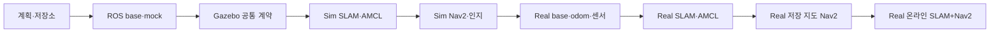

# 단계별 구현 계획

[README](../README.md) · [통합 설계](architecture.md) · [검증 기준](acceptance.md) · [기술 기준](baseline.md)

`Oh-My-SLAM` 워크스페이스의 `P0`–`P8` 단계별 구현 범위, 선행 조건, 주요 산출물과 완료 기준을 정리한 계획입니다. 시뮬레이션(`P1`–`P4`)에서 인터페이스와 주행 스택을 먼저 검증한 뒤, 같은 계약을 실물 로봇(`P5`–`P8`)에 그대로 적용합니다.

## 진행 원칙

1. P1에서 명령과 측정 인터페이스를 먼저 고정합니다. P2–P4 시뮬레이션을 통과한 구조를 실물 로봇에 그대로 연결합니다.
2. 단계마다 관련된 검사는 한 번의 실행 묶음으로 돌립니다. 코드가 바뀌거나 새로운 실패가 나오지 않으면 이미 통과한 검사를 반복하지 않습니다.
3. 빌드가 깨지면 그 결과물에 의존하는 실행 검증은 바로 멈춥니다. 설치 경로와 소스 커밋이 일치할 때만 검증 결과로 인정합니다.
4. 코드 수준의 문제는 자동화 테스트로 먼저 잡고, 실물 확인이 꼭 필요한 항목만 짧은 실기 시험으로 묶어 확인합니다.
5. 기존 저수준 구동이 완료된 부분은 그대로 둡니다. 새 ROS 계층이 붙으면서 달라지는 명령, TF, odom, 상위 동작만 검증합니다.
6. 수치 합격 기준은 [acceptance](acceptance.md)에 적어 둔 초기 기준을 따릅니다. 실측 근거 없이 통과시키려고 기준을 낮추지 않습니다.

## P0. 저장소와 설계 기준

**산출물**

- 공개 GitHub 저장소 `Oh-My-SLAM`과 개발 PC 작업 경로 `~/MyRos/Oh-My-SLAM`
- 통합 설계, 단계별 계획, 검증 기준, 기존 환경과 코드 출처 문서
- 의존 커밋을 고정한 `dependencies.repos`, 계획된 `src/` 구조, 생성물 제외 규칙
- 작업 규칙을 정리한 `AGENTS.md`

**완료 조건:** 문서마다 토픽, TF, 단계, 타임아웃 값이 서로 어긋나지 않고, 의존성 커밋이 실제로 존재하며, 로컬 커밋이 공개 저장소에 올라가야 합니다. 이 단계에는 아직 실행할 ROS 패키지가 없으므로 colcon 빌드나 실물 시험은 하지 않습니다.

## P1. ROS 구동 브리지와 측정 오도메트리

**선행:** P0, `Oh-My-Control` 고정 기준.

**현재 상태:** base와 vendor 패키지, 명령과 엔코더 측정 경로를 구현하고 모의 장치에서 검증을 마쳤습니다. 실행과 입력 규칙은 [구동·EKF 안내](base_ekf.md)에 정리해 두었습니다. Velocity Smoother와 `navigation_guard`를 포함한 Nav2 속도 체인 통합은 P4에서 다룹니다.

**구현 순서**

1. `omslam_control_vendor`가 고정된 공통 모듈만 설치하도록 만듭니다. 개인 홈 디렉터리나 기존 overlay, 전역 `PYTHONPATH`에 기대지 않도록 분리합니다.
2. `omslam_base`의 차동구동 변환, 바퀴 상한 축소, 엔코더 SE(2) odometry, timestamp와 deadline 처리를 ROS 의존성 없는 작은 모듈로 떼어 작성합니다.
3. 호스트 `WheelDrive`에 원본 monotonic 시각을 넘길 수 있는 호환 API를 추가하고, 새 명령과 같은 stamp의 평활 출력 갱신을 구분합니다. 필요한 변경만 별도 커밋으로 남겨 버전을 고정합니다. 장애물 정지나 명시적 정지는 일반 송신 주기보다 먼저 처리하고, 남은 lease가 100 ms 미만이면 바로 `STOP`으로 보냅니다.
4. `rclpy.lifecycle.LifecycleNode` 기반 브리지를 만듭니다. configure에서 설정 검증과 장치 준비를, activate에서 명령 수락을, deactivate와 오류 상황에서는 목표 폐기와 출력 해제를 처리합니다.
5. 시리얼 포트를 단독으로 담당하는 worker, 최신 값 1개만 보관하는 큐, `MockMotorClient`를 붙입니다. ROS 콜백 안에서는 ACK를 기다리지 않습니다.
6. `/wheel/odometry`, `/joint_states`, `/diagnostics`와 명령 소스 감시를 붙입니다. 기본 시작 상태는 비활성·장치 미연결 프로파일입니다.

**핵심 산출물:** ROS base 패키지, vendor 패키지, mock adapter, 명령·피드백 단위 시험, 설정 예제, `base.launch.py`.

**필수 검증 V1:** 직진과 회전 부호, 곡률 보존, 원본 timestamp를 살린 재송신, 명령·피드백 중단, 큐 지연, 같은 stamp 반복, fault와 재접속, 알려진 엔코더 변화량에 대한 odom 계산, 최신 설치본의 토픽 타입을 모의 장치에서 한 번에 확인합니다.

**완료 조건:** 코드와 설치본에서 같은 계약이 확인되고 오래된 nonzero 명령이 다시 살아나지 않아야 합니다. 이 단계는 모의 검증까지이며 실물 구동 검증을 뜻하지 않습니다.

## P2. 시뮬레이션 하단과 공통 TF

**선행:** P1.

**현재 상태:** CAD 로봇과 라이다, IMU, RGB-D, wheel/EKF를 공항 월드에 연결했고, 전진·좌회전·정지, 명령 만료, pause/resume, TF와 센서 시각을 실제 Gazebo 실행으로 검증했습니다. 자세한 실행 방법은 [실행 안내](sim_robot.md)를 참고하면 됩니다.

공항 월드와 환경 자산은 구동 브리지와 별도로 먼저 만들어 두었습니다. [공항 환경 패키지](airport_world.md)가 2터미널 공간, 가구, 보행자, 시각 연결을 맡고, 로봇 센서와 구동·TF 기준은 P2 범위로 나눠 둡니다.

**구현 내용**

- 원본 CAD 설명 패키지를 고정 버전으로 가져오고, `omslam_description`에서 launch와 장비별 extrinsic 설정을 제공합니다. 모델 원점과 관절 이름, 원본 라이선스는 그대로 유지합니다.
- `omslam_sim`의 공항 환경에 로봇 모델을 올립니다. 방이나 좁은 코너, 낮은 장애물처럼 작은 테스트 월드는 원인 분리가 꼭 필요할 때만 따로 가져옵니다.
- P1과 똑같은 명령 수명과 속도 상한을 적용하고, 맨 아래 단계에서만 Gazebo 메시지로 바꿉니다.
- Gazebo의 wheel odom을 `/wheel/odometry`로 연결합니다. EKF를 켜면 Gazebo 자체 odom TF는 끕니다.
- 가상 라이다, IMU, RGB-D의 frame과 stamp, QoS, `use_sim_time`을 통일합니다. 검증용 truth 토픽은 검증 도구에서만 구독합니다.
- 시뮬레이션은 바퀴별 3–70 RPM과 3.0 RPM 최소 구동 하한을 씁니다. 실물 운용 범위 3–95 RPM, MCU 보호 상한 100 RPM과는 구분해서 관리합니다.

**산출물:** `sim.launch.py`, 기본 robot profile, 센서 bridge 설정, RViz 설정.

**필수 검증 V2:** 짧은 시뮬레이션 주행 한 번으로 전진·좌회전 부호, odom과 관절 이동, TF 단일 발행자, 센서 시각, 명령 중단과 pause/resume을 함께 확인합니다.

**완료 조건:** 시뮬레이션 base가 동일한 ROS 계약으로 동작하고 USB 장치에 손을 대지 않아야 합니다. 시뮬레이션이 실제 Mega 1 kHz PID를 그대로 재현했다고 보지는 않습니다.

## P3. 시뮬레이션 SLAM과 저장 지도 위치추정

**선행:** P2.

**현재 상태:** 공항 일부 구간에서 비동기 SLAM으로 지도와 pose graph를 만들고, 저장 파일 재로딩과 AMCL 재위치추정까지 검증을 마쳤습니다. EKF는 P2의 바퀴·IMU 경로를 그대로 씁니다. 자세한 내용은 [지도 작성·위치추정 실행 안내](sim_mapping.md)에 있습니다.

**구현 내용**

- `omslam_localization`에서 wheel-only 진단 모드와 EKF 모드를 나눠 둡니다. EKF에는 실측 입력만 넣습니다.
- `omslam_mapping`의 `mapping.launch.py`에 `slam_toolbox` 비동기 2D mapping을 붙입니다. 시작 해상도는 0.05 m입니다.
- 지도 저장 도구는 occupancy map(`yaml`과 `pgm/png`)과 SLAM pose graph를 같이 저장합니다. 메타데이터에는 backend, commit, frame, 기하·보정 식별값을 함께 남깁니다.
- SLAM을 끄고 `localization.launch.py`로 map_server와 AMCL을 띄워 초기 자세 지정과 스캔 정합을 확인합니다.
- mapping과 localization은 한 번에 하나만 실행되도록 모드를 분리합니다.

**필수 검증 V3:** 통로와 방을 도는 짧은 폐루프 주행, loop closure, 두 형식 저장, 재시작 뒤 AMCL 재위치추정을 한 시나리오로 묶어 확인합니다.

**완료 조건:** 저장한 지도와 그래프를 다시 불러 쓸 수 있고, `map → odom` 발행자가 중복되지 않으며, sim truth 대비 초기 오차 기준을 통과해야 합니다.

## P4. 시뮬레이션 Nav2와 기존 인지 기능 이관

**선행:** P3.

**실행과 검증 기준:** 실행과 복구 절차는 [시뮬레이션 자율주행 안내](sim_navigation.md), 통과 수치 기준은 [인수 검증 기준](acceptance.md)을 따릅니다.

**현재 상태:** 한 번의 실행에서 목표 5곳에 연속으로 도착하고 정지 기준과 오차 기준을 통과했습니다. 최대 위치 오차 0.1111 m, 최대 yaw 오차 0.0100 rad, 충돌 0회였고, 마지막 구동 해제와 프로세스 정리까지 마쳤습니다.

**구현 순서**

1. `diff` 모델, 0.05 m 격자, 16방향, 0.5 m 곡선 반경의 초기 움직임 집합을 출처·해시와 함께 `omslam_navigation`에 설치합니다. 전역 costmap 해상도 일치와 `lattice_filepath` 설치 경로를 확인합니다.
2. State Lattice와 DWB, 표준 static·obstacle·inflation 레이어, footprint, 목표·진행 판정, smoothing, `navigation_guard`를 연결합니다. 전역 계획기는 `nav2_smac_planner::SmacPlannerLattice`, 지역 제어기는 `dwb_core::DWBLocalPlanner`로 통일했습니다. `vy=0`과 초기 후진 비활성, 사각형 차체 `ObstacleFootprint` 충돌 검사를 적용하고 속도·가감속·샘플 수·critic 가중치는 장비 profile에서 관리합니다.
3. 목표 도착, 취소 후 재출발, 코너, 제자리 회전, 막힌 경로에서의 대기·실패 반환을 확인합니다. 무한 recovery는 기본으로 두지 않습니다.
4. 기존 `omm_perception`과 메시지, camera memory costmap을 이관합니다. 낮은 장애물 감지, 시야 밖 기억 유지, 다시 봤을 때 빈 공간 정리, 데이터 중단 시 차단을 확인합니다.
5. 온라인 SLAM을 켠 채로 달리는 Nav2 모드도 따로 구성해, 지도 갱신과 loop closure 때 장애물 기억이 좌표에 맞게 처리되는지 확인합니다.

**산출물:** `omslam_navigation`과 고정된 움직임 집합 JSON·출처, 이관한 인지·camera memory costmap 패키지, `navigation.launch.py`, `slam_navigation.launch.py`, 최소 BT.

**필수 검증 V4:** 한 번의 실행에서 목표 5곳에 연속 도착해야 합니다. 각 목표의 action 성공과 측정 정지, truth 기준 위치 오차 0.15 m 이하·yaw 오차 0.20 rad 이하를 확인하고, 같은 기록에서 센서·TF·인지·명령 한도와 충돌 0회를 같이 검사합니다. 최신 빌드와 수정에 직접 걸린 검사부터 통과해야 하며, 이전 실행의 성공을 합쳐서 세지 않습니다.

**완료 조건:** 목표 5곳 연속 성공과 정상 구동 해제·실행 정리가 끝나면 완료입니다. 이 기준을 통과한 뒤 추가 목표나 실패 주입, 모드 전환 시험을 불필요하게 늘리지 않습니다.

## P5. 실물 ROS 구동과 기하·IMU·오도메트리

**선행:** P4. Orin이 연결되어 있고 사용자가 실물 시험을 진행할 수 있는 상태여야 합니다.

**배치 방법**

- Orin의 `~/Oh-My-SLAM`에 같은 commit을 checkout해서 ARM64로 빌드합니다. 기존 `~/ros2_dev_ws`와 `~/robot_mapping_ws`에 있는 소스, 보정값, 지도는 건드리지 않습니다.
- 새 셸에서 `/opt/ros/jazzy`와 새 install만 source합니다. 기존 launch가 자동으로 떠 있거나 USB를 같이 잡고 있지 않은지, ICP나 Gazebo TF가 섞여 나오지 않는지 먼저 확인합니다.
- 실물 보정값은 장비별 로컬 설정으로 직접 불러옵니다. 저장소 예제 설정이 실물 보정값을 덮어쓰지 않도록 막습니다.
- 라이다, D435i, HFI-A9은 이미 잘 돌아가는 기존 드라이버를 그대로 쓰고, 토픽과 frame 이름만 표준 계약에 맞춥니다.

**실물 시험 순서 — 준비된 한 세션으로 묶어서 진행**

1. 모터 전원을 끈 상태: 최신 설치 경로, 시리얼 식별과 피드백, ROS 메시지와 설정, 센서 frame·QoS·시각을 확인합니다. USB를 열 때 메가가 재부팅될 수 있으므로 초기화 이후 새로 들어오는 피드백을 확인합니다.
2. 바퀴를 띄운 상태: 새 ROS 경로로 전진, 후진, 좌우 회전, 정지, 소스 중단, 브리지 종료 후 출력 해제가 잘 되는지 봅니다. 이미 끝난 저수준 검사 전체를 다시 돌리지는 않습니다.
3. 지면 주행: 바닥 표식 사이 1 m 직진과 양방향 회전, 사각형 주행으로 유효 반경과 윤거, 실제 방향, 정지와 재출발, 필요한 저속 구간을 측정합니다.
4. IMU 확인: 정지 바이어스, 중력 방향, 좌회전 yaw-rate 부호, timestamp를 확인한 뒤 EKF에 센서 하나만 연결합니다.
5. 비교 확인: wheel-only와 EKF의 위치·속도 오차를 같은 기록에서 비교합니다. 보정값이 바뀌면 영향받는 기하 주행만 다시 확인합니다.

**필수 검증 V5:** 위 세션에서 기록한 `/wheel/odometry`, `/imu/data`, `/odom`, TF, 명령과 MCU 상태를 한 보고서로 묶습니다. ROS 계층이 올라가면서 새로 생기는 동작만 판정합니다.

**완료 조건:** 실제 거리와 회전각 기준, TF와 시각 기준을 통과하고, Nav2가 쓸 저속·회전·감속 범위를 확보하며, 데이터가 끊겼을 때 과거 명령이 다시 살아나지 않아야 합니다.

저속 응답이 기대보다 부족하면 실제로 확인된 속도와 가속도 범위로 Nav2를 제한합니다. 정밀 도착이 아예 불가능할 정도의 결함이 드러난 경우에만 구동 계층을 다시 손봅니다. 30 RPM으로 억지로 끌어올리는 식으로는 해결하지 않습니다.

## P6. 실물 수동 SLAM과 AMCL

**선행:** V5 통과.

**구현과 시험**

- 새 workspace의 wheel/EKF odom으로 작은 실내 공간부터 수동 mapping을 시작합니다. 첫 실물 mapping 동안에는 Nav2가 구동 명령을 내지 않도록 꺼 둡니다.
- 직선과 회전, 폐루프가 들어간 짧은 코스를 돌면서 스캔 정합, 벽이 겹치는 현상, 누락, loop closure를 확인합니다.
- 실물 map과 pose graph를 저장하고, 메타데이터에 실제 calibration hash와 backend를 남깁니다.
- SLAM을 끄고 AMCL 모드로 다시 띄운 뒤, 시작 표식과 다른 위치 표식 두 곳에서 초기 자세와 스캔 정합을 확인합니다.
- 기존 2026-11-10 지도는 참고용으로만 두고, 새 odom과 TF의 통과 근거로 쓰지 않습니다.

**필수 검증 V6:** mapping 기록 하나, 저장·재시작 기록, 두 기준 위치의 오차만 묶어 확인합니다. 센서 전체 시험을 처음부터 다시 하지는 않습니다.

**완료 조건:** 지도와 pose graph 저장이 성공하고, 실측 기준과 맞는 재위치추정이 확인되며, TF 중복이나 시간 역행, 지속적인 scan drop이 없어야 합니다.

## P7. 실물 저장 지도 Nav2

**선행:** V6 통과, 시뮬레이션에서 State Lattice + DWB와 인지 검증 완료.

**진행 방식**

- P5에서 확인한 속도, 가속도, yaw 한도로 시작합니다. 95 RPM은 최대 상한일 뿐 처음부터 그 속도로 시험하지 않습니다.
- 실물 footprint와 padding, 실제 제동 거리를 반영한 충돌 감시 영역을 씁니다. 뒤쪽 관측이 충분하지 않으면 자율 후진 recovery는 끕니다.
- P4의 State Lattice + DWB, 움직임 집합, footprint 충돌 검사를 바탕으로 장비별 기하와 센서 timeout, P5에서 잰 속도와 제동 한도를 적용합니다.
- 직선, 회전·코너, 복귀의 목표 3개를 이어서 도착과 방향 정렬을 확인합니다. 그중 한 목표에서 취소 후 정지, 새 목표 재출발까지 확인합니다.
- 라이다 높이보다 낮은 상자, 시야 밖 장애물 기억, 차체 외곽을 고려한 통로·코너 주행을 확인합니다. 카메라 데이터가 끊겼을 때 guard가 제한하거나 차단하는 동작도 일관되게 적용합니다.
- 사람이 없는 조건에서 센서 데이터 중단이나 프로세스 중단을 한 번 걸어 보고 정지와 복구를 확인합니다. 실제 사람을 충돌 시험 대상으로 세우지 않습니다.

**필수 검증 V7:** 경로, 취소, 장애물 시나리오를 실물 주행 한 세션에 묶어 확인합니다. 출발·도착 위치와 yaw 오차, 정지 거리, 최소 장애물 여유, timeout과 fault, CPU·메모리, 제어 주기를 함께 남깁니다.

**완료 조건:** 목적지 도착과 취소, 장애물 처리 기준을 모두 통과해야 합니다. 단순히 lifecycle이 active이거나 경로만 그려진 상태, `motor:=false` 실행은 실물 Nav2 완료로 보지 않습니다.

## P8. 실물 온라인 SLAM + Nav2와 운용 정리

**선행:** 저장 지도 주행 V7 통과.

**구현과 검증**

- AMCL 대신 `slam_toolbox`가 `map → odom`을 맡는 `slam_navigation` 모드로 실행합니다.
- 이미 관측된 자유 공간 안에서 목표를 주며 지도가 넓어지는 동안 주행합니다. frontier 자동 탐색은 이번 범위에 넣지 않습니다.
- loop closure가 생기면 전역 경로와 장애물 메모리를 갱신하고, 로컬 odom은 끊기지 않게 유지합니다. 위치 보정이 크게 일어난 직후에는 유효한 경로가 다시 나올 때까지 움직이지 않습니다.
- 지도 작성, 저장 지도 주행, 온라인 SLAM 주행의 시작과 종료 순서를 문서로 정리합니다. 모드를 바꿀 때는 중립 상태에서 목표, 구동 권한, 이전 명령을 먼저 정리한 뒤 전환합니다.
- 같은 commit과 설정, 저장 지도로 다시 띄웠을 때 정상적으로 복구되는지 확인합니다. 전원을 켜자마자 무조건 자율주행을 시작하는 부팅 서비스는 넣지 않습니다.

**필수 검증 V8:** 작은 공간에서 지도 확장, 코너 목표, loop closure, 지도 저장, 정상 종료와 재시작을 한 시나리오로 확인합니다.

**완료 조건:** V8을 통과하고 재현 가능한 실행 절차와 롤백 경로가 정리되어 있어야 합니다. 운용에 필요한 소스, 보정, 지도 버전도 구분해서 관리할 수 있어야 합니다.

## 저장소 구현 단위

| 순서 | 주요 변경 | 완료 검증 |
| --- | --- | --- |
| 1 | vendor 설치, 기구학, 명령 시각 계약 | V1의 pure/mock 부분 |
| 2 | ROS base lifecycle, 측정 메시지, 장치 worker | 나머지 V1 |
| 3 | description/sim, 센서·TF, EKF | V2 |
| 4 | mapping, 저장 도구, AMCL 모드 | V3 |
| 5 | State Lattice + DWB, 움직임 집합, 인지·장애물 기억 이관 | V4 |
| 6 | Orin 배치, 장비 profile, 실측 보정 | V5 |
| 7 | 실물 map, 위치추정, 운용 기록 | V6 |
| 8 | 실물 목표 주행 설정과 기록 | V7 |
| 9 | 온라인 SLAM 주행과 재시작 절차 | V8 |

실제 보정과 실물 시험은 하드웨어 여건에 따라 시간이 달라지므로 근거 없는 일정을 미리 못 박지 않습니다. 앞 단계 통과 결과를 보고 다음 단계로 넘어갑니다. 서로 독립적인 소스 조사나 긴 빌드·시험은 나눠서 돌리되, 같은 시험을 중복 실행하지는 않습니다.
